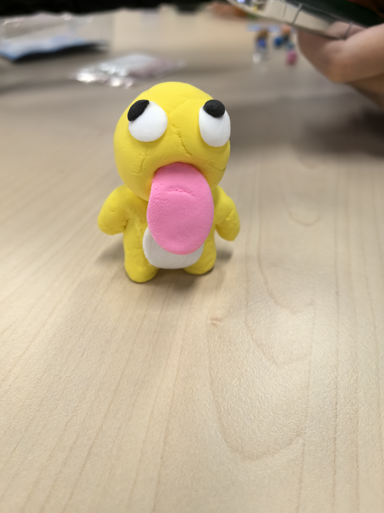

# 大学生朋辈心理辅导

[大一课程](../../index.md) / 通识选修课程

> **大学生朋辈心理辅导** · 2学分（蔡云/李娟   89/4.5）冬【生命探索/心理健康类】

还是挺推荐选这门课的，论坛上对蔡云老师的朋辈心理也都很推荐，不过我当时上的时候主要是李娟老师在上，应该是分别负责两个教学班。这门课还是挺有意思的，每节课都会开展一些围绕心理健康的小组活动（比如有一次让我们用粘土制作作品），相当于每节课都是一次朋辈团辅，不过有点尬就是了，属于是i人地狱。课程考核内容包括知到智慧树平台上的网课和期末测验、小组开展的朋辈心理团辅活动以及对此的课堂展示（这个需要我们自己招募参与成员，我们当时招不到人最终是和另一个小组交换了一下成员，再自己找几个熟人，水了一下流程）以及最后的课堂期末测验（内容是针对某案例的分析，用自带的电脑作答，开卷，允许看电子资料但是不允许网上搜索和AI，考前熟悉一下老师发的PPT，尽量多写点就行），最终给分挺好的，当小组长应该有加分。课程最后会给我们发一个大学生心理朋辈辅导资格证书，还是挺有意义的。

最后附本人粘土制作那节课的奶龙作品（感觉会掉码）
