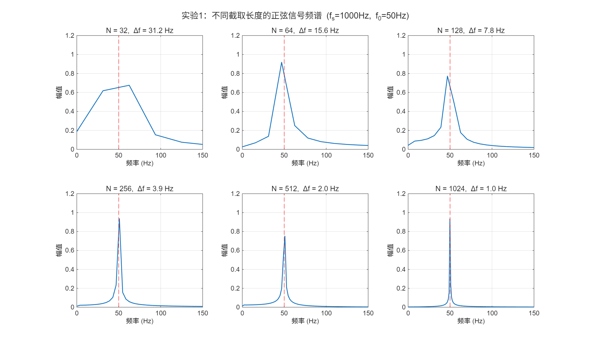
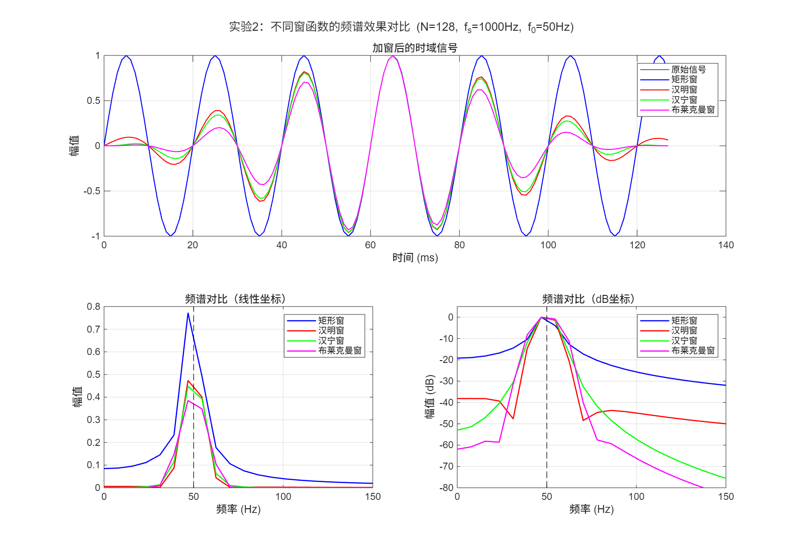
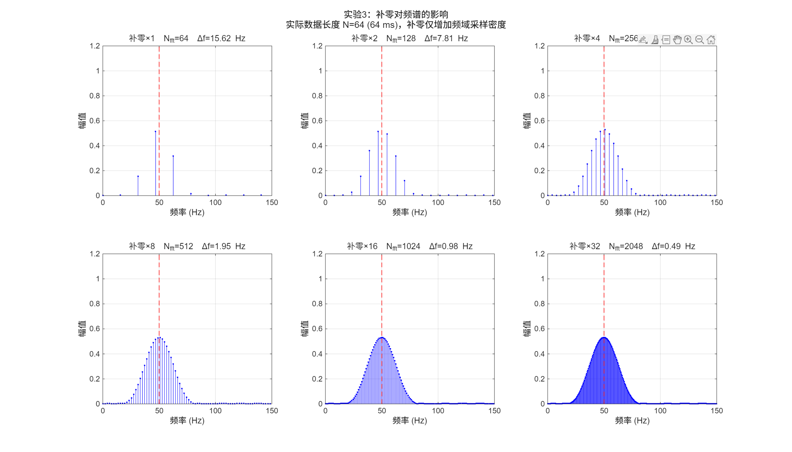
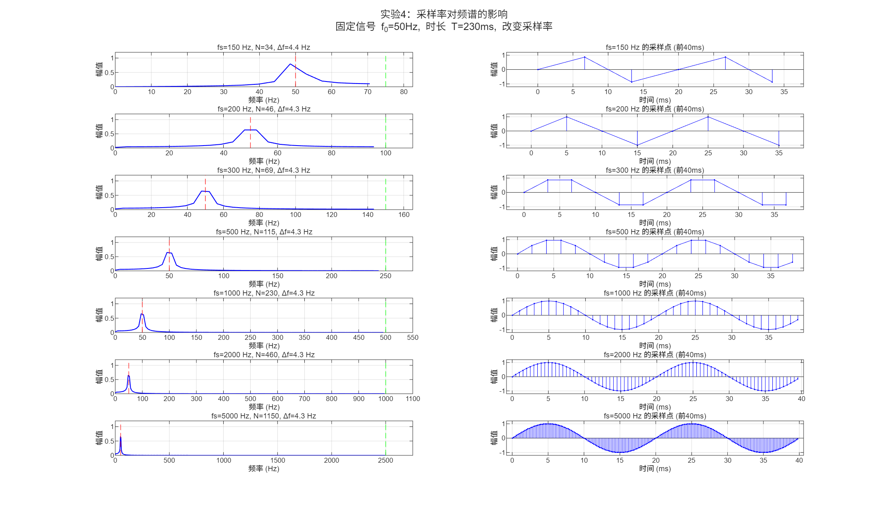
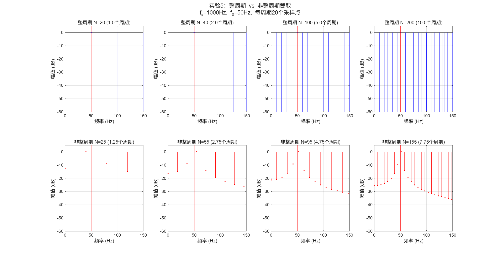
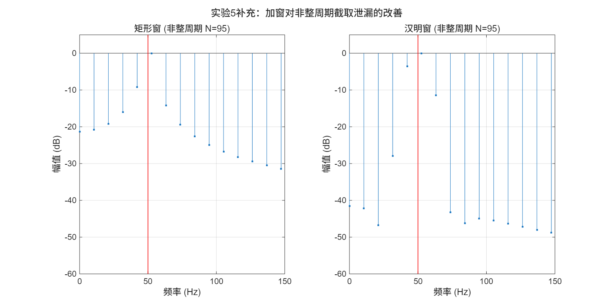

# 信号与系统 · 正弦信号截取长度与频谱研究

[← 返回课程心得](../../index.md)

## 课程设计报告

[打开或下载 PDF](report.pdf)

<details class="report-pdf" data-pdf="report.pdf">
<summary>展开 PDF 预览</summary>
</details>

- [下载 MATLAB 程序及配图](source.zip)

---

# 题目3：正弦信号不同截取长度的频谱特性研究

## 一、问题的提出

	傅里叶变换将时域信号映射到频域，使我们能够从频谱角度分析信号的频率成分。然而，计算机只能处理有限长的离散序列，实际应用中必须对信号进行截断和采样。然而这一过程会引入三个核心问题：

1. **如何对正弦信号进行谱分析？** 
2. **不同截取长度对频谱有何影响？** 
3. **采样率变化对频谱有何影响？** 

	这些问题本质上是有限时宽截取效应（即加矩形窗）在频域的表现。本实验将围绕上述三个问题展开研究，并探讨改善频谱特性的有效方法。

## 二、解决问题的原理、技术方案或算法

### 2.1 原理

**离散傅里叶变换：**

	对于长度为 N 的离散序列 $x[n]$，其离散傅里叶变换（DFT）定义为：

$$
X[k] = \sum_{n=0}^{N-1} x[n] \cdot e^{-j\frac{2\pi}{N}kn}, \quad k = 0, 1, \dots, N-1
$$

	频率轴上的对应频率为 $f_k = k \cdot f_s / N$，相邻频点的间隔（即频率分辨率）为 $\Delta f = f_s / N$。FFT 是 DFT 的快速算法实现。

**频谱泄漏的数学本质：**

	考虑连续正弦信号 $x(t) = \sin(2\pi f_0 t)$，其理论频谱为位于 $\pm f_0$ 处的冲激函数。但计算机只能处理有限长的离散序列，截取 N 个采样点等价于在时域乘上一个长度为 $N/f_s$ 的矩形窗 $w[n]$：

$$
x_N[n] = x[n] \cdot w[n], \quad w[n] = \begin{cases} 1, & 0 \le n < N \\ 0, & \text{其他} \end{cases}
$$

	根据离散傅里叶变换的卷积性质，时域相乘对应频域卷积。矩形窗的频谱 $W(f)$ 为 sinc 函数：

$$
W(f) = \frac{\sin(\pi f N / f_s)}{\sin(\pi f / f_s)} \cdot e^{-j\pi f (N-1)/f_s}
$$

	其幅度谱的主瓣宽度为 $2f_s/N$，第一旁瓣高度约为主瓣的 $-13\,\text{dB}$。截断后的信号频谱是冲激函数与 $W(f)$ 的卷积，因此理想单根谱线被展宽为 sinc 形状——主瓣有一定宽度，两侧出现逐渐衰减的旁瓣，这就是频谱泄漏的来源。

**整周期截取的特殊情况：**

	当截取长度恰好为信号周期的整数倍（即 $N \cdot T_s = k \cdot T_0$，或等价地 $N = k \cdot f_s/f_0$，$k \in \mathbb{Z}^+$）时，sinc 函数的过零点精确落在 FFT 离散频点 $f_k = k \cdot f_s/N$ 上。以 $f_0 = 50\,\text{Hz}$、$f_s = 1000\,\text{Hz}$ 为例，每周期 20 个采样点，当 N 为 20 的整数倍时，除 $f_0$ 所在频点外其余频点恰好位于 sinc 过零点，频谱表现为干净的单线。当 N 不是 20 的整数倍时，各频点均偏离过零点，能量扩散，出现泄漏现象。

### 2.2 技术方案

	针对频谱泄漏问题，本文采用三种改善方法：

**加窗函数法：**

	用旁瓣更低的窗函数替代矩形窗。常见窗函数的时域定义如下：

| 窗函数 | 时域表达式（$n = 0,1,\dots,N-1$） | 第一旁瓣 |
|--------|------|:---:|
| 矩形窗 | $w[n] = 1$ | −13 dB |
| 汉明窗 | $w[n] = 0.54 - 0.46\cos\left(\frac{2\pi n}{N-1}\right)$ | −43 dB |
| 汉宁窗 | $w[n] = 0.5 - 0.5\cos\left(\frac{2\pi n}{N-1}\right)$ | −32 dB |
| 布莱克曼窗 | $w[n] = 0.42 - 0.5\cos\left(\frac{2\pi n}{N-1}\right) + 0.08\cos\left(\frac{4\pi n}{N-1}\right)$ | −58 dB |

	加窗函数法以主瓣展宽（频率分辨率略微下降）为代价，换取旁瓣的大幅抑制，属于用分辨率换动态范围。在实际工程中，汉明窗因 −43 dB 的旁瓣抑制能力和适中的主瓣宽度，常作为首选，在本课程的 MATLABGUI 编程项目"基于傅里叶变换的语音数字识别系统"中，语音帧在 FFT 前统一加汉明窗，目的正是抑制截断引起的频谱泄漏，避免其对后续共振峰提取和特征匹配造成干扰。

**补零法：**

	在数据序列末尾补零，使 FFT 点数 $N_{FFT} > N_{data}$。补零后频率间隔 $\Delta f' = f_s/N_{FFT}$ 小于原始分辨率 $\Delta f = f_s/N_{data}$，频域采样更密，频谱曲线更光滑。然而补零不增加信号的实际时长，主瓣的真实宽度没有改变——它仅是对 DTFT 的加密采样（频域内插），不提升频率分辨能力。

**整周期截取：**

	当截取长度恰好为信号周期的整数倍时，理论上可完全消除频谱泄漏。实际应用中可作为参数设计的指导原则。

**实验总体设计：**

	全部实验在 MATLAB 环境下完成。基本参数：采样率 $f_s = 1000\,\text{Hz}$，信号频率 $f_0 = 50\,\text{Hz}$，正弦信号 $x(t) = \sin(2\pi f_0 t)$。共设计五个实验：

| 实验 | 研究变量 | 固定参数 |
|------|---------|---------|
| 实验1 | 截取长度 N = 32, 64, 128, 256, 512, 1024 | $f_s$, $f_0$ |
| 实验2 | 窗函数类型（矩形/汉明/汉宁/布莱克曼） | $f_s$, $f_0$, N=128 |
| 实验3 | 补零倍数 ×1, ×2, ×4, ×8, ×16, ×32 | $f_s$, $f_0$, $N_{data}$=64, 汉明窗 |
| 实验4 | 采样率 $f_s$ = 150~5000 Hz | $f_0$, T=230ms（非整周期） |
| 实验5 | 整周期 vs 非整周期截取 | $f_s$, $f_0$ |

### 2.3 算法展示

	以下给出三个核心算法的 MATLAB 代码实现。

**算法 1：FFT 频谱分析**（实验1 核心）

```matlab
fs = 1000;  f0 = 50;
N_values = [32, 64, 128, 256, 512, 1024];
t = 0:1/fs:max(N_values)/fs;       % 生成足够长的信号
x = sin(2*pi*f0 * t);              % 原始正弦信号

for i = 1:length(N_values)
    N = N_values(i);
    x_trunc = x(1:N);              % 截取前 N 点（等价于加矩形窗）
    X = fft(x_trunc, N);
    X_mag = abs(X) / N;            % 归一化幅值
    X_mag(2:N) = 2 * X_mag(2:N);   % 单边谱修正
    f_axis = (0:N-1) * fs / N;     % 频率轴
    % 绘制 0 ~ fs/2 范围
    plot(f_axis(1:N/2), X_mag(1:N/2));
end
```

**算法 2：加窗与频谱分析**（实验2 核心）

```matlab
fs = 1000;  f0 = 50;  N = 128;
t = (0:N-1)' / fs;
x = sin(2*pi*f0 * t);              % N 点正弦信号

% 定义四种窗函数
w_rect  = rectwin(N);              % 矩形窗
w_hamm  = hamming(N);              % 汉明窗
w_hann  = hann(N);                 % 汉宁窗
w_black = blackman(N);             % 布莱克曼窗

% 以汉明窗为例
x_windowed = x .* w_hamm;          % 时域加窗
X = fft(x_windowed, N);
X_db = 20 * log10(abs(X(1:N/2)) / max(abs(X(1:N/2))) + eps);
% X_db 中可读取旁瓣高度
```

**算法 3：补零与分辨率分析**（实验3 核心）

```matlab
fs = 1000;  f0 = 50;
N_data = 64;                       % 实际数据长度
t = (0:N_data-1)' / fs;
x = sin(2*pi*f0 * t) .* hamming(N_data);

for mult = [1, 2, 4, 8, 16, 32]
    N_fft = N_data * mult;         % FFT 点数 > 数据点数
    X = fft(x, N_fft);             % 自动补零到 N_fft 点
    X_mag = abs(X(1:N_fft/2)) / N_data * 2;
    f_axis = (0:N_fft/2-1) * fs / N_fft;
    % Δf = fs/N_fft 变小，但实际分辨率仍是 fs/N_data
end
```

	以上三个算法覆盖了信号生成、截断、加窗、FFT 计算、补零及幅度谱提取的完整流程，是全部实验的代码基础。

## 三、实验与仿真验证

### 3.1 实验1：不同截取长度的频谱分析

	本实验固定参数 $f_s = 1000\,\text{Hz}$、$f_0 = 50\,\text{Hz}$，改变 FFT 分析点数 N，观察频谱变化。



**分析**：

- N=32 时，$\Delta f = 31.25\,\text{Hz}$，主瓣极宽，峰值偏离 50Hz 至约 60~70Hz 处，几乎没有频率分辨能力。
- N=64 时，$\Delta f = 15.6\,\text{Hz}$，主瓣收窄，峰值接近 50Hz，但仍有明显展宽。
- N=128 时，$\Delta f = 7.8\,\text{Hz}$，主瓣进一步收窄，旁瓣开始清晰可见。
- N=256 及以上，主瓣尖锐，峰值精确对准 50Hz，旁瓣呈现典型的 sinc 函数衰减特征。
- N=1024 时，主瓣极窄，频谱接近理想冲激函数。

	从数据中可以看出，N 越小，频谱泄漏越严重，如 N=32 时直流分量附近的幅值高达 0.375，而 N=1024 时降至 0.003。频率分辨率 $\Delta f$ 与 N 成反比，增加截取长度是提高分辨率的根本途径。

### 3.2 实验2：窗函数的效果对比

	本实验固定 N=128，对比矩形窗、汉明窗、汉宁窗和布莱克曼窗四种窗函数的效果。



	子图说明：上图为加窗后的时域波形，左下图为线性坐标下的频谱，右下图为 dB 坐标下的频谱（更能看清旁瓣差异）。

**分析**：

	从 dB 坐标图可以清晰看到各窗函数的旁瓣抑制能力：
- 矩形窗：第一旁瓣约 -13 dB，旁瓣衰减慢。
- 汉明窗：第一旁瓣约 -43 dB，远低于矩形窗。
- 汉宁窗：第一旁瓣约 -32 dB，比汉明窗略高但主瓣稍窄。
- 布莱克曼窗：第一旁瓣约 -58 dB，旁瓣抑制最强，但主瓣宽度也最大。

	从数据中可读出，在 0 Hz（即直流）处各窗的衰减分别为：矩形窗 -21.5 dB、汉明窗 -39.3 dB、汉宁窗 -53.9 dB、布莱克曼窗 -62.6 dB。可以看出，汉明窗在旁瓣抑制和主瓣宽度之间取得了较好的平衡：矩形窗泄漏过大容易淹没弱共振峰，布莱克曼窗主瓣过宽可能模糊相邻频率分量，而汉明窗恰好在两者之间，兼顾了频率分辨力和抗泄漏能力。窗函数的选取本质上是主瓣宽度（频率分辨率）与旁瓣高度（动态范围）的权衡。

### 3.3 实验3：补零对频谱的影响

	本实验固定实际数据长度 $N_{data} = 64$（加汉明窗），通过补零将 FFT 点数扩大 1 至 32 倍，观察频谱变化。



**分析**：

- 补零×1（$N_{fft}=64$，$\Delta f=15.6\,\text{Hz}$）：频点稀疏，频谱呈折线状，50Hz 处没有正好对应的频点，出现明显的栅栏效应。
- 补零×2（$N_{fft}=128$，$\Delta f=7.8\,\text{Hz}$）：频点增密，频谱更光滑。
- 补零×4 及以上：频点密度进一步提高，频谱曲线趋于连续，50Hz 峰值清晰可见。

	需要注意的是，补零只是增加了频域采样密度，主瓣的真实宽度没有改变，因为实际数据长度 $N_{data}=64$ 没有变化。补零前后的频率分辨能力完全一样，它只是让我们看到了更多的 DTFT 采样点。

### 3.4 实验4：采样率对频谱的影响

	本实验固定信号频率 $f_0=50\,\text{Hz}$、截取时长 $T=230\,\text{ms}$（约 11.5 个周期，确保非整周期以显示泄漏），改变采样率 $f_s$ 从 150 Hz 至 5000 Hz。



	每行左侧为频谱图（蓝色曲线为幅度谱，红色虚线标记 50Hz，绿色虚线标记奈奎斯特频率 $f_s/2$），右侧为前 40ms 的时域采样波形（蓝色折线和采样点）。

**分析**：

- 固定时长下，所有采样率的频率分辨率相同：$\Delta f = 1/T = 1/0.23 \approx 4.35\,\text{Hz}$。因为 50Hz 不是 $4.35\,\text{Hz}$ 的整数倍，所有采样率下均存在频谱泄漏。
- $f_s=150\,\text{Hz}$ 时，采样点仅 34 个，时域波形严重失真呈锯齿状，频谱峰值显著偏离（约 48Hz），泄漏最为严重。
- 随着 $f_s$ 增大，时域波形逐渐逼近光滑正弦波，频谱主瓣收窄、旁瓣降低。
- $f_s=5000\,\text{Hz}$ 时，时域波形几乎完美还原正弦信号，频谱峰值也最为准确（峰值幅值 0.651，接近理论值）。
- 提高采样率不改变频率分辨率，但能改善时域还原质量和频谱精度，特别是在信号频率接近奈奎斯特极限时。

### 3.5 实验5：整周期截取与非整周期截取

	本实验中 $f_s=1000\,\text{Hz}$，$f_0=50\,\text{Hz}$，每周期 20 个采样点。上排为整周期截取（N=20, 40, 100, 200，均为 20 的整数倍），下排为非整周期截取（N=25, 55, 95, 155）。



**分析**：

	上排整周期截取的结果极为清晰——仅在 50Hz 处有一根谱线，其余频点幅值均在本图纵轴下限（−60 dB）以下，实际值约 −300 dB（数值计算精度极限，等价于零），完全无泄漏。这是因为矩形窗的 sinc 函数过零点精确对齐了 FFT 的离散频点。

	下排非整周期截取则出现明显的频谱泄漏：主瓣展宽，旁瓣延伸至较远的频率范围，第一旁瓣约 -10 dB（矩形窗）。泄漏模式呈现典型的 sinc 函数特征。

	此外，对非整周期截取（N=95）加汉明窗后，可以看到明显的改善效果：



	左图（矩形窗）旁瓣从主峰两侧约 −10 dB 开始，逐渐衰减至 −30 dB 以下，大部分旁瓣集中在 −15~−25 dB 区间；右图（汉明窗）旁瓣整体降至 −40 dB 以下，主峰更加清晰突出。这直观说明了加窗函数对非整周期截取的有效补偿作用。

## 四、结论

	本文通过五组 MATLAB 仿真实验，系统研究了正弦信号频谱特性的影响因素及改善方法，主要结论如下：

1. **截取长度 N 决定频率分辨率**。根据公式$\Delta f = f_s/N$，N 越大分辨率越高，频谱泄漏越小。当 N 足够大时，频谱逼近理想冲激。
2. **窗函数以牺牲分辨率为代价抑制旁瓣**。汉明窗可将第一旁瓣从矩形窗的 -13 dB 降至约 -43 dB，布莱克曼窗可降至约 -58 dB，但主瓣宽度的增加会降低分辨率。
3. **补零是频域内插而非提高分辨率**。补零使频谱曲线更光滑，但实际的频率分辨能力由原始数据长度决定。补零后 Δf 变小的假象需要正确理解。
4. **采样率不影响频率分辨率但影响时域还原**。固定时长下 $\Delta f = 1/T$ 不变。提高采样率主要改善时域波形质量和增大频率覆盖范围（奈奎斯特频率）。
5. **整周期截取是消除频谱泄漏的理想条件**。当截取长度恰好为信号周期的整数倍时，DFT 的频点与 sinc 过零点对齐，泄漏完全消失。实际中无法保证整周期时，可通过加窗函数有效减轻泄漏。

	以上结论对实际工程中的频谱分析工作具有指导意义：在数据长度受限时，选择合适的窗函数是平衡分辨率与泄漏抑制的关键手段；进行 FFT 分析时应注意区分补零带来的视觉改善与真实的分辨率提升。
