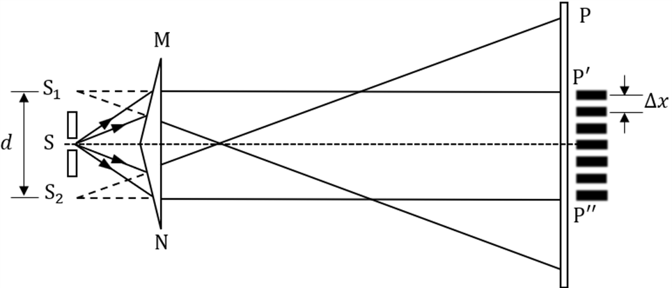
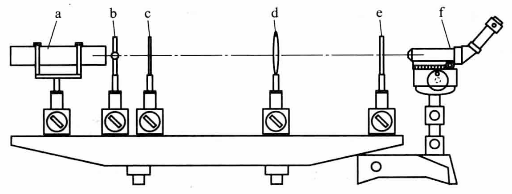
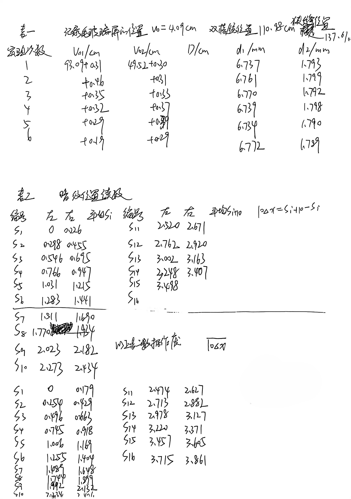

# 双棱镜干涉

[← 大学物理实验 · 课程心得](../../index.md) · [全部实验报告](../index.md)

- [在线打开 PDF（2.8 MB）](%E5%8F%8C%E6%A3%B1%E9%95%9C%E5%B9%B2%E6%B6%89%E5%AE%9E%E9%AA%8C%E6%8A%A5%E5%91%8A.pdf)

展开 PDF 预览

- [下载markdown版可编辑源文件与配套图片、脚本](source.zip)

---

## 一、预习报告

### 1. 实验综述

#### 实验现象

当光路调节正确时，在毛玻璃屏或读数显微镜的视场中，可以观察到一系列明暗相间、等间距分布的直条纹，这些条纹平行于狭缝。这就是双棱镜产生的干涉条纹。使用He-Ne激光作为光源时，条纹为红色。

#### 实验原理

本实验是分波前法干涉的典型实例。激光通过狭缝后，照射在双棱镜上，其波阵面被分割成两束。这两束光传播时如同分别从狭缝的两个虚像（即虚光源S₁和S₂）发出。由于它们源于同一光源，满足相干条件，在空间叠加区域会产生稳定的干涉图样。

<strong>图 1 &emsp; 实验原理图</strong>

波长计算公式为：$λ = \frac{d·Δx}{D}$

其中，*d*是两个虚光源的间距，Δ*x*是相邻明（暗）条纹的间距，*D*是狭缝到观测屏的距离。虚光源间距*d*通过二次成像法并利用公式 $d=\sqrt{d_1·d_2}$测得，其中*d*1和*d*2分别为透镜两次成清晰像时像点的间距。

#### 实验方法

1. **光路调节**：如图在光具座上布置元件，精细调节各元件共轴，并使激光通过所有元件中心。
2. **关键参数测量**：首先，利用二次成像法测量虚光源间距 *d*。然后，移去透镜，微调狭缝使干涉条纹最清晰，使用读数显微镜测量连续多条暗纹的位置，通过逐差法计算出条纹间距 Δ*x*。同时记录狭缝到屏的距离 *D*。
3. **计算波长**：将测得的*D*、*d*和Δ*x*代入公式，计算出激光的波长*λ*，并进行不确定度分析。

<strong>图 2 &emsp; 实验装置图</strong>

### 2. 实验重点

1. 掌握分波面法干涉的原理与光路调节技巧。
2. 学会使用二次成像法间接测量虚光源间距*d*。
3. 熟练使用读数显微镜测量干涉条纹间距Δ*x*，并最终计算光波波长。

### 3. 实验难点

1. 光路共轴调节要求高，需确保激光依次通过所有光学元件中心，否则难以观察到干涉条纹。
2. 干涉条纹的清晰度调节难度较大。
3. 使用读数显微镜时，需避免空程误差，并对准暗纹边缘读数，操作不当会引入较大测量误差。

## 二、原始数据

## 三、结果与分析

### 1. 数据处理与结果

<strong>表 1 &emsp; 计算 <i>D</i> 与 <i>d</i> （记录毛玻璃屏位置 <i>v0</i> = 4.09 cm）</strong>

| 实验次数 | *v~01~*/cm | *v~02~*/cm | *D*/cm | *d~1~*/mm | *d~2~*/mm |
| -------- | ---------- | ---------- | ------ | --------- | --------- |
| 1        | 93.40      | 49.82      | 135.04 | 6.737     | 1.793     |
| 2        | 93.55      | 49.83      | 135.20 | 6.761     | 1.799     |
| 3        | 93.44      | 49.85      | 135.11 | 6.770     | 1.792     |
| 4        | 93.41      | 49.89      | 135.12 | 6.739     | 1.798     |
| 5        | 93.38      | 49.91      | 135.11 | 6.734     | 1.790     |
| 6        | 93.28      | 49.81      | 134.91 | 6.772     | 1.789     |

$$
\bar{D} = \frac{\overset{6}{\underset{i=1}{\sum}} D_i}{6} ≈ 135.08 \, \text{cm}
$$

$$
u_{DA} = \sqrt{\frac{\overset{6}{\underset{i=1}{\sum}} (D_i - \bar{D})^2}{6 \times 5}} ≈ 0.04 \, \text{cm}
$$

$$
u_{DB} = \frac{\Delta \text{仪}}{\sqrt{3}} = \frac{0.02}{\sqrt{3}} ≈ 0.011 \, \text{cm}
$$

$$
u_D = \sqrt{u_{DA}^2 + u_{DB}^2} ≈ 0.04 \, \text{cm}
$$

$$
D = (135.08 \pm 0.04) \, \text{cm}
$$

$$
\bar{d_1} = \frac{\overset{6}{\underset{i=1}{\sum}} d_{1i}}{6} ≈ 6.752 \, \text{mm}
$$

$$
u_{d_1A} = \sqrt{\frac{\overset{6}{\underset{i=1}{\sum}} (d_{1i} - \bar{d_1})^2}{6 \times 5}} ≈ 0.007 \, \text{mm}
$$

$$
\bar{d_2} = \frac{\overset{6}{\underset{i=1}{\sum}} d_{2i}}{6} ≈ 1.794 \, \text{mm}
$$

$$
u_{d_2A} = \sqrt{\frac{\overset{6}{\underset{i=1}{\sum}} (d_{2i} - \bar{d_2})^2}{6 \times 5}} ≈ 0.0017 \, \text{mm}
$$

$$
u_{d_1B} = u_{d_2B} = \frac{\Delta \text{仪}}{\sqrt{3}} = \frac{0.004}{\sqrt{3}} ≈ 0.0023 \, \text{mm}
$$

$$
d_1 = (6.752 \pm 0.007) \, \text{mm}
$$

$$
u_{d_1} = \sqrt{u_{d_1A}^2 + u_{d_1B}^2} ≈ 0.007 \, \text{mm}
$$

$$
u_{d_2} = \sqrt{u_{d_2A}^2 + u_{d_2B}^2} ≈ 0.0028 \, \text{mm}
$$

$$
d_2 = (1.794 \pm 0.0028) \, \text{mm}
$$

$$
\bar{d} = \sqrt{\bar{d_1}\bar{d_2}} ≈ 3.480 \, \text{mm}
$$

<strong>表 2 &emsp; 暗纹位置读数</strong>

| 编号 | 左/mm | 右/mm | 平均*S~i~* /mm | 编号 | 左/mm | 右/mm | 平均*S~i+10~* /mm | 10Δ*x* =            | *S~i+10~* - *S~i~* /mm |
| ---- | ----- | ----- | -------------- | ---- | ----- | ----- | ----------------- | ------------------- | ---------------------- |
| 1    | 0     | 0.179 | 0.090          | 11   | 2.474 | 2.627 | 2.551             | 10Δ*x~1~*           | 2.461                  |
| 2    | 0.254 | 0.429 | 0.342          | 12   | 2.713 | 2.882 | 2.798             | 10Δ*x~2~*           | 2.456                  |
| 3    | 0.496 | 0.663 | 0.580          | 13   | 2.978 | 3.127 | 3.053             | 10Δ*x~3~*           | 2.473                  |
| 4    | 0.745 | 0.918 | 0.832          | 14   | 3.220 | 3.371 | 3.296             | 10Δ*x~4~*           | 2.464                  |
| 5    | 1.006 | 1.169 | 1.088          | 15   | 3.457 | 3.605 | 3.531             | 10Δ*x~5~*           | 2.443                  |
| 6    | 1.255 | 1.404 | 1.330          | 16   | 3.715 | 3.861 | 3.788             | 10Δ*x~6~*           | 2.458                  |
| 7    | 1.489 | 1.648 | 1.569          |      |       |       |                   |                     |                        |
| 8    | 1.744 | 1.899 | 1.822          |      |       |       |                   | $\overline{10Δx}$ | 2.459                  |
| 9    | 1.992 | 2.132 | 2.062          |      |       |       |                   |                     |                        |
| 10   | 2.234 | 2.406 | 2.320          |      |       |       |                   |                     |                        |

令 $y=10Δx$，则

$$
\bar{y} = \frac{\overset{6}{\underset{i=1}{\sum}} y_i}{6} ≈ 2.459 \, \text{mm}
$$

$$
u_{yA} = \sqrt{\frac{\overset{6}{\underset{i=1}{\sum}} (y_i - \bar{y})^2}{6 \times 5}} ≈ 0.004 \, \text{mm}
$$

$$
u_{yB} = \frac{\Delta \text{仪}}{\sqrt{3}} = \frac{0.004}{\sqrt{3}} ≈ 0.0023 \, \text{mm}
$$

$$
u_{y} = \sqrt{u_{yA}^2 + u_{yB}^2} ≈ 0.005 \, \text{mm}
$$

$$
y = (2.459 \pm 0.005) \, \text{mm}
$$

### 2. 误差分析

#### 计算波长 λ

根据以上数据分析结果，计算实验最终结果

$$
\bar{λ} = \frac{\bar{d}\bar{y}}{10\bar{D}} ≈ 633.5\, \text{nm}
$$

下讨论实验结果的不确定度

$$
\frac{u_λ}{\bar{λ}} = \sqrt{(\frac{u_{d_1}}{2\bar{d_1}})^2 + (\frac{u_{d_2}}{2\bar{d_2}})^2+(\frac{u_y}{\bar{y}})^2+(\frac{u_D}{\bar{D}})^2} ≈0.22\%
$$

$$
λ=\bar{λ}\pm u_λ≈(633.5\pm 1.4)\, \text{nm}
$$

#### 误差原因分析

本实验的误差可能来源于以下几个方面：

**1. 随机误差**

- **条纹位置 (S~i~) 测量**：此为最主要误差源，包括测量显微镜的对准误差、螺距空程误差以及环境扰动导致的条纹抖动。
- **虚光源间距 (d) 测量**：在使用“二次成像法”测量时，透镜与像清晰位置的判断及读数存在随机性。
- **距离 (D) 测量**：米尺测量时，因端点定位不准和视差导致误差。

**2. 系统误差**

- **装置固有误差**：双棱镜折射角加工不对称、光源非理想单色性会降低条纹对比度或者激光束引起空气局部发热，导致空气折射率不均匀，使条纹扭曲，引入固有偏差。

- **测量方法误差**： 测量方法与公式近似带来的系统误差：

  **1.虚光源位置：**公式$𝜆=\frac{𝑑Δ𝑥}{𝐷}$ 是基于两虚光源是相干线光源的近似。实际上，它们有一定的宽度，这会给结果带来微小但固有的系统误差。 

  **2.“二次成像法”测 d：** 该方法要求虚光源𝑆1,𝑆2和透镜的光心严格共轴，任何偏离都会使测得的 d值与真实值有系统偏差。

**3. 环境误差**
实验台微小振动与空气流动会引致条纹模糊或扭曲，影响读数准确性。

### 3. 实验探讨

本实验成功观察到明暗相间的等间距干涉条纹。通过精细调节光路共轴，并使用逐差法与二次成像法分别测量条纹间距 Δ𝑥 与虚光源间距 𝑑，最终计算出 He-Ne 激光波长为 (633.5 ± 1.4) nm，与标准值吻合良好，验证了分波前干涉原理。

## 四、思考题

**1.为减小测量误差，应该如何设置狭缝到屏的距离D，狭缝到双棱镜的距离？**

- **狭缝到屏的距离 D**：应适当增大。因为根据公式 $𝜆=\frac{𝑑Δ𝑥}{𝐷}$，在 d 和 λ 一定时，增大 D 会使条纹间距 Δx 变大，更易于精确测量，从而减小条纹间距 Δx 的相对测量误差。
- **狭缝到双棱镜的距离**：在能够获得清晰、均匀、有足够亮度的干涉条纹的前提下，此距离应相对小一些。这样可以增大两个虚光源的间距 d，由误差传递公式可知，增大 d 有助于减小波长 λ 的相对不确定度。但此距离过小会导致虚光源过于靠近，使 d 的测量变得困难，且可能影响条纹质量，故需权衡。

**2.测量时如果条纹有倾斜，对测量结果有何影响？**

如果干涉条纹发生倾斜，会导致测量的“条纹间距”并非公式 $𝜆=\frac{𝑑Δ𝑥}{𝐷}$ 中定义的、垂直于光程差方向的、真正的相邻条纹中心距。测量值会大于实际的理论值 Δx，从而导致根据公式计算出的波长 λ 偏大，引入系统误差。此外，倾斜也会增加条纹中心定位的难度，引入更大的随机误差。
