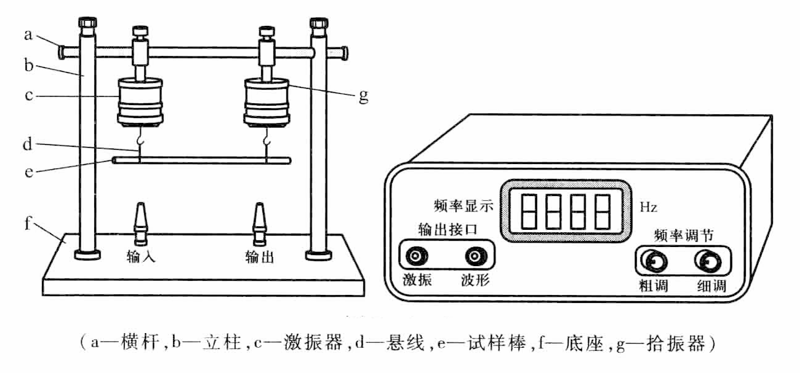
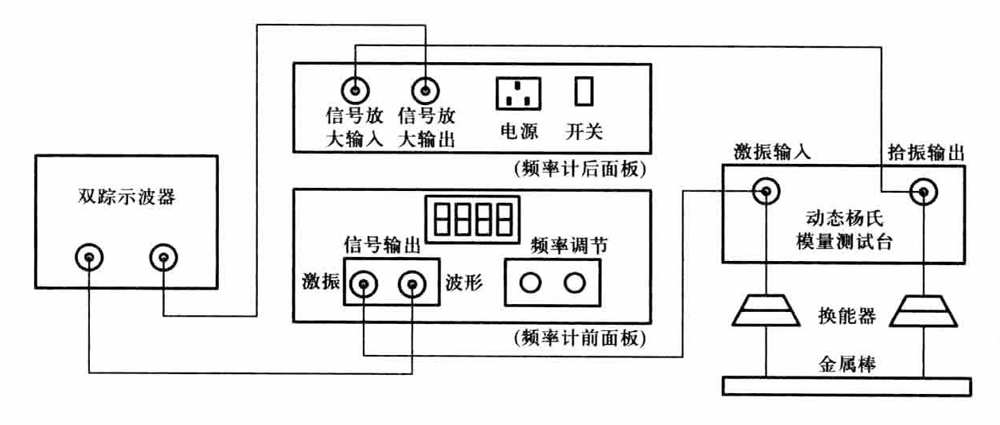
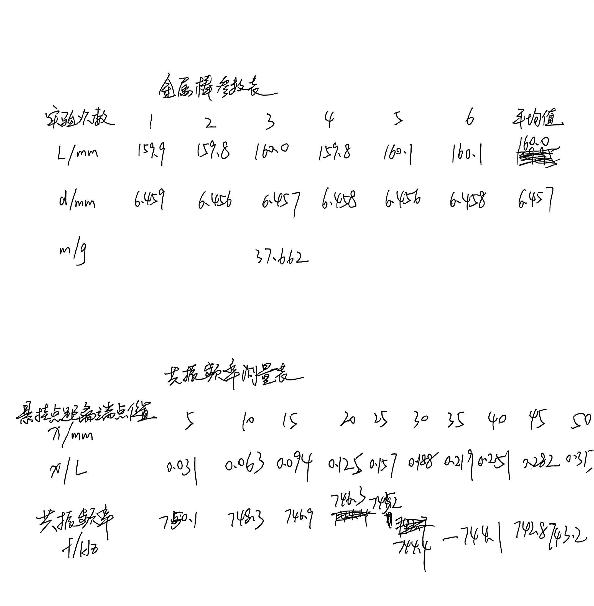
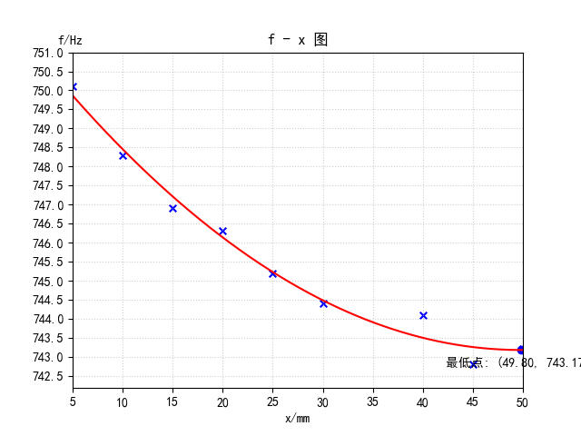

# 动态法测量材料杨氏模量

[← 大学物理实验 · 课程心得](../../index.md) · [全部实验报告](../index.md)

- [在线打开 PDF（1.8 MB）](%E5%8A%A8%E6%80%81%E6%B3%95%E6%B5%8B%E9%87%8F%E6%9D%90%E6%96%99%E6%9D%A8%E6%B0%8F%E6%A8%A1%E9%87%8F%E5%AE%9E%E9%AA%8C%E6%8A%A5%E5%91%8A.pdf)

展开 PDF 预览

- [下载markdown版可编辑源文件与配套图片、脚本](source.zip)

数据处理脚本

- [1.py](%E6%95%B0%E6%8D%AE%E5%A4%84%E7%90%86/1.py)

---

## 一、预习报告

### 1. 实验综述

#### 1)实验原理

一根长度*L*远远大于直径*d*的细长棒，作微小弯曲振动时满足横振动方程：

$$
\frac{\partial^4 y}{\partial x^4} + \frac{\rho S}{EJ} \frac{\partial^2 y}{\partial t^2} = 0
$$

该方程的边界条件为：棒的两端时自由端，端点既不受正应力也不受切向力。通过分离变量法求解上述方程，并代入上述边界条件，可以得到一系列固有频率的解。对于两端自由的支撑方式，其基频（最低的固有频率）f与杨氏模量 E的关系为：

$$
E = 1.9978\times10^{-3}\frac{\rho L^4S}{J} ω^2=7.8870\times10^{-2}\frac{L^3m}{J} f^2
$$

如果式样为圆棒(*d*<<*L*)，则：

$$
J = \frac{\pi d^4}{64}
$$

所以上述公式可被改写为

$$
E = 1.6067\frac{L^3m}{d^4} f^2
$$

因此只要精确测量出试样的几何尺寸（ *L* , *J* ）、质量（用于计算密度 *ρ*）和其振动的基频 *f* ，就可以通过上述公式计算出材料的杨氏模量 *E*。

#### 2)实验方法

动态法杨氏模量测试台和测试仪结构示意图如下图所示。

动态法杨氏模量测量仪器系统连接示意图如下图所示。

实验步骤：

1. 多次测量金属棒参数：长度 *L*，直径 *d*，质量 *m*；
2. 调节换能器位置，两侧竖直对称悬挂金属棒；
3. 按峰峰值最大，测量不同位置共振频率 *f*；
4. 多项式拟合，确定基频 *f~1~*；
5. 计算杨氏模量及不确定度。

#### 3)实验现象

1. 连接实验装置，并将悬丝分别连接在测试棒的0.1*L*与0.9*L*处；
2. 由小到大逐渐调节信号发生器的频率，并观察示波器上信号的变化。当示波器显示的拾振信号（交流信号）在某一频率处达到极大，则认为信号发生器的激振频率与测试棒共振。并记下该频率 *f~1~*。
3. 将两悬丝以等间隔向里靠拢，分别记下频率*f~2~*，*f~3~*，…；
4. 用外延方法作图，并获取测试棒的固有频率 *f*；
5. 将 *f* 代入计算公式，计算该棒的杨氏模量，并计算ΔE。

### 2. 实验重点

1. 了解物性中的弹性与杨氏模量的定义；
2. 熟悉动态法测量杨氏模量的基本原理；
3. 掌握动态法测杨氏模量的基本测量方法；
4. 学习用外延法测定试样节点处共振频率；
5. 学会如何进行物理实验中的数据处理与不确定度的分析。

### 3. 实验难点

一、操作过程中需要足够的细心和熟练度使读数更加准确；

二、存在假的共振峰；

三、各种误差原因：

1. 示波器本身仪器误差；
2. 示波器读数误差；
3. 测量时，金属棒并非完全静止；
4. 测量金属棒直径时存在误差；
5. 金属棒与细线并非绝对垂直；
6. 细线悬点偏差或产生细微滑动。

## 二、原始数据

## 三、结果与分析

### 1. 数据处理与结果

#### d、L、m 测量数据表

| 实验次数 | 1     | 2     |   3   |   4    |   5   |   6   | 平均值 |
| :------: | ----- | ----- | :---: | :----: | :---: | :---: | :----: |
|   L/mm   | 159.9 | 159.8 | 160.0 | 159.8  | 160.1 | 160.1 | 160.0  |
|   d/mm   | 6.459 | 6.456 | 6.457 | 6.458  | 6.456 | 6.458 | 6.457  |
|   m/g    |       |       |       | 37.662 |       |       |        |

#### 平均值与不确定度计算

$$
\bar{d} = \frac{\overset{6}{\underset{i=1}{\sum}} d_i}{6} = 6.457 \, \text{mm}
$$

$$
u_{dA} = \sqrt{\frac{\overset{6}{\underset{i=1}{\sum}} (d_i - \bar{d})^2}{6 \times 5}} = 0.0005 \, \text{mm}
$$

$$
u_{dB} = \frac{\Delta \text{仪}}{\sqrt{3}} = \frac{0.004}{\sqrt{3}} = 0.002 \, \text{mm}
$$

$$
u_d = \sqrt{u_{dA}^2 + u_{dB}^2} = 0.002 \, \text{mm}
$$

$$
d = (6.457 \pm 0.002) \, \text{mm}
$$

$$
\bar{L} = \frac{\overset{6}{\underset{i=1}{\sum}} L_i}{6} = 159.95 \, \text{mm}
$$

$$
u_{LA} = \sqrt{\frac{\overset{7}{\underset{i=1}{\sum}} (L_i - \bar{L})^2}{6 \times 5}} = 0.05 \, \text{mm}
$$

$$
u_{LB} = \frac{\Delta \text{仪}}{\sqrt{3}} = \frac{0.2}{\sqrt{3}} = 0.12 \, \text{mm}
$$

$$
u_L = \sqrt{u_{LA}^2 + u_{LB}^2} = 0.13 \, \text{mm}
$$

$$
L = (159.95 \pm 0.13) \, \text{mm}
$$

$$
\bar{m} = 37.662 \, \text{g}
$$

$$
u_{mA} = 0
$$

$$
u_{mB} = \frac{\Delta \text{仪}}{\sqrt{3}} = \frac{0.001}{\sqrt{3}} = 0.0006 \, \text{g}
$$

$$
u_m = \sqrt{u_{mA}^2 + u_{mB}^2} = 0.0006 \, \text{g}
$$

$$
m = (37.662 \pm 0.0006) \, \text{g}
$$

#### 共振频率测量表

| 最差点距端点的位置 x/mm | 5     | 10    | 15    | 20    | 25    | 30    | 35    | 40    | 45    | 50    |
| ----------------------- | ----- | ----- | ----- | ----- | ----- | ----- | ----- | ----- | ----- | ----- |
| x/L                     | 0.031 | 0.063 | 0.094 | 0.125 | 0.157 | 0.188 | 0.219 | 0.251 | 0.282 | 0.313 |
| 共振频率 f/Hz           | 750.1 | 748.3 | 746.9 | 746.3 | 745.2 | 744.4 | /     | 744.1 | 742.8 | 743.2 |

#### 计算结果

用外延法作图：

得到固有频率：

$$
f = 743.17 \, \text{Hz}
$$

$$
u_f = \frac{\Delta \text{仪}}{\sqrt{3}} = 0.06 \, \text{Hz}
$$

### 2. 误差分析

计算杨氏模量：

$$
E = 1.6067 \frac{L^3 m}{d^4} f^2 = 7.868 \times 10^{10} \, \text{Pa}
$$

不确定度计算：

$$
u_E = E \sqrt{(3 \frac{u_L}{\bar{L}})^2 + (4 \frac{u_d}{\bar{d}})^2 + (\frac{u_m}{\bar{m}})^2 + (2 \frac{u_f}{\bar{f}})^2} = 2.2 \times 10^8 \, \text{Pa}
$$

最终结果：

$$
E = (7.868 \pm 0.022) \times 10^{10} \, \text{Pa}
$$

误差原因分析：

1.示波器本身存在的仪器误差；

2.示波器读数时判断波形达到峰值与否存在误差；

3.在进行实验测量时,金属棒并非完全静止；

4.用螺旋测微器测量金属棒直径时存在：

	(1)夹紧金属棒的程度；
	
	(2)会属棒某些地方截面并非绝对圆形；
	
	(3)测量金属棒直径在夹的过程中位置有偏差导致测量的值比直径略小；
	
	(4)金属棒并非绝对均一，即各处直径相等

等误差；

5.金属棒与细线并非绝对垂直；

6.细线所悬悬点并非绝对正确且会产生一定的细微滑动；

7.环境因素影响：如空气流动、空调出风口；

8.操作不当：如碰到桌子产生晃动，呼气导致铜棒晃动。

### 3. 实验探讨

本实验采用动态法测量金属棒杨氏模量，通过测量几何尺寸、质量及共振频率，利用外延法确定基频。实验中出现假共振峰等难点，通过调整悬丝位置和多项式拟合克服。最终计算出杨氏模量，并进行不确定度分析，结果可靠，加深了对弹性材料物性的理解。

## 四、思考题

**1. 如何区分假的共振峰？**
答：一般可以用如下方法判别真假共振峰：

(1)共振频率预估法：做实验前先用理论公式估算出共振频率的大致范围然后进行细致的测量。

(2)峰宽判别法：真正的共振峰的峰宽十分尖锐，特别是在室温时，只要改变激振信号频率约0.1Hz，即可判断出试样是否处于最佳共振状态，而虚假共振峰的峰宽较宽。

**2. 测量的实验条件是否满足杆振动模型的要求？**
答：不完全满足。模型要求棒两端自由、均匀材质、微小振动且无外部约束。但实际实验中存在以下影响因素：

- 悬丝支撑引入约束，使棒端非完全自由。
- 棒材质可能不均匀，几何尺寸有误差。
- 环境振动和空气阻尼影响理想振动。
  因此，条件与理想模型有偏差。

**3. 假如不满足，为什么能采用这种方法测出横杆基频？**
答：尽管条件不完美，但通过外延法可以近似消除支撑点的影响。外延法将测量数据拟合后外推到节点位置（理论自由端），从而还原理想边界条件下的频率。此外，基频对边界条件敏感度较低，且实验误差通过多次测量和不确定度分析得以控制，故仍能获得可靠结果。

**4. 我们能否观察 n= 2 , 3 等情况的本征振动来测量杨氏模量？有什么困难？**
答：理论上可以，因为高阶本征频率也与杨氏模量相关（公式类似，但常数因子不同）。困难包括：

- 激发难度：高阶模式需要更精确的激振位置和频率，不易稳定产生。
- 识别难度：高阶共振峰振幅小，易与假共振或基频谐波混淆。
- 节点增多：悬丝位置可能恰好位于节点，导致信号微弱。
- 模型修正：高阶模式需更复杂的边界条件修正，增加计算复杂度。因此，实践中通常使用基频。
