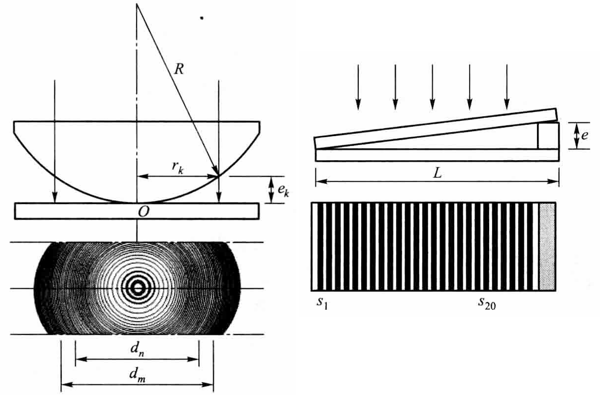
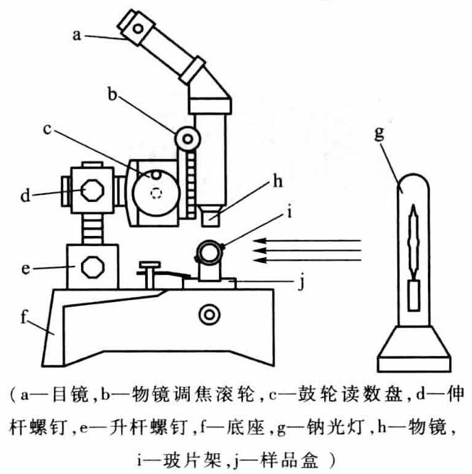
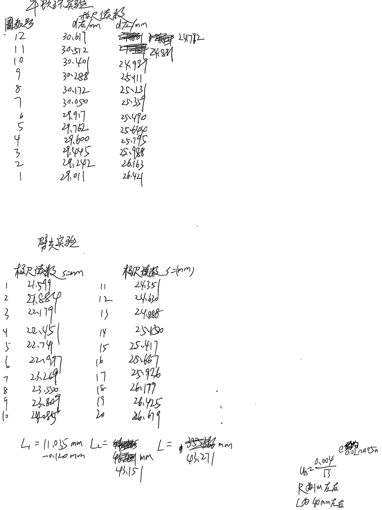

# 等厚干涉

[← 大学物理实验 · 课程心得](../../index.md) · [全部实验报告](../index.md)

- [在线打开 PDF（2.7 MB）](%E7%AD%89%E5%8E%9A%E5%B9%B2%E6%B6%89%E5%AE%9E%E9%AA%8C%E6%8A%A5%E5%91%8A.pdf)

展开 PDF 预览

- [下载可编辑源文件与配套图片、脚本](source.zip)

---

## 一、预习报告

### 1. 实验综述

#### （1）实验现象

等厚干涉是光在厚度变化的薄膜表面发生干涉时形成的独特图样。典型的牛顿环呈现为一系列以接触点为中心的明暗相间的同心圆环，而劈尖干涉则表现为平行等距的直条纹。这些干涉条纹的分布直接反映了薄膜厚度的变化情况。

#### （2）实验原理

当单色光垂直入射到空气薄膜上下表面时，两束反射光因存在光程差而产生干涉。光程差满足δ = 2e + λ/2的关系，其中 λ/2 项源于光从光疏介质到光密介质反射时的半波损失。在薄膜厚度相等的轨迹上形成同一级次的干涉条纹，这正是"等厚干涉"的物理内涵。

<strong>图 1 &emsp; 牛顿环（左）与劈尖干涉（右）光路图</strong>

#### （3）实验方法

采用钠光灯（λ = 589.3 nm）作为单色光源，通过读数显微镜进行精密测量。牛顿环实验中，通过测量不同级次暗环的直径，利用 $R = \frac{(dₘ² - dₙ²)}{4(m-n)λ}$ 计算透镜曲率半径；劈尖实验中，通过测定单位长度的条纹数 n 和劈尖长度 *L*，根据 $e = \frac{nL·λ}2$ 计算薄膜厚度。

<strong>图 2 &emsp; 实验装置示意图</strong>

### 2. 实验重点

深入理解等厚干涉的物理本质，熟练掌握读数显微镜的规范操作，准确测量干涉条纹的位置分布，并运用差值法处理实验数据以消除系统误差，最终通过牛顿环和劈尖分别测定透镜曲率半径和薄膜厚度，培养严谨的科学态度和数据处理能力。

### 3. 实验难点

消除读数显微镜的回程差影响，精确调节干涉条纹至最清晰状态，准确定位牛顿环的中心零点，避免实验过程中的振动干扰和灰尘污染，以及保证在测量过程中十字叉丝与条纹相切的准确性，这些因素都直接影响最终测量结果的可靠性。

## 二、原始数据

## 三、结果与分析

### 1. 数据处理与结果

#### 实验一：牛顿环实验

<strong>表 1 &emsp; 实验一数据记录</strong>

| 圈数号 | d~右~/mm | d~左~/mm | d~右~-d~左~/mm | 直径平方d~k~^2^/mm^2^ | 相隔6圈直径平方之差/mm^1^ | R/m   |
| ------ | -------- | -------- | -------------- | --------------------- | ------------------------- | ----- |
| 12     | 30.617   | 24.772   | 5.845          | 34.164                | 14.566                    | 1.029 |
| 11     | 30.502   | 24.881   | 5.621          | 31.596                | 14.390                    | 1.017 |
| 10     | 30.401   | 24.989   | 5.412          | 29.290                | 14.812                    | 1.047 |
| 9      | 30.288   | 25.111   | 5.177          | 26.801                | 14.850                    | 1.050 |
| 8      | 30.172   | 25.231   | 4.941          | 24.414                | 14.933                    | 1.056 |
| 7      | 30.050   | 25.359   | 4.691          | 22.006                | 15.297                    | 1.082 |
| 6      | 29.917   | 25.490   | 4.427          | 19.598                |                           |       |
| 5      | 29.792   | 25.644   | 4.148          | 17.206                |                           |       |
| 4      | 29.600   | 25.795   | 3.805          | 14.478                |                           |       |
| 3      | 29.445   | 25.988   | 3.457          | 11.951                |                           |       |
| 2      | 29.242   | 26.163   | 3.079          | 9.480                 |                           |       |
| 1      | 29.011   | 26.421   | 2.590          | 6.708                 |                           |       |

备注：表格中*R*值由公式 $R=\frac{d_m^2-d_n^2}{4(m-n)λ}$ 计算而得，其中 *λ* = 589.3nm。

$$
\bar{R} = \frac{\overset{6}{\underset{i=1}{\sum}} R_i}{6} ≈ 1.047m
$$

#### 实验二：劈尖干涉实验

<strong>表 2 &emsp; 实验二数据记录</strong>

|      | 标尺读数s/mm |      | 标尺读数s/mm | s~x+10~-s~x~/mm |
| ---- | ------------ | ---- | ------------ | --------------- |
| 1    | 21.599       | 11   | 24.351       | 2.752           |
| 2    | 21.884       | 12   | 24.630       | 2.746           |
| 3    | 22.179       | 13   | 24.888       | 2.709           |
| 4    | 22.451       | 14   | 25.150       | 2.699           |
| 5    | 22.741       | 15   | 25.417       | 2.676           |
| 6    | 22.997       | 16   | 25.667       | 2.670           |
| 7    | 23.269       | 17   | 25.926       | 2.657           |
| 8    | 23.550       | 18   | 26.179       | 2.629           |
| 9    | 23.809       | 19   | 26.425       | 2.616           |
| 10   | 24.085       | 20   | 26.679       | 2.594           |

$$
L_1=-0.120mm,L_2=43.151mm，L=L_2-L_1=43.271mm
$$

$$
\bar{Δs}=\frac{{\overset{10}{\underset{i=1}{\sum}}(S_{i+10}-S_i)}}{10}=2.6748mm
$$

$$
\bar{e}=\frac{5Lλ}{\bar{Δs}}≈0.0477mm
$$

**两个实验的不确定度计算见下一个部分**

### 2. 误差分析

#### （一）实验一不确定度计算

忽略B类不确定度，则

$$
u(R)=u_A(R) = \sqrt{\frac{\overset{6}{\underset{i=1}{\sum}} (R_i - \bar{R})^2}{6 \times 5}} ≈0.009mm
$$

$$
R = (1.047 \pm 0.009){\text mm}
$$

#### （二）实验二不确定度计算

$$
u_A(Δs) = \sqrt{\frac{\overset{10}{\underset{i=1}{\sum}} (Δs_i - \bar{Δs})^2}{10 \times 9}} ≈0.017mm
$$

$$
u_B(Δs) = \frac{\Delta \text{仪}}{\sqrt{3}} = \frac{0.004}{\sqrt{3}} ≈ 0.0023 °
$$

$$
u(Δs) = \sqrt{u_A(Δs)^2 + u_B(Δs)^2} ≈ 0.017 °
$$

忽略 *L* 的不确定度，则根据传递公式得

$$
u(e) =\frac{u(Δs)}{\bar{Δs}}\times\bar{e}≈0.0003
$$

$$
e = (0.0477 \pm 0.0003){\text mm}
$$

#### （三）误差分析

1. 在推导牛顿环半径公式时，是基于 R≫e 的假设而忽略了高阶小量 e^2^，当环的半径较大时，会引入一定的理论误差。
2. 实验中将钠黄光的波长取其平均值 λ=589.3nm*λ*=589.3nm，而钠光实际是双线结构，这也会带来微小的系统误差。
3. 劈尖干涉实验中为了获取更好的光照条件会移动显微镜，这个过程可能导致劈尖装置的移动。
4. 读数过程中的偶然误差。
5. 读数显微镜中齿轮结构中存在间隙，转动过程中可能还是存在回程差。
6. 实验中所用装置由于使用时间过长而老化磨损，或者存在杂质，对条纹图像产生影响。
7. 实验台面的微小振动或空气流动会使干涉条纹发生抖动，对读数造成一定影响。

### 3. 实验探讨

本实验通过牛顿环和劈尖干涉两种等厚干涉现象，分别测定了透镜的曲率半径和薄膜厚度。实验观察到清晰的同心圆环和直条纹，通过读数显微镜精确测量，并采用差值法有效减小了系统误差。整个过程加深了对光的波动性及干涉原理的理解。

## 四、思考题

**1.如果读数显微镜的叉丝不是准确地通过圆心，那么测出的直径实际上是弦长，这对测量结果有无影响？并解释原因。**

没有影响。因为计算曲率半径的公式为 $R=\frac{d_m^2-d_n^2}{4(m-n)λ}$，其中 $d_m^2-d_n^2$ 是两级暗环直径的平方差。当叉丝未通过圆心时，所测得的“直径”虽为弦长，但同一方向的弦长偏差具有一致性。在平方相减运算中，与圆心位置相关的偏差项会被抵消，因此对最终结果没有影响。

**2.反射光干涉观察到牛顿环中央是暗斑，那么从透射方向观察，牛顿环中央是暗斑还是亮斑？**

是亮斑。反射光干涉中央为暗斑是由于空气薄膜下表面反射光存在半波损失，导致光程差为 *λ*/2，满足暗纹条件。而透射光干涉的两束光中，不存在额外的半波损失，中央接触点处光程差为零，满足明纹条件，因此观察到的是亮斑。透射光的牛顿环图样与反射光正好互补。
