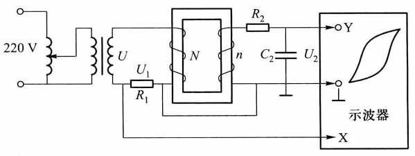
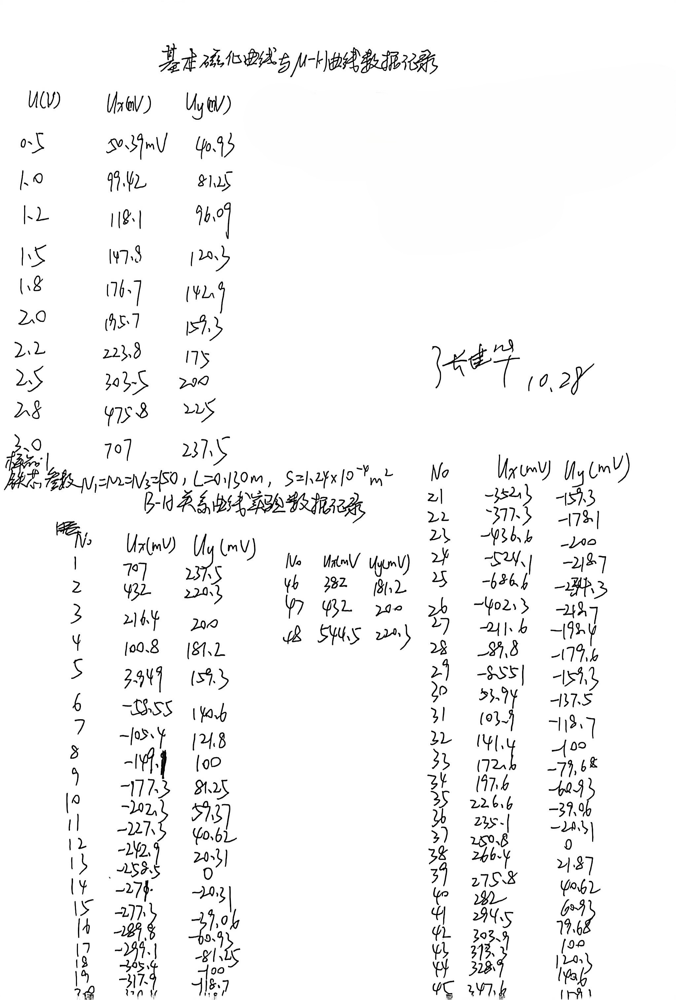
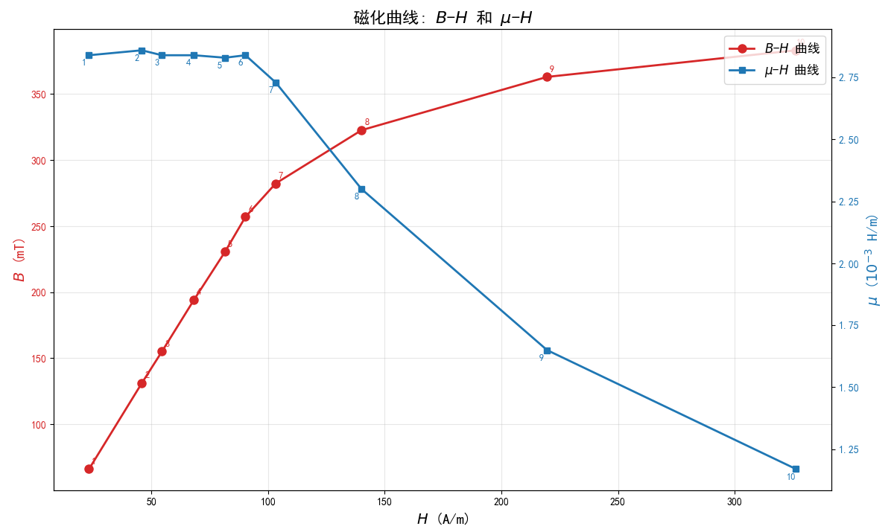
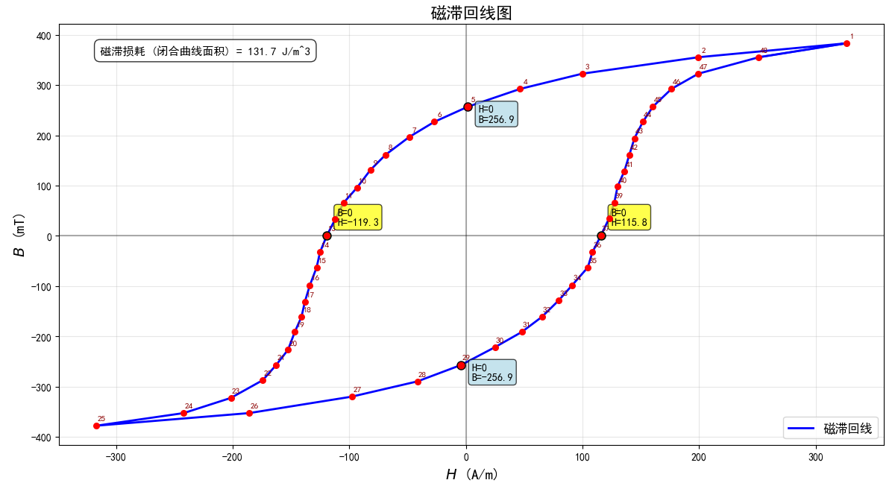

# 铁磁材料的磁滞回线和基本磁化曲线

[← 大学物理实验 · 课程心得](../../index.md) · [全部实验报告](../index.md)

- [在线打开 PDF（2.2 MB）](%E9%93%81%E7%A3%81%E6%9D%90%E6%96%99%E7%9A%84%E7%A3%81%E6%BB%9E%E5%9B%9E%E7%BA%BF%E5%92%8C%E5%9F%BA%E6%9C%AC%E7%A3%81%E5%8C%96%E6%9B%B2%E7%BA%BF%E5%AE%9E%E9%AA%8C%E6%8A%A5%E5%91%8A.pdf)

展开 PDF 预览

- [下载markdown版可编辑源文件与配套图片、脚本](source.zip)

数据处理脚本

- [1.py](%E6%95%B0%E6%8D%AE%E5%A4%84%E7%90%86/1.py)
- [2.py](%E6%95%B0%E6%8D%AE%E5%A4%84%E7%90%86/2.py)

---

## 一、预习报告

### 1. 实验综述

（自述实验现象、实验原理和实验方法，包括必要的光路图、电路图、公式等。不超过500字。）

#### 实验现象

铁磁材料在交变磁场中磁化时，磁感应强度 *B* 的变化滞后于磁场强度 *H*，形成闭合的磁滞回线。硬磁材料（如铸钢）回线宽，剩磁 *B~r~* 和矫顽力 *H~c~* 大；软磁材料（如硅钢）回线窄，*H~c~* 小。动态测量时，回线面积比静态大，因存在涡流损耗。

#### 实验原理

基于安培环路定律和法拉第电磁感应定律。励磁线圈 *N*~1~ 通电流 *I*~1~，产生 $H = \frac{N_1 L_1}{L}$，正比于示波器 X 轴电压*U~x~*。测量线圈 *N*~2~ 感应电动势 $E_2 = N_2 S\frac{dB}{dt}$，经积分电路（*R*~2~*C*）输出 *U~y~*∝*B*，输入 Y 轴。示波器显示 *B*−*H* 曲线，公式为：

$$
H = \frac{N_1}{L R_1}U_x ，B = \frac{R_2 C}{N_2 S}U_y
$$

<strong>图 1 &emsp; 实验原理图</strong>

#### 实验方法

1. 按图 1 连接样品 1 ，设置电阻值 *R*~1~=2.5Ω、*R~*2~=10kΩ、*C*=3µF，交流励磁频率设置130Hz。
2. 调节示波器为 X-Y 模式，将交流励磁信号的电压单调上升至3.5V，调节 X-Y 放大增益使磁滞回线完整显示并尽可能占据更大的屏幕面积。微调电子束聚焦、亮度等显示。
3. 将交流励磁电压单调下降至0V，进行退磁，并调节电子束光斑至屏幕中心。
4. 以0.5V的间隔增加交流励磁电压直至3V，示波器光标读出磁滞曲线的端点电压的峰值坐标(*U~x~*,*U~y~*)，根据公式计算对应的(*H*,*B*,*μ*)。
5. 保持励磁电压为3V，利用光标逐点读出饱和状态磁滞回线上各点的电压的值(*U*~x~, *U*~y~) 计算(*H*,*B*)。

### 2. 实验重点

1. 理解磁滞回线、剩磁、矫顽力等基本概念及其物理意义。
2. 掌握示波器法测绘磁滞回线和基本磁化曲线的实验方法。
3. 学会通过实验数据计算 *B~s~*、*B~r~*、*H~c~* 等参数，并分析不同铁磁材料的磁特性差异。
4. 认识动态磁滞回线与静态磁滞回线的区别，以及频率对磁化过程的影响。

### 3. 实验难点

1. 示波器的定标和灵敏度调节，需确保 X 轴和 Y 轴的电压信号准确转换为 *H* 和 *B* 的物理量。
2. 磁滞回线图形的调节，避免因积分电路参数不当或信号畸变导致图形失真（如顶部编织状小环）。
3. 样品退磁过程的控制，需通过反复磁化和逐步减小电流实现完全退磁，确保实验起点准确。
4. 动态磁滞回线与静态磁滞回线的差异分析，需理解涡流损耗对回线面积的影响。

## 二、原始数据

## 三、结果与分析

### 1. 数据处理与结果

<strong>表 1 &emsp; 基本磁化曲线与<i>μ-H</i>曲线数据记录表</strong>

| *U*(V) | *U~x~*(mV) | *U~y~*(mV) | *H*(A/m) | *B*(mT) | *μ=B/H*(10^-3^H/m) |
| ------ | ---------- | ---------- | -------- | ------- | ------------------ |
| 0.5    | 50.39      | 40.93      | 23.26    | 66.02   | 2.84               |
| 1.0    | 99.42      | 81.25      | 45.89    | 131.05  | 2.86               |
| 1.2    | 118.1      | 96.09      | 54.51    | 154.98  | 2.84               |
| 1.5    | 147.8      | 120.3      | 68.22    | 194.03  | 2.84               |
| 1.8    | 176.7      | 142.9      | 81.55    | 230.48  | 2.83               |
| 2.0    | 195.7      | 159.3      | 90.32    | 256.94  | 2.84               |
| 2.2    | 223.8      | 175.0      | 103.29   | 282.26  | 2.73               |
| 2.5    | 303.5      | 200.0      | 140.08   | 322.58  | 2.30               |
| 2.8    | 475.8      | 225.0      | 219.60   | 362.90  | 1.65               |
| 3.0    | 707.0      | 237.5      | 326.31   | 383.06  | 1.17               |

实验中 ***f* = 125.1Hz，*N~1~* = *N~2~* = *N~3~* = 150，*L* = 0.130m，*S* = 1.24×10^−4^𝑚^2^**
                                 ***R~1~* = 2.5Ω，*R~2~* = 10kΩ，*C* = 3.0μF**
通过python软件作出 ***μ-H*，*B-H*** 双y轴磁化曲线图如下。

**曲线意义：**
*B-H*图像描述铁磁材料在交变或直流磁化场作用下，磁感应强度𝐵随磁场强度𝐻变化的关系曲线，是铁磁材料磁化能力的直接体现。曲线的走势也能反映铁磁材料的“磁化饱和特性”，即随着𝐻的增大，𝐵会趋于饱和，饱和值称为饱和磁感应强度。
*μ-H*图像描述𝜇随𝐻变化的关系，直观体现铁磁材料 “磁导率非线性”的特性。当磁导率达到峰值后，随着磁场强度的增加，磁导率迅速减小，最终会达到接近非铁磁状态。

<strong>表 2 &emsp; <i>B-H</i>关系曲线实验数据记录</strong>

| No   | *U~x~*(mV) | *U~y~*(mV) | *H*(A/m) | *B*(mT) |
| ---- | ---------- | ---------- | -------- | ------- |
| 1    | 707.0      | 237.5      | 326.31   | 383.06  |
| 2    | 432.0      | 220.3      | 199.38   | 355.32  |
| 3    | 216.4      | 200.0      | 99.88    | 322.58  |
| 4    | 100.8      | 181.2      | 46.52    | 292.26  |
| 5    | 3.949      | 159.3      | 1.822    | 256.94  |
| 6    | -58.55     | 140.6      | -27.02   | 226.77  |
| 7    | -105.4     | 121.8      | -48.65   | 196.45  |
| 8    | -149.1     | 100.0      | -68.82   | 161.29  |
| 9    | -177.3     | 81.25      | -81.83   | 131.05  |
| 10   | -202.3     | 59.37      | -93.37   | 95.76   |
| 11   | -227.3     | 40.62      | -104.91  | 65.52   |
| 12   | -242.9     | 20.31      | -112.11  | 32.76   |
| 13   | -258.5     | 0.000      | -119.31  | 0.00    |
| 14   | -271.0     | -20.31     | -125.08  | -32.76  |
| 15   | -277.3     | -39.06     | -127.98  | -63.00  |
| 16   | -289.8     | -60.93     | -133.75  | -98.27  |
| 17   | -299.1     | -81.25     | -138.05  | -131.05 |
| 18   | -305.4     | -100.0     | -140.95  | -161.29 |
| 19   | -317.9     | -118.7     | -146.72  | -191.45 |
| 20   | -330.4     | -140.6     | -152.49  | -226.77 |
| 21   | -352.3     | -159.3     | -162.60  | -256.94 |
| 22   | -377.3     | -178.1     | -174.14  | -287.26 |
| 23   | -436.6     | -200.0     | -201.51  | -322.58 |
| 24   | -524.1     | -218.7     | -241.89  | -352.74 |
| 25   | -686.6     | -234.3     | -316.89  | -377.90 |
| 26   | -402.3     | -218.7     | -185.68  | -352.74 |
| 27   | -211.6     | -198.4     | -97.66   | -320.00 |
| 28   | -89.80     | -179.6     | -41.45   | -289.68 |
| 29   | -8.551     | -159.3     | -3.95    | -256.94 |
| 30   | 53.94      | -137.5     | 24.90    | -221.77 |
| 31   | 103.9      | -118.7     | 47.95    | -191.45 |
| 32   | 141.4      | -100.0     | 65.26    | -161.29 |
| 33   | 172.6      | -79.68     | 79.66    | -128.52 |
| 34   | 197.6      | -60.93     | 91.20    | -98.27  |
| 35   | 226.6      | -39.06     | 104.58   | -63.00  |
| 36   | 235.1      | -20.31     | 108.51   | -32.76  |
| 37   | 250.8      | 0.000      | 115.75   | 0.00    |
| 38   | 266.4      | 21.87      | 122.95   | 35.27   |
| 39   | 275.8      | 40.62      | 127.29   | 65.52   |
| 40   | 282.0      | 60.93      | 130.15   | 98.27   |
| 41   | 294.5      | 79.68      | 135.92   | 128.52  |
| 42   | 303.9      | 100.0      | 140.26   | 161.29  |
| 43   | 313.3      | 120.3      | 144.60   | 194.03  |
| 44   | 328.9      | 140.6      | 151.80   | 226.77  |
| 45   | 347.6      | 159.3      | 160.43   | 256.94  |
| 46   | 382.0      | 181.2      | 176.31   | 292.26  |
| 47   | 432.0      | 200.0      | 199.38   | 322.58  |
| 48   | 544.5      | 220.3      | 251.31   | 355.32  |

实验中 ***f* = 125.1Hz，*N~1~* = *N~2~* = *N~3~* = 150，*L* = 0.130m，*S* = 1.24×10^−4^𝑚^2^**

                           ***U* = 3.0V，*R~1~* = 2.5Ω，*R~2~* = 10kΩ，*C* = 3.0μF**

通过python软件作出磁滞回线图如下，标出闭合图像与坐标轴的交点并积分得出闭合曲线的面积。

**曲线意义：**本曲线反映了在交变外磁场强度作用下铁磁性物质的磁化过程中*B*和*H*的非线性关系，其面积单位为𝐽/𝑚^3^,因此我们可以猜想，图像面积可能反应了实验中铁磁材料储存磁能效率的高低，利用图像可以寻找磁性材料的最优利用效率。 

**剩磁：**根据图像取𝐻=0时曲线与*B*的交点，得到𝐵~𝑟1~=256.9𝑚𝑇,𝐵~𝑟2~=-256.9𝑚𝑇
**矫顽力：**根据图像取𝐵=0时曲线与*H*的交点，得到𝐻~𝑐1~=-119.3𝐴/𝑚,𝐻~𝑐2~=115.8𝐴/𝑚
**磁耗：**利用python对闭合区域进行积分，得到$\lvert B·H\rvert$=131.7𝐽/𝑚^3^

### 2. 误差分析

**误差产生可能的原因：**

**(1) 仪器误差：**公式中的比例系数依赖电阻 R1、R2、电容 C、线圈匝数 N等参数的标称值，实际值与标称值可能存在偏差。

**(2) 操作误差**

1. **退磁不完全：**若样品退磁不彻底，初始磁化状态非零，导致磁滞回线偏移。
2. **信号噪声：**电源波动或电磁干扰使示波器波形抖动，影响数据读取精度。  
3. **光标定位：**手动读取电压值时，光标对准存在主观偏差。

**(3) 环境误差**

1. **温度漂移：**电阻和电容参数随温度变化，影响定标系数。
2. **地磁场干扰：**实验室地磁场可能对弱磁场测量（如近 H=0区域）产生干扰。

### 3. 实验探讨

本次实验中，我通过示波器法成功测绘了铁磁材料的磁滞回线和基本磁化曲线，验证了其非线性磁化特性。实验测得剩磁 *B~r~* = 256.9mT，矫顽力 *H~c~* = 119.3A/m，磁滞损耗$\lvert B·H\rvert$ = 131.7J/m³。掌握了示波器定标和退磁操作技巧，加深了对铁磁材料磁化机制的理解。

## 四、思考题

**1.什么叫铁磁材料的磁滞现象?试说明铁磁材料基本磁化曲线和磁滞回线的特性。** 

**磁滞现象：**铁磁材料磁化时，磁感应强度*B*的变化始终落后于磁场强度*H*的变化，*H*回到原值时*B*不回到原值的现象，如*H* = 0时仍有剩磁*B~r~*。
**基本磁化曲线特性：**从原点出发，连接各磁滞回线顶点的光滑曲线；*B*随*H*非线性增长，先快后缓直至饱和，反映材料从无磁到饱和的磁化规律。
**磁滞回线特性：**闭合曲线；*H*按*H~m~*→0→-*H~c~*→-*H~m~*→0→*H~c~*→*H~m~*变化时，*B*沿对应轨迹变化；软磁材料回线窄，*H~c~*小，硬磁材料回线宽*H~c~*大。

**2.铁磁材料的基本磁化曲线和磁滞回线各有什么意义?** 

**基本磁化曲线：**反映材料磁化的整体规律，可确定不同*H*对应的*B*，近似计算磁导率 *μ=B/H*，是设计电机、变压器等电磁设备选材料的依据。
**磁滞回线：**体现材料磁滞特性，回线面积对应单位体积磁滞损耗，可区分软磁与硬磁材料；还能确定饱和磁感应强度*B~s~*、剩磁*B~r~*、矫顽力*H~c~*，为材料应用（如硬磁做永磁体）提供参数。

**3.怎样才能在示波器上显示出铁磁材料的磁滞回线?** 

1. 按实验线路接线，将励磁线圈*N~1~*接信号源，取样电阻R~1~两端电压*U~x~*接示波器X轴(*U~x~*正比于*H*)。
2. 次级线圈*N~2~*串联R~2~与C构成积分电路，电容两端电压*U~y~*接示波器Y轴(*U~y~*正比于*B*)。
3. 开机后先退磁，再调节信号源输出电压，示波器X/Y轴灵敏度，使屏上显示完整、清晰的磁滞回线。
