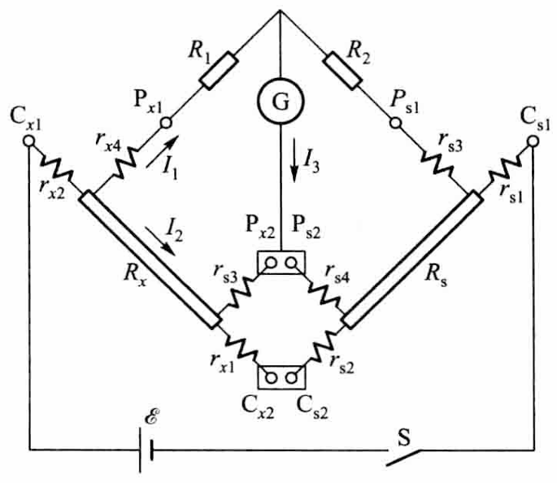
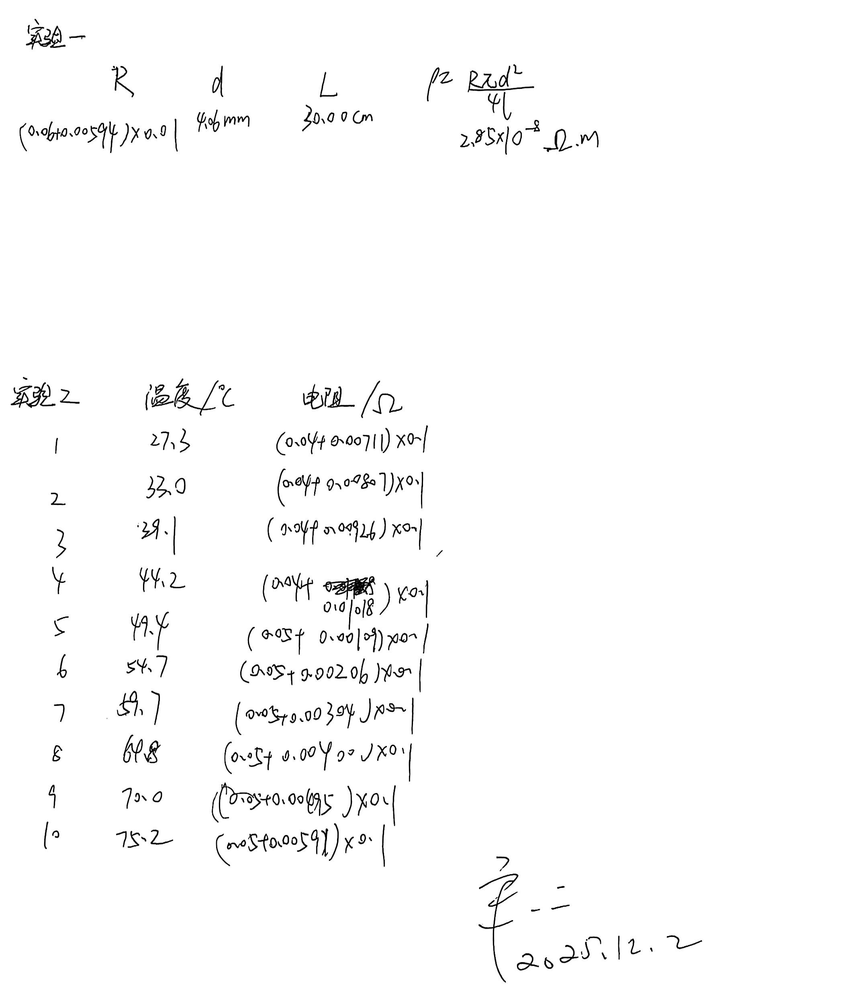
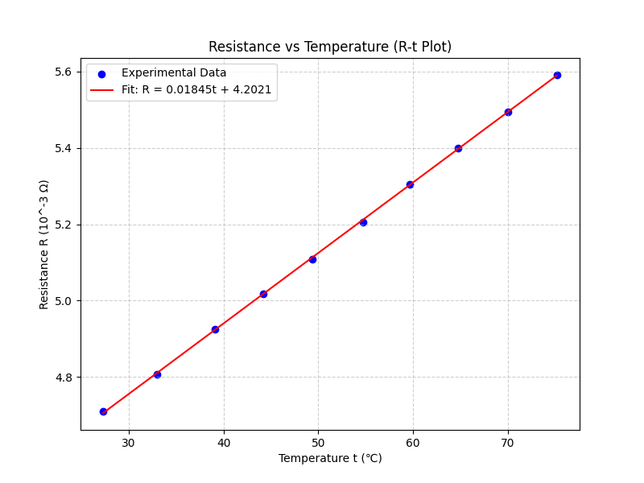

# 用双臂电桥测低电阻

[← 大学物理实验 · 课程心得](../../index.md) · [全部实验报告](../index.md)

- [在线打开 PDF（1.8 MB）](%E7%94%A8%E5%8F%8C%E8%87%82%E7%94%B5%E6%A1%A5%E6%B5%8B%E4%BD%8E%E7%94%B5%E9%98%BB%E5%AE%9E%E9%AA%8C%E6%8A%A5%E5%91%8A.pdf)

展开 PDF 预览

- [下载可编辑源文件与配套图片、脚本](source.zip)

数据处理脚本

- [1.py](%E6%95%B0%E6%8D%AE%E5%88%86%E6%9E%90/1.py)

---

## 一、预习报告

### 1. 实验综述

#### （1）实验原理

直流双臂电桥（又称开尔文电桥）主要用于测量 $10^{-5} \sim 1 \Omega$ 的低值电阻。在测量低电阻时，接触电阻和导线电阻（约 $10^{-4} \sim 10^{-2} \Omega$）不可忽略。为了消除其影响，双臂电桥采用了四端接入法：将待测电阻的接头分为电流接头（$C_1, C_2$）和电位接头（$P_1, P_2$）。
双臂电桥电路如图 1 所示，由待测电阻 $R_x$、标准电阻 $R_s$ 以及两对比率臂电阻 $R_1, R_2$ 和 $R_3, R_4$ 组成。根据基尔霍夫定律，当电桥平衡（检流计 $I_G=0$）且满足结构对称条件 $\frac{R_1}{R_2} = \frac{R_3}{R_4}$ 时，待测电阻的计算公式为：

$$
R_x = \frac{R_1}{R_2} R_s
$$

此时，附加电阻的影响被消除或减小到可忽略的程度。

<strong>图 1 &emsp; 双臂电桥电路</strong>

#### （2）实验方法

1.  **测量电阻率**：使用QJ44型直流双臂电桥测量金属铜棒的阻值 $R_x$。利用游标卡尺测量铜棒的直径 $d$ 和电位接头间的长度 $L$，根据公式 $\rho = \frac{\pi d^2 R_x}{4L}$ 计算电阻率。
2.  **测量电阻温度系数**：将待测铜棒置于温控装置中，通过加热或降温改变环境温度（每隔约5℃记录一次），测量不同温度 $t$ 下的电阻 $R_t$。利用公式 $R_t = R_0(1 + \alpha t)$，通过作图或计算求出金属的电阻温度系数 $\alpha$。

### 2. 实验重点

1.  掌握直流双臂电桥测量低电阻的工作原理，特别是理解四端接入法如何消除导线电阻和接触电阻的影响。
2.  熟悉QJ44型双臂电桥的结构与操作，包括正确连接四端接线（C端在外，P端在内）、倍率选择以及检流计的调零与读数。
3.  掌握测量金属导体电阻率及其电阻温度系数的实验方法与数据处理。

### 3. 实验难点

1.  **接线操作**：必须严格区分电流接头（Current）与电位接头（Potential），确保被测电阻和标准电阻均采用四端接法，且连接顺序正确（电流回路在外，电位回路在内）。
2.  **灵敏度控制**：测量过程中需根据电桥偏转情况逐步调节检流计灵敏度。开始时需用低灵敏度保护仪器，接近平衡时使用高灵敏度以保证精度。
3.  **温度控制与同步读数**：在测温系数实验中，温度变化具有热惯性，需要协调温控仪的操作与电桥的快速调节平衡，以减少温度波动带来的测量误差。

## 二、原始数据

## 三、结果与分析

### 1. 数据处理与结果

#### 实验一：

| *d*    | *L*     | *R*           |
| ------ | ------- | ------------- |
| 4.06mm | 30.00cm | 6.594×10^-4^Ω |

$$
\rho = \frac{\pi d^2 R_x}{4L}=2.85×10^{-8}\text{Ω·m}
$$

**不确定度计算见误差分析部分**

#### 实验二：

| 序号 | 温度/℃ | 电阻/10^-3^Ω |
| ---- | ------ | ------------ |
| 1    | 27.3   | 4.711        |
| 2    | 33.0   | 4.807        |
| 3    | 39.1   | 4.926        |
| 4    | 44.2   | 5.018        |
| 5    | 49.4   | 5.109        |
| 6    | 54.7   | 5.206        |
| 7    | 59.7   | 5.304        |
| 8    | 64.8   | 5.400        |
| 9    | 70.0   | 5.495        |
| 10   | 75.2   | 5.591        |

①用逐差法求平均值：

$$
α_i = \frac{[R_{x(i+5)} - R_{x(i)}]}{R_{x(i)}t_{i+5} - R_{x(i+5)}t_{i}}，i = 1,2,3,4,5
$$

| *i*                   | 1     | 2     | 3     | 4     | 5     |
| --------------------- | ----- | ----- | ----- | ----- | ----- |
| *α~i~* /(10^-3^℃^-1^) | 4.283 | 4.440 | 4.386 | 4.401 | 4.463 |

$$
\bar{α} = \frac{\overset{5}{\underset{i=1}{\sum}} α_i}{5} = 4.395 \, ×10^{-3}\text{℃}^{-1}
$$

参考值 $α_0 = 4.33×10^{-3}\text{℃}^{-1}$

相对误差 $E=\frac{\lvert {\bar{α}}-{α_0}\rvert}{{α_0}}×100\%= 1.50\%$

②作图法：

利用python生成 R~x~ - t 拟合图像如下

拟合直线方程为 R = 0.01845t + 4.2021，则斜率 k = 0.01845，截距 b = 4.2021

由 $R_t = R_0(1 + \alpha t)$ 得 $α = \frac{k}{b} = 4.39×10^{-3}\text{℃}^{-1}$

参考值 $α_0 = 4.33×10^{-3}\text{℃}^{-1}$

相对误差 $E=\frac{\lvert {α}-{α_0}\rvert}{{α_0}}×100\%= 1.41\%$

### 2. 误差分析

#### 实验一：

$$
u(R) = \frac{0.01×0.11×0.2\%}{\sqrt{3}}\text{Ω}=1.3×10^{-6}\text{Ω}
$$

$$
u(D) = \frac{0.02}{\sqrt{3}}\text{mm}=0.012\text{mm}，u(l) = \frac{0.5}{\sqrt{3}}\text{mm}=0.3\text{mm}
$$

$$
R = \bar{R}\pm u(R)=(6.594\pm 0.013)×10^{-4}\text{Ω}
$$

$$
D = \bar{D}\pm u(D) = (4.06\pm 0.012)\text{mm}，l = \bar{l}\pm u(l) = (300.0\pm 0.3)\text{mm}
$$

$$
\bar{\rho} = \frac{\bar{R}·\bar{S}}{\bar{l}} = \frac{\pi\bar{R}{\bar{D}^2}}{4\bar{l}}
$$

$$
\xrightarrow{\text{积化和差}}ln\rho = ln\frac{\pi}{4}+lnR+2lnD-lnl
$$

$$
\xrightarrow{\text{求偏导}} \frac{\partial lnR}{\partial R}=\frac{1}{\bar R} , \frac{\partial lnD}{\partial D}=\frac{2}{\bar D},\frac{\partial lnl}{\partial l}=\frac{1}{\bar l}
$$

$$
\xrightarrow{\text{合成}} \frac{u(\rho)}{\rho} = \sqrt{(\frac{u(R)}{\bar R})^2 + (\frac{2u(D)}{\bar D})^2 + (\frac{u(l)}{\bar l})^2} = 0.63\%
$$

$$
\xrightarrow{\text{结果表达式}} \rho = \bar{\rho}\pm u(\rho) = (2.85\pm 0.02)×10^{-8}\text{Ω·m}
$$

#### 实验二：

逐差法计算得的结果的相对误差 $E_1=\frac{\lvert {\bar{α}}-{α_0}\rvert}{{α_0}}×100\%= 1.50\%$ ，作图法计算得的结果的相对误差 $E_2=\frac{\lvert {α}-{α_0}\rvert}{{α_0}}×100\%= 1.41\%$ ，由此可见作图法的准确性较高。

#### 误差原因分析：

1. 在加热或降温过程中，温度计测量的往往是介质（如水或油）的温度，而铜棒内部温度的变化具有热惯性，导致记录的温度与导体实际温度存在偏差。此外，温控装置内若搅拌不充分，会存在温度梯度。
2. 铜棒的直径可能并非处处均匀，仅在某几个位置测量直径取平均值计算横截面积，会给电阻率的计算带来误差。
3. 在极小电流下检流计指针可能不偏转，导致电桥平衡点的判断存在范围误差。此外，检流计本身的零点漂移也会影响测量。
4. 读取电阻箱读数、温度计刻度以及游标卡尺读数时，可能存在视差或估读误差。
5. 由于电路中存在不同金属的接触点且处于不同温度下，可能会产生温差电动势，叠加在测量信号上影响电桥平衡。

### 3. 实验探讨

本实验通过双臂电桥成功测量了铜棒的电阻率及电阻温度系数。实验中观察到导体电阻随温度升高呈现明显的线性增长趋势。通过逐差法与作图法处理数据，所得电阻温度系数与理论值接近，相对误差均约为1.5%，验证了双臂电桥在消除接触电阻方面的有效性以及金属电阻随温度线性变化的规律。

## 四、思考题

**1.双臂电桥与惠斯登电桥有哪些异同？**

**（1）相同点**
两者都是采用“比较法”进行测量的电桥电路，利用电桥平衡条件（检流计指零）来计算待测电阻；两者都包含四个桥臂，分别由已知电阻和待测电阻组成。

**（2）不同点**

**测量范围**：惠斯登电桥适用于测量中值电阻（通常在几欧姆到几兆欧姆之间）；双臂电桥适用于测量低值电阻（通常在几微欧姆到几欧姆之间）。

**结构特点**：惠斯登电桥待测电阻仅有两个接线端；双臂电桥采用四端接线法（两个电流端，两个电位端），且比惠斯登电桥多了两个辅助电阻臂（*R~3~ ,R~4~*）。

**误差消除**：双臂电桥能有效消除导线电阻和接触电阻的影响，而惠斯登电桥不能。

**2.为什么双臂电桥测量低电阻时能够消除（或减小）附加电阻对测量结果的影响？** 

双臂电桥采用四端法测量电阻，即将电流端和电位端分开接线。电流端用于通过待测电阻的电流，而电位端用于测量电阻两端的电压。由于电位端的接线电阻和接触电阻不会通过大电流，因此这些附加电阻对电压测量的影响可以忽略不计。通过这种方式，双臂电桥能够有效消除或减小接线电阻和接触电阻对测量结果的影响，从而提高低值电阻的测量精度。 

**3.如果四端电阻的电流端和电位端接反了，对测量结果有什么影响？** 

**（1）电流分布不均：**电流端和电位端的功能不同，接反后电流可能不会均匀通过待测电阻，导致电压测量不准确。
**（2）附加电阻影响：**电位端接线电阻和接触电阻可能会通过较大电流，从而引入额外的电压降，影响测量结果。
**（3）测量误差增大：**由于电流端和电位端的功能错位，测量结果会受到接线电阻和接触电阻的显著影响，导致测量误差增大，无法准确反映待测电阻的真实值。
