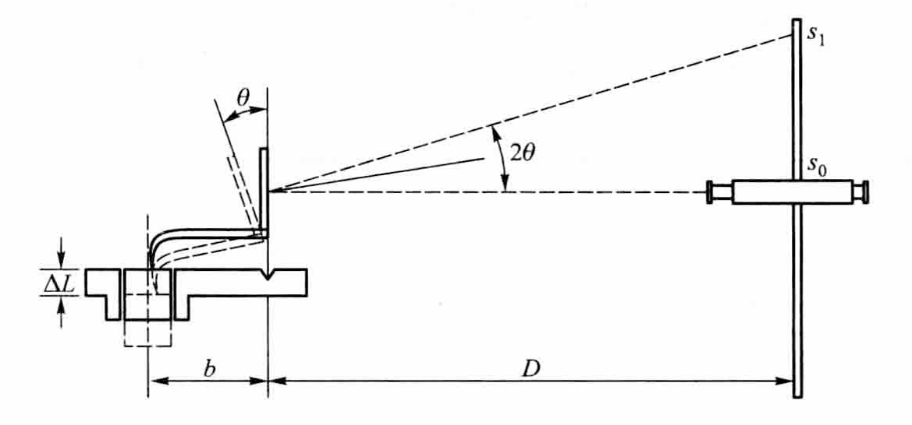
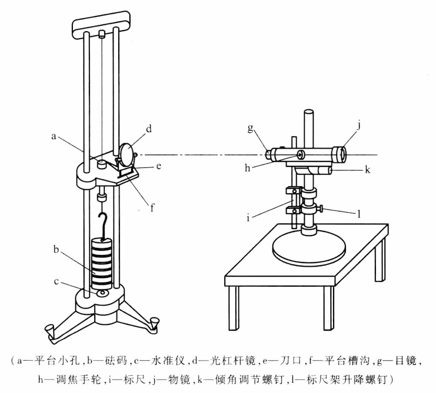
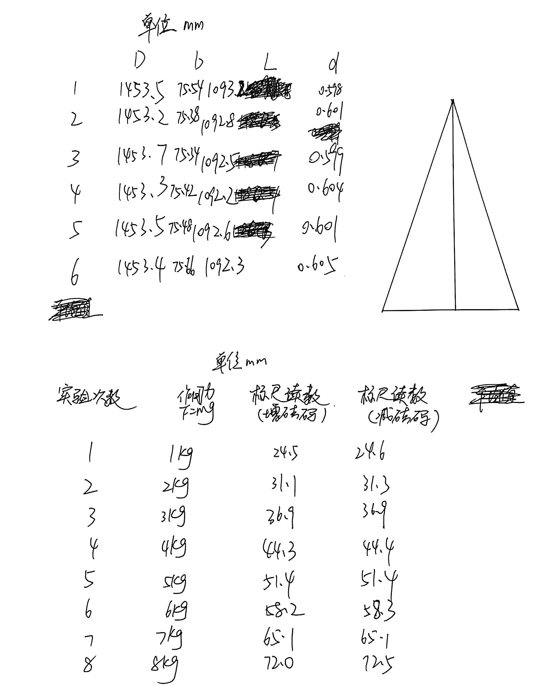
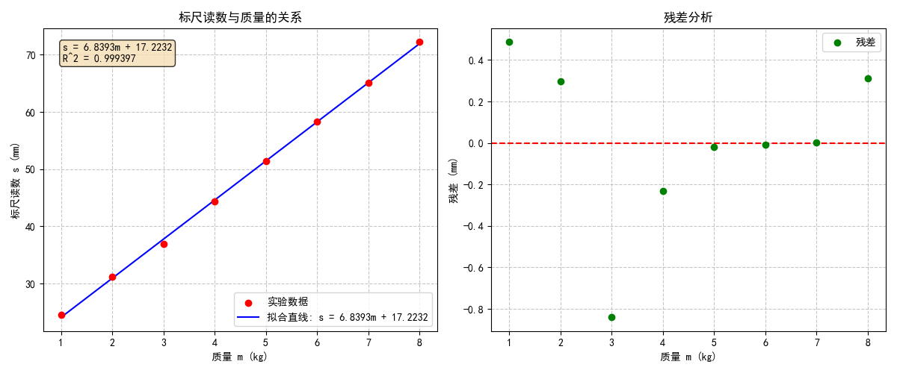

# 金属材料杨氏模量测量

[← 大学物理实验 · 课程心得](../../index.md) · [全部实验报告](../index.md)

- [在线打开 PDF（2.2 MB）](%E9%87%91%E5%B1%9E%E6%9D%90%E6%96%99%E6%9D%A8%E6%B0%8F%E6%A8%A1%E9%87%8F%E6%B5%8B%E9%87%8F%E5%AE%9E%E9%AA%8C%E6%8A%A5%E5%91%8A.pdf)

展开 PDF 预览

- [下载可编辑源文件与配套图片、脚本](source.zip)

数据处理脚本

- [1.py](%E6%95%B0%E6%8D%AE%E5%A4%84%E7%90%86/1.py)

---

## 一、预习报告

### 1. 实验综述

#### 1)实验原理

本实验的核心原理是胡克定律在弹性范围内的应用。杨氏模量 *E* 定义为材料在单向受力时，正应力与线应变的比值，其计算公式为：

$$
E = \frac{\sigma}{\varepsilon} = \frac{F/S}{\Delta L / L} = \frac{FL}{S \Delta L}
$$

其中 *F* 为拉力，S = πd^2^/4 为金属丝横截面积，*L* 为原长，Δ*L* 为微小伸长量。

由于 Δ*L* 极小，直接测量困难，故采用光杠杆进行光放大。光杠杆由平面镜和尺读望远镜组成，其光路示意图如下。

当金属丝伸长 Δ*L*，导致光杠杆后足随之移动，使平面镜偏转角度 *θ*，反射光斑在标尺上移动距离 Δ*s*。根据几何关系，放大公式为：

$$
\Delta s = \frac{2D}{b} \cdot \Delta L
$$

式中 *b* 为光杠杆短臂长，*D* 为镜尺距。代入杨氏模量定义式后得到实验公式：

$$
E = \frac{8DFL}{\pi d^2 b \cdot \Delta s}
$$

#### 2)实验方法

实验总体装置示意图如下。

实验步骤：

1. **系统调节**：调节底座螺丝使立柱铅直，预加砝码拉直金属丝；正确放置光杠杆，调节望远镜直至能清晰看到标尺刻度。
2. **观测钢丝伸长量**：先读取钢丝下挂 2kg 砝码后使钢丝拉直时的标尺上的读数 s~0~ ，然后每加上 1kg 砝码，读取一次数据，依次可以得到钢丝拉伸过程中的读数变化值。紧接着再每次撤掉 1kg 砝码，读取一次数据，依次得到钢丝收缩过程中的读数变化值。
3. **数据测量**：用钢直尺测量金属丝原长 *L*，螺旋测微计在不同位置多次测量直径 d*；用卷尺测量镜尺距 D*，游标卡尺测量光杠杆短臂长 *b*。
4. **计算杨氏模量**：根据实验数据计算杨氏模量，并求其不确定度。

#### 3)实验现象

当在金属丝下端逐级增加砝码时，金属丝发生微小的伸长。通过光杠杆系统，这一微小伸长被放大为标尺上光斑位置的明显移动。增加砝码时，光斑向标尺下端移动；逐级减少砝码时，光斑则向上端移动。

### 2. 实验重点

1. 理解杨氏模量的定义及测量原理。
2. 掌握用光杠杆法测量微小长度的原理。
3. 学习用逐差法和作图法处理实验数据。
4. 学会进行数据分析与不确定度计算。

### 3. 实验难点

1. 光杠杆系统的初始调节较为精细，需确保光路准直、镜面与标尺平行、望远镜视野清晰。
2. 金属丝直径 *d* 和微小伸长量 Δ*L* 的间接测量易产生较大误差，对操作规范性要求高。
3. 有多种原因可能导致实验中加减砝码时测得的数值重复性不好或规律性不好。

## 二、原始数据

## 三、结果与分析

### 1. 数据处理与结果

#### D、b、L、d测量结果及数据分析

| 单位/mm | D      | b     | L      | d     |
| ------- | ------ | ----- | ------ | ----- |
| 1       | 1453.5 | 75.54 | 1093.2 | 0.598 |
| 2       | 1453.2 | 75.38 | 1092.8 | 0.601 |
| 3       | 1453.7 | 75.34 | 1092.5 | 0.599 |
| 4       | 1453.3 | 75.42 | 1092.2 | 0.604 |
| 5       | 1453.5 | 75.48 | 1092.6 | 0.601 |
| 6       | 1453.4 | 75.66 | 1092.3 | 0.605 |
| 平均值  | 1453.4 | 75.47 | 1092.6 | 0.601 |

$$
\bar{D} = \frac{\overset{6}{\underset{i=1}{\sum}} D_i}{6} = 1453. 433\, \text{mm}
$$

$$
\Delta_AD = \sqrt{\frac{\overset{6}{\underset{i=1}{\sum}} (D_i - \bar{D})^2}{6 \times 5}} = 0.087 \, \text{mm}
$$

$$
\Delta_BD = \frac{\Delta \text{仪}}{\sqrt{3}} = \frac{0.5}{\sqrt{3}} = 0.289 \, \text{mm}
$$

$$
\Delta D = \sqrt{\Delta_A(D)^2 + \Delta_B(D)^2} = 0.301 \, \text{mm}
$$

$$
D = (1453. 433 \pm 0.301) \, \text{mm}
$$

$$
\bar{b} = \frac{\overset{6}{\underset{i=1}{\sum}} b_i}{6} = 75.470\, \text{mm}
$$

$$
\Delta_Ab = \sqrt{\frac{\overset{6}{\underset{i=1}{\sum}} (b_i - \bar{b})^2}{6 \times 5}} = 0.047 \, \text{mm}
$$

$$
\Delta_Bb = \frac{\Delta \text{仪}}{\sqrt{3}} = \frac{0.02}{\sqrt{3}} = 0.012 \, \text{mm}
$$

$$
\Delta b = \sqrt{\Delta_A(b)^2 + \Delta_B(b)^2} = 0.048 \, \text{mm}
$$

$$
b = (75.470 \pm 0.048) \, \text{mm}
$$

$$
\bar{L} = \frac{\overset{6}{\underset{i=1}{\sum}} L_i}{6} = 1092.600\, \text{mm}
$$

$$
\Delta_AL = \sqrt{\frac{\overset{6}{\underset{i=1}{\sum}} (L_i - \bar{L})^2}{6 \times 5}} = 0.136 \, \text{mm}
$$

$$
\Delta_BL = \frac{\Delta \text{仪}}{\sqrt{3}} = \frac{0.5}{\sqrt{3}} = 0.289 \, \text{mm}
$$

$$
\Delta L = \sqrt{\Delta_A(L)^2 + \Delta_B(L)^2} = 0.319 \, \text{mm}
$$

$$
L = (1092.600 \pm 0.319) \, \text{mm}
$$

$$
\bar{d} = \frac{\overset{6}{\underset{i=1}{\sum}} d_i}{6} = 0.601\, \text{mm}
$$

$$
\Delta_Ad = \sqrt{\frac{\overset{6}{\underset{i=1}{\sum}} (d_i - \bar{d})^2}{6 \times 5}} = 0.0011 \, \text{mm}
$$

$$
\Delta_Bd = \frac{\Delta \text{仪}}{\sqrt{3}} = \frac{0.004}{\sqrt{3}} = 0.0023 \, \text{mm}
$$

$$
\Delta d = \sqrt{\Delta_A(d)^2 + \Delta_B(d)^2} = 0.0026 \, \text{mm}
$$

$$
d = (0.601 \pm 0.003) \, \text{mm}
$$

#### Δs测量结果及数据分析

| 实验次数 | 砝码质量/kg | 标尺读数/mm（增砝码） | 标尺读数/mm（减砝码） | 平均值/mm |
| -------- | ----------- | --------------------- | --------------------- | --------- |
| 1        | 1           | 24.5                  | 24.6                  | 24.55     |
| 2        | 2           | 31.1                  | 31.3                  | 31.20     |
| 3        | 3           | 36.9                  | 36.9                  | 36.90     |
| 4        | 4           | 44.3                  | 44.4                  | 44.35     |
| 5        | 5           | 51.4                  | 51.4                  | 51.40     |
| 6        | 6           | 58.2                  | 58.3                  | 58.25     |
| 7        | 7           | 65.1                  | 65.1                  | 65.10     |
| 8        | 8           | 72.0                  | 72.5                  | 72.25     |

根据以下公式

$$
\Delta s_i = \frac{(s_{i+4} - s_i)}{4}, \quad i = 1, 2, 3, 4
$$

可得**Δ*s~1~*** = 6.7125mm，**Δ*s~2~*** = 6.7625mm，**Δ*s~3~*** = 7.05mm，**Δ*s~4~*** = 6.975mm，带入以下公式

$$
\overline{\Delta s} = \frac{\sum(\Delta s_i)}{4}=6.875\, \text{mm}
$$

$$
\Delta_A(\Delta s) = \sqrt{\frac{\sum(\Delta s_i - \overline{\Delta s})^2}{4 \times 3}}=0.081\, \text{mm}
$$

$$
\Delta_B(\Delta s) = \frac{\Delta \text{仪}}{\sqrt{3}} = 0.12\, \text{mm}
$$

$$
\Delta(\Delta s) =  \sqrt{\Delta_A(\Delta s)^2 + \Delta_B(\Delta s)^2} = 0.332 \, \text{mm}
$$

$$
\Delta s = (6.875 \pm 0.332) \, \text{mm}
$$

#### 拟合图像

### 2. 误差分析

（运用测量误差、相对误差或不确定度等分析实验结果，写出完整的结果表达式，并分析误差原因。）

#### 计算杨氏模量

$$
E = \frac{8DmgL}{\pi d^2 b\Delta s} =2.158\times 10^{11} \, \text{Pa}
$$

#### 不确定度计算

$$
\Delta m = \frac{\Delta \text{仪}}{\sqrt{3}} = \frac{5\times 10^{-4}}{\sqrt{3}} = 3\times 10^{-4} \, \text{kg}
$$

$$
\frac{\Delta E}{E} = \sqrt{ \left( \frac{\Delta m}{\bar{m}} \right)^2 + \left( \frac{\Delta L}{L} \right)^2 + \left( \frac{\Delta D}{D} \right)^2 + \left( \frac{2\Delta d}{\bar{d}} \right)^2 + \left( \frac{\Delta b}{b} \right)^2 + \left( \frac{\Delta (\Delta s)}{\Delta s} \right)^2 }\\=1.21\%
$$

$$
E = (2.158 \pm 0.026)\times 10^{11} \, \text{Pa}
$$

#### 误差原因分析

1. 实验中测量了较多长度，由于估读的主观性，测量结果存在误差；
2. 实验中砝码均作 1 kg，但是实际上砝码可能存在磨损，对结果产生一定影响；
3. 读数时，砝码难以完全静止，存在一定的上下振动，为Δs的测量带来一定误差；
4. 在实验开始前，若光杠杆仪器未调至最佳状态，将会产生误差；
5. 在实验过程中，望远镜可能有一定磕碰，使之角度改变，产生误差。

### 3. 实验探讨

本实验通过光杠杆放大法成功测量了金属丝的杨氏模量，测得结果为(2.158±0.026)×10¹¹ Pa。实验过程中，光杠杆系统将微小伸长量有效放大，使得测量成为可能。逐差法的运用减少了系统误差，线性拟合显示数据具有良好的线性关系(R²=0.9998)，验证了胡克定律在弹性范围内的适用性。整个实验操作需细致耐心，特别是光路调节环节对最终结果影响显著。

## 四、思考题

**1.本实验中测量了哪些物理量？分别用什么量具进行测量？有效数字分别是几位？**

|         物理量         |  测量工具  | 估读最小位数 |    有效数字位数    |
| :--------------------: | :--------: | ------------ | :----------------: |
|      金属丝原长 L      |   钢直尺   | 0.1mm        | 5位（如1092.6 mm） |
|      金属丝直径 d      | 螺旋测微计 | 0.001mm      | 4位（如0.601 mm）  |
|     光杠杆短臂长 b     |  游标卡尺  | 不估读       | 4位（如75.47 mm）  |
| 标尺到光杠杆镜面距离 D |    卷尺    | 0.1mm        | 5位（如1453.4 mm） |
|       标尺读数 s       | 尺读望远镜 | 0.1mm        | 4位（如24.55 mm）  |

**2.光杠杆中，增大 D 和减小 b 都可以增加放大倍数，那么两者有何不同？是否可以无限放大光杠杆的倍数？**

放大倍数为 **2D / b**，理论上可以增大 **D** 或者减小 **b** 使之放大。增大 **D**，随着距离增大，光线变暗，刻度模糊，读数困难；减小 **b**，光杠杆的机械稳定性降低，使测量误差偏大，同时会使 **θ** 变大，**tan θ ~ θ** 的近似不成立。故不可以无限放大光杠杆的倍数。（此外也有对仪器、场地等因素等限制）

**3.逐差法，作图法，最小二乘法在处理数据时有何不同？**

**逐差法**：充分利用所有测量数据，减小随机误差，特别适用于等间距测量的线性关系验证，但不能直观显示数据分布规律。

**作图法**：直观显示物理量间的关系，便于发现异常数据点，但存在人为读图误差，精度相对较低。

**最小二乘法**：通过数学计算得到最佳拟合直线，客观准确，能给出明确的拟合参数和相关系数，但计算复杂，需借助计算工具。三种方法各有优势，在实际实验中可根据需求选择使用或结合使用。
