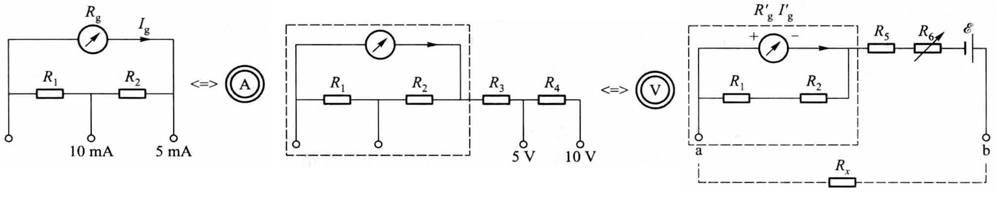
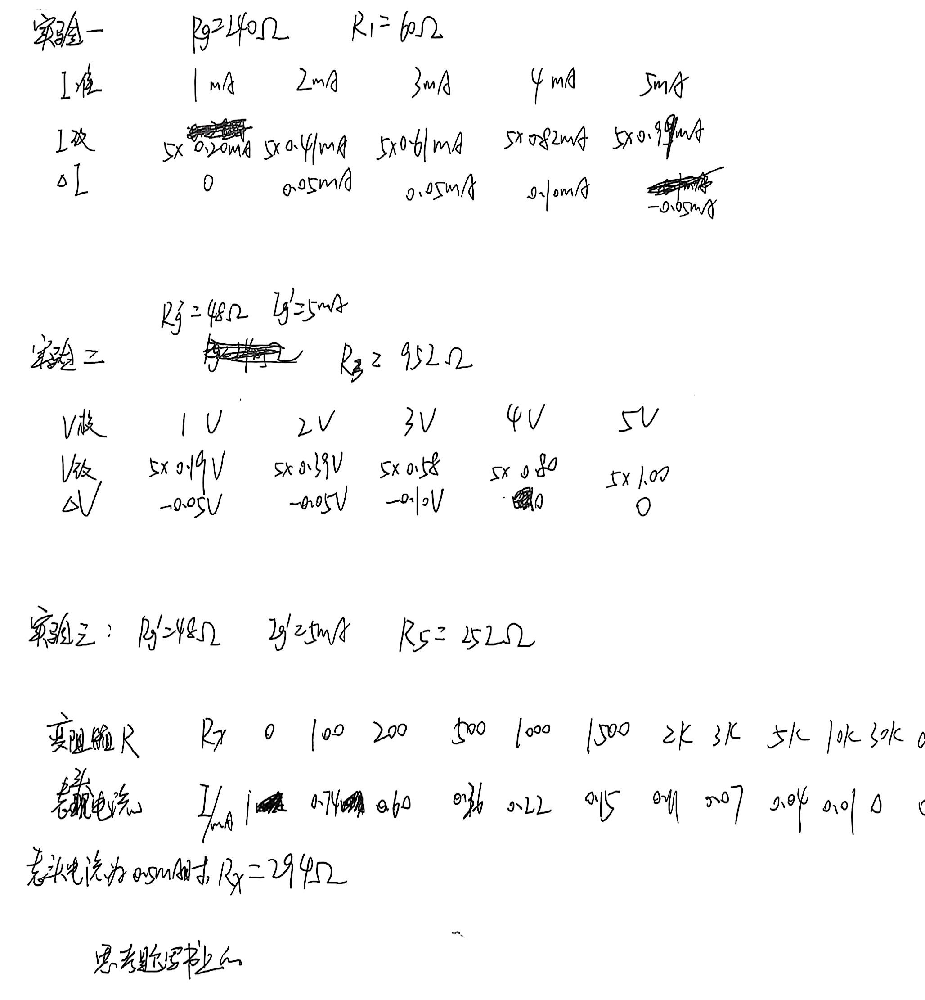
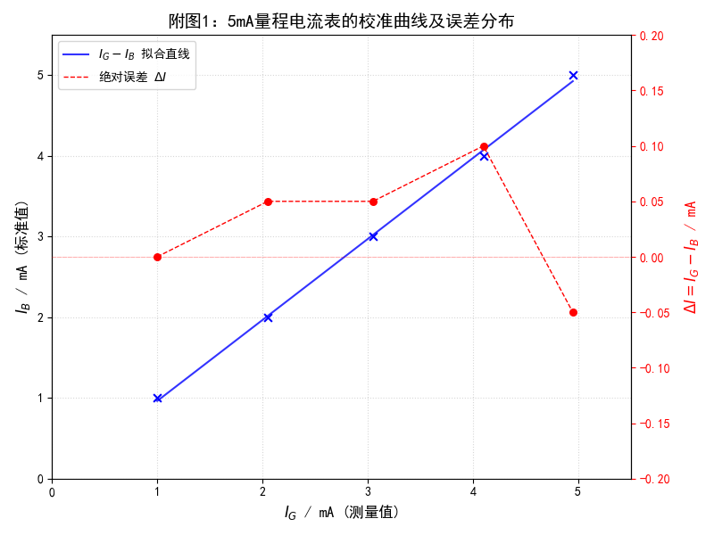
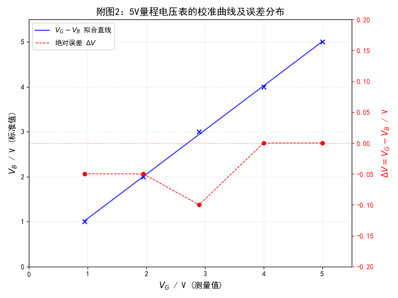
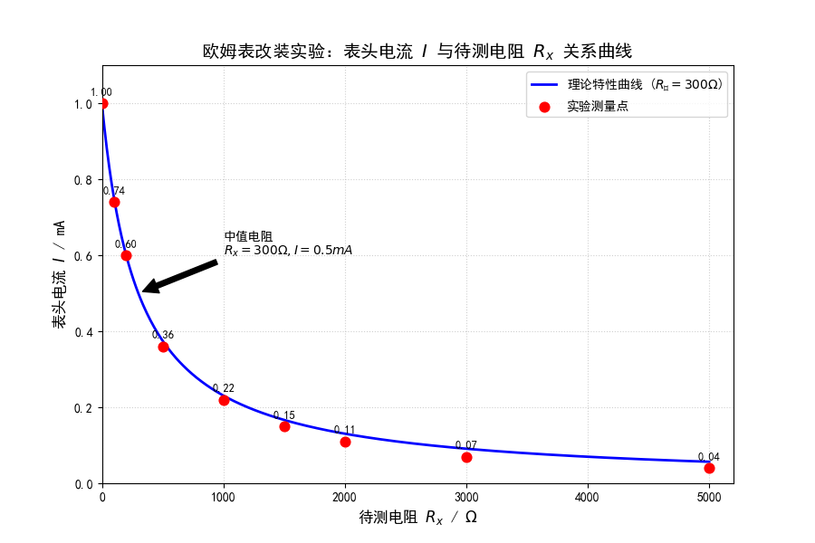
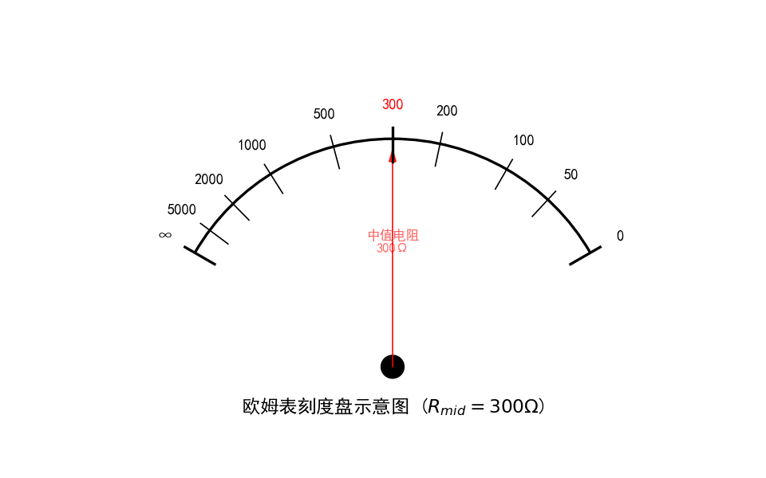

# 万用表的设计

[← 大学物理实验 · 课程心得](../../index.md) · [全部实验报告](../index.md)

- [在线打开 PDF（2.5 MB）](%E4%B8%87%E7%94%A8%E8%A1%A8%E7%9A%84%E8%AE%BE%E8%AE%A1%E5%AE%9E%E9%AA%8C%E6%8A%A5%E5%91%8A.pdf)

展开 PDF 预览

- [下载可编辑源文件与配套图片、脚本](source.zip)

数据处理脚本

- [1.py](%E6%95%B0%E6%8D%AE%E5%88%86%E6%9E%90/1.py)
- [2.py](%E6%95%B0%E6%8D%AE%E5%88%86%E6%9E%90/2.py)
- [3.py](%E6%95%B0%E6%8D%AE%E5%88%86%E6%9E%90/3.py)
- [4.py](%E6%95%B0%E6%8D%AE%E5%88%86%E6%9E%90/4.py)
- [5.py](%E6%95%B0%E6%8D%AE%E5%88%86%E6%9E%90/5.py)

---

## 一、预习报告

### 1. 实验综述

#### （1）实验现象

本实验的核心现象是磁电式电流计（表头）通电后，内部线圈在磁场中受到安培力矩作用，带动指针发生偏转。

*   **改装电流/电压表**：随着输入电流或电压的增大，指针偏转角线性增大，刻度分布均匀。
*   **改装欧姆表**：红黑表笔短接时指针满偏（对应 $0\Omega$）；接入被测电阻后指针回退；断路时指针不偏转（对应 $\infty$）。刻度呈现“反向、非均匀”的分布特征（左密右疏）。

#### （2）实验原理

*   **基本原理**：磁电式仪表偏转角 $\theta$ 与流过线圈的电流 $I$ 成正比。
*   **多量程电流表**：基于并联分流。在表头两端并联分流电阻，使大部分被测电流通过分流支路。本实验采用环形（Ayrton）分流电路，通过改变并联点实现 $5\text{mA}$ 和 $10\text{mA}$ 量程切换，计算公式涉及基尔霍夫定律。
*   **多量程电压表**：基于串联分压。在改装后的电流表基础上串联大电阻，使其分担大部分电压，从而扩展为 $5\text{V}$ 和 $10\text{V}$ 量程。
*   **欧姆表**：基于闭合电路欧姆定律。电路串联电池 $E$、表头和调零电阻。回路电流 $I_x$ 与被测电阻 $R_x$ 的关系为 $I_x = \frac{E}{R_{\text{内}} + R_x}$，通过电流值反映电阻值。

<strong>图 1 &emsp; 实验原理图（从左至右依次为多量程电流表、多量程电压表、欧姆表）</strong>

#### （3）实验方法

1.  **参数测定**：利用替代法或中值法精确测定表头的满偏电流 $I_g$ 和内阻 $R_g$。
2.  **设计与组装**：根据扩程指标计算分流电阻（$R_1, R_2$）和分压电阻（$R_3, R_4$），在面包板上利用电阻箱和开关搭建万用表电路。
3.  **校准与定标**：
    *   **电流/电压档**：采用比较法，将改装表与标准数字万用表串联（测电流）或并联（测电压），逐点对比读数，计算修正值和准确度等级。
    *   **欧姆档**：接入标准电阻箱，记录不同阻值下的电流读数，描绘 $I_x - R_x$ 曲线以制作刻度。

### 2. 实验重点

1. 掌握将磁电式微安表改装成多量程电流表、电压表及欧姆表的基本原理与电路设计方法。
2. 能够根据设计要求精确计算各分流、分压电阻的阻值。
3. 掌握改装电表的校准方法、准确度等级的确定及误差分析。

### 3. 实验难点

1. 多量程电流表分流电阻 $R_1, R_2$ 的联立方程计算与精确选取。
2. 在面包板上正确搭建电路，特别是多量程转换电路的节点连接容易出错。
3. 理解欧姆表的非线性刻度特性以及电源内阻变化对测量的影响。

## 二、原始数据

## 三、结果与分析

### 1. 数据处理与结果

#### 实验一：电流表的改装

| *I*~准~/mA     | 1    | 2    | 3    | 4    | 5     |
| -------------- | ---- | ---- | ---- | ---- | ----- |
| ***I*~改~/mA** | 0.20 | 0.41 | 0.61 | 0.82 | 0.99  |
| ***I*~测~/mA** | 1.00 | 2.05 | 3.05 | 4.10 | 4.95  |
| **Δ*I*/mA**    | 0    | 0.05 | 0.05 | 0.10 | -0.05 |

$$
R_g=240Ω，R_1=60Ω
$$

使用python作出 *I*~测~ - *I*~准~与Δ*I* 曲线，如下图

#### 实验二：电压表的改装

| *V*~准~/V     | 1     | 2     | 3     | 4    | 5    |
| ------------- | ----- | ----- | ----- | ---- | ---- |
| ***V*~改~/V** | 0.19  | 0.39  | 0.58  | 0.80 | 1.00 |
| ***V*~测~/V** | 0.95  | 1.95  | 2.90  | 4.00 | 5.00 |
| **Δ*V*/V**    | -0.05 | -0.05 | -0.10 | 0    | 0    |

$$
R_g'=48Ω，I_g'=5mA，R_2=\frac{5-R_g'I_g'}{I_g'}=952Ω
$$

使用python作出 *V*~测~ - *V*~改~与Δ*V* 曲线，如下图

#### 实验三：欧姆表的改装

| 变阻箱*R*~x~/Ω     | 0    | 100  | 200  | 500  | 1000 | 1500 | 2k   | 3k   | 5k   | 10k  | 30k  | ∞    |
| ------------------ | ---- | ---- | ---- | ---- | ---- | ---- | ---- | ---- | ---- | ---- | ---- | ---- |
| **表头电流*I*/mA** | 1    | 0.74 | 0.60 | 0.36 | 0.22 | 0.15 | 0.11 | 0.07 | 0.04 | 0.01 | 0    | 0    |

$$
R_g'=48Ω，I_g'=5mA，R_3=252Ω
$$

表头电流为0.5mA时，*R*~x~ = 294Ω，即可估计欧姆表内阻约为*R* = 294Ω
理论上，欧姆表的内阻为$R_g'+R_3=300Ω$，与测量值较为接近
使用python作出 *I* - *R*~x~ 曲线，如下图

根据图像与实验测量结果作出欧姆表刻度盘示意图如下，可以观察到欧姆表的电阻分布特征为左密右疏，即表头偏转较大时待测电阻变化对表头电流的影响较大

### 2. 误差分析

#### 1.实验一：电流表的改装

**(1) 准确度等级计算**

根据实验数据，计算最大绝对误差与量程的比值：

*   各点绝对误差 $\Delta I$ 为：$0, 0.05, 0.05, 0.10, -0.05$ (mA)
*   最大绝对误差 $|\Delta I|_{max} = 0.10\,\text{mA}$

$$
E = \frac{|\Delta I|_{max}}{I_m} \times 100\% = \frac{0.10}{5} \times 100\% = 2.0\%
$$

**结论：**
计算所得引用误差为 2.0%。根据电工仪表等级国家标准，该表满足 2.5级 仪表的要求（介于 1.5级与 2.5级之间）。

**(2) 校准后并联电阻 ($R_{cal}$) 计算**

根据并联分流公式：$U_g = U_{sh} \Rightarrow I_{g} R_g = (I_{准} - I_{g}) R_{cal}$

$$
R_{cal} = \frac{I_{g} \times R_g}{I_{准} - I_{g}}
$$

| $I_{准}$ (mA) | $I_g$ ($I_{改}$) (mA) | $R_{cal}$ 计算值 ($\Omega$) | 相对误差 (%) |
| :-----------: | :-------------------: | :-------------------------: | :----------: |
|       1       |         0.20          |          **60.00**          |    0.00%     |
|       2       |         0.41          |          **61.89**          |    3.15%     |
|       3       |         0.61          |          **61.26**          |    2.10%     |
|       4       |         0.82          |          **61.89**          |    3.15%     |
|       5       |         0.99          |          **59.25**          |    -1.25%    |

#### 2.实验二：电压表的改装

**(1) 准确度等级计算**

根据实验数据，各点绝对误差 $\Delta V$ 为：$-0.05, -0.05, -0.10, 0, 0$ (V)

*   最大绝对误差 $|\Delta V|_{max} = 0.10\,\text{V}$

$$
E = \frac{|\Delta V|_{max}}{V_m} \times 100\% = \frac{0.10}{5} \times 100\% = 2.0\%
$$

**结论：**
计算所得引用误差为 2.0%。该表符合 2.5级 仪表的要求。

**(2) 校准后串联电阻 ($R_{cal}$) 计算**

$$
R_{cal} = \frac{V_{准}}{I} - R_g' = \frac{V_{准}}{5 V_{改} \times 10^{-3}} - 48
$$

| $V_{准}$ (V) | $V_{改}$ (表头示数) | 推算电流 $I$ (mA) | $R_{cal}$ 计算值 ($\Omega$) | 相对误差 (%) |
| :----------: | :-----------------: | :---------------: | :-------------------------: | :----------: |
|      1       |        0.19         |       0.95        |         **1004.63**         |    5.53%     |
|      2       |        0.39         |       1.95        |         **977.64**          |    2.69%     |
|      3       |        0.58         |       2.90        |         **986.48**          |    3.62%     |
|      4       |        0.80         |       4.00        |         **952.00**          |    0.00%     |
|      5       |        1.00         |       5.00        |         **952.00**          |    0.00%     |

#### 3.实验三：电阻表的改装

**1. 理论值计算公式**

根据闭合电路欧姆定律，欧姆表的电流与待测电阻 $R_x$ 的关系为：

$$
I = \frac{E_0}{R_{内} + R_x}
$$

其中 $E_0 = 1.5\,\text{V}$， $R_{内} = R_g' + R_3 = 48 + 252 = 300\,\Omega$

则$ I_{理论}(\text{mA}) = \frac{1.5}{300 + R_x} \times 1000 = \frac{1500}{300 + R_x} $

下表展示了不同阻值下，实际电流（由读数还原）与理论计算电流的对比及误差分析：

| 变阻箱 $R_x$ ($\Omega$) | $I_{读}$ (记录示数) | **$I_{实}$ (实际值/mA)** | **$I_{理论}$ (计算值/mA)** | 绝对误差 $\Delta I$ (mA) | 相对误差 (%) |
| :---------------------: | :-----------------: | :----------------------: | :------------------------: | :----------------------: | :----------: |
|          **0**          |        1.00         |         **5.00**         |          **5.00**          |           0.00           |    0.00%     |
|         **100**         |        0.74         |         **3.70**         |          **3.75**          |          -0.05           |    -1.33%    |
|         **200**         |        0.60         |         **3.00**         |          **3.00**          |           0.00           |    0.00%     |
|         **500**         |        0.36         |         **1.80**         |          **1.88**          |          -0.08           |    -4.00%    |
|        **1000**         |        0.22         |         **1.10**         |          **1.15**          |          -0.05           |    -4.68%    |
|        **1500**         |        0.15         |         **0.75**         |          **0.83**          |          -0.08           |   -10.00%    |
|        **2000**         |        0.11         |         **0.55**         |          **0.65**          |          -0.10           |   -15.65%    |
|        **3000**         |        0.07         |         **0.35**         |          **0.45**          |          -0.10           |   -23.00%    |
|        **5000**         |        0.04         |         **0.20**         |          **0.28**          |          -0.08           |   -29.30%    |
|        **10000**        |        0.01         |         **0.05**         |          **0.15**          |          -0.10           |   -64.67%    |

**分析结论：**
1.  **低阻值区准确度高**：在 $0 \sim 500\,\Omega$ 范围内，实际电流与理论值吻合度极高，说明改装表的中值电阻（内阻）设计参数（$300\,\Omega$）非常准确。
2.  **高阻值区误差增大**：随着 $R_x$ 增大（尤其是超过 $1000\,\Omega$ 后），相对误差显著增加且均为负值（读数偏小）。造成此现象的主要原因包括：
    *   欧姆表刻度在左侧（高阻区）极度密集，导致读数分辨率大幅下降（即“读数误差”被放大）。
    *   随着负载电阻增大，电流减小到微安级别，表头可能存在微小的非线性或机械摩擦误差。

#### 4.误差可能的原因：

1. 磁电式电表老化，内阻可能与给定的阻值不一致，导致计算时产生误差。  
2. 电表刻度较细，读数时不易读准确，会产生一定的误差。
3. 部分导线接触不良，引起测量时电表指针的晃动，干扰读数，引起误差。  
4. 通电时间过长导致电阻发热，引起电路阻值变化，产生误差。
5. 电源电压的波动可能导致电表读数产生偏差。

### 3. 实验探讨

本实验基于分流、分压及欧姆定律原理，成功将微安表改装为多量程电流、电压及欧姆表。通过与标准表对比校准，发现改装表在中低量程及欧姆表中值附近准确度较高，但欧姆表高阻区因刻度密集导致读数误差显著。实验验证了电表扩程设计的可行性，掌握了校准与定标方法。

## 四、思考题

**1.为什么不能用万用表欧姆挡测量电源电阻？**

①欧姆档通过内部电池提供电流，测量外部电阻时，电流流过待测电阻并产生电压降。如果直接测量电源电阻，外部电源的电压会干扰万用表的内部电路，导致测量不准确甚至损坏万用表。
②电源本身具有电压，而欧姆档设计用于测量无源元件的电阻。电源电压会与万用表内部电压叠加，导致测量结果错误。
③直接测量电源电阻可能导致万用表过载，烧坏内部元件，尤其是高电压或大电流电源。因此，测量电源电阻应使用其他方法，如伏安法，避免直接使用欧姆档。

**2.为什么不能用欧姆表测量另一表头内阻？**

因为欧姆挡（尤其是倍率较小的 $R \times 1$ 或 $R \times 10$ 挡）在测量时输出的电流较大，这个电流往往大于高灵敏度微安表头（如 $50\mu\text{A}$ 或 $100\mu\text{A}$）的满偏电流 $I_g$。
如果直接测量，流过待测表头的电流会超过其承受极限，导致指针瞬间剧烈偏转（打表），可能撞弯指针甚至烧毁线圈。若必须测量，需选择高阻挡或串联保护电阻。

**3.为什么 *I*~x~ 与 *R*~x~ 为非线性关系？**

欧姆表测量时的电路电流公式为：$ I_x = \frac{E}{R_{\text{内}} + R_x} $
其中 $E$ 和 $R_{\text{内}}$ 为常数。可以看出，$I_x$ 与 $R_x$ 不是线性函数关系（$y=kx+b$），而是反比例函数关系。
当 $R_x$ 较小时，分母变化对 $I_x$ 影响较大，刻度稀疏；
当 $R_x$ 较大时，分母很大，$\Delta R_x$ 引起的 $\Delta I_x$ 很小，导致刻度密集。
