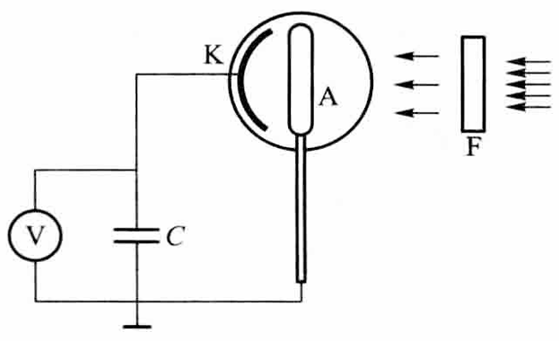
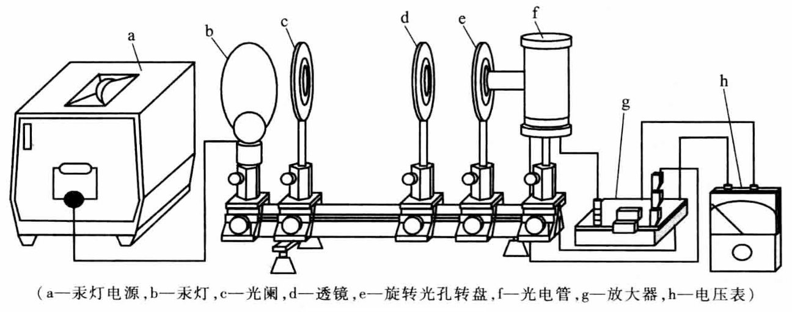
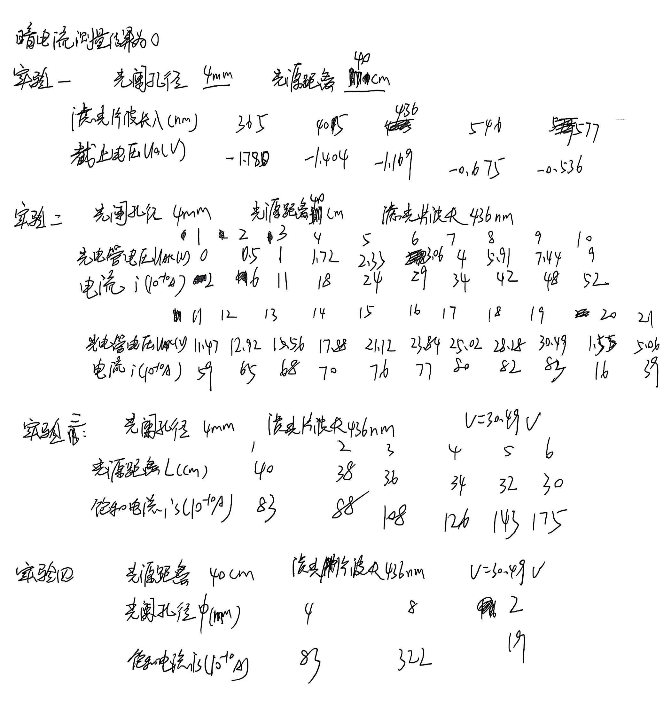
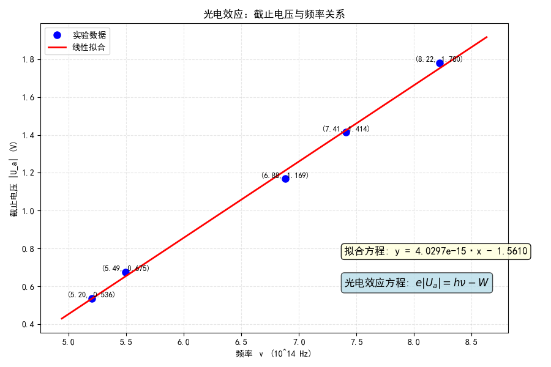
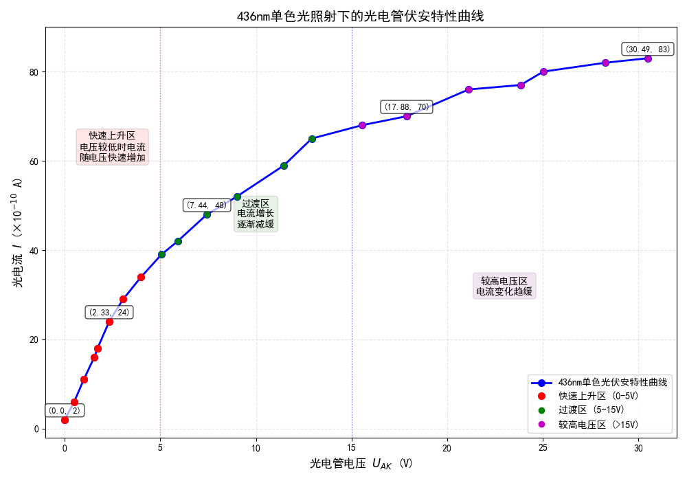
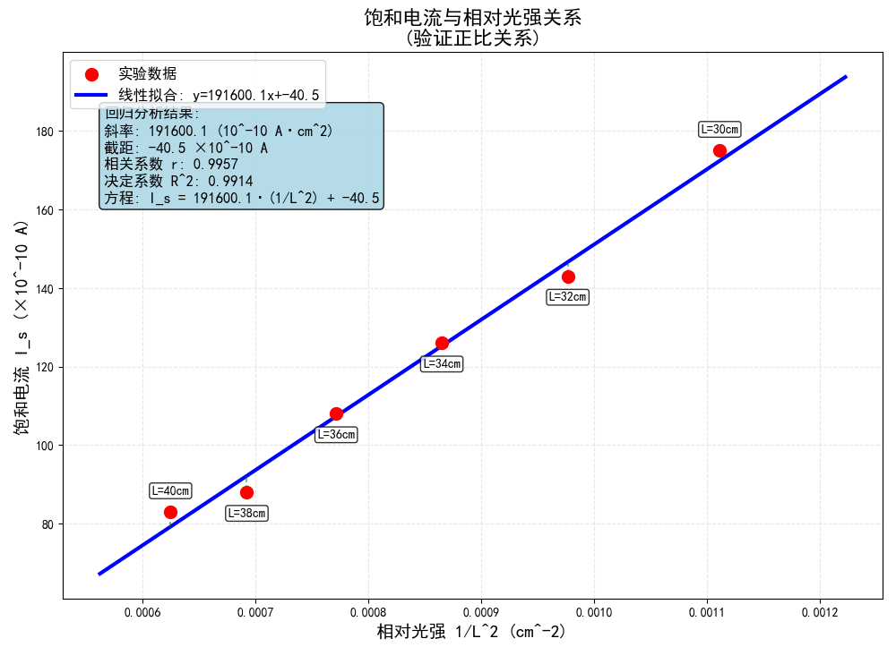
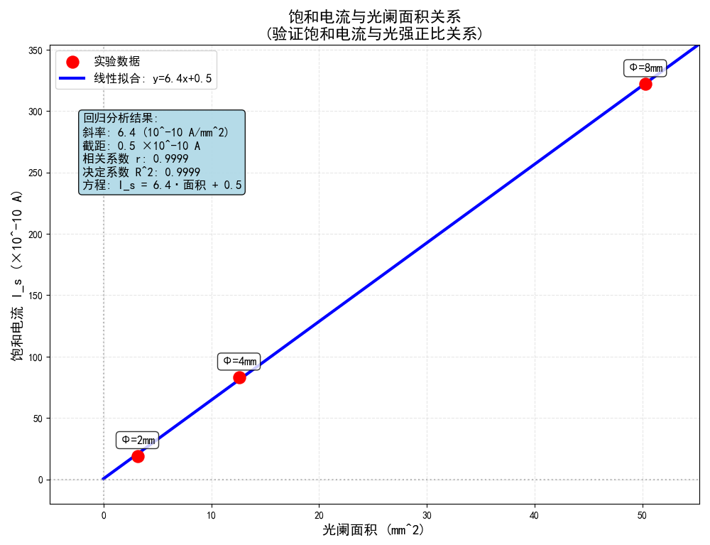

# 光电效应测量普朗克常量

[← 大学物理实验 · 课程心得](../../index.md) · [全部实验报告](../index.md)

- [在线打开 PDF（3.2 MB）](%E5%85%89%E7%94%B5%E6%95%88%E5%BA%94%E6%B5%8B%E9%87%8F%E6%99%AE%E6%9C%97%E5%85%8B%E5%B8%B8%E9%87%8F%E5%AE%9E%E9%AA%8C%E6%8A%A5%E5%91%8A.pdf)

展开 PDF 预览

- [下载markdown版可编辑源文件与配套图片、脚本](source.zip)

数据处理脚本

- [1.py](%E6%95%B0%E6%8D%AE%E5%A4%84%E7%90%86/1.py)
- [2.py](%E6%95%B0%E6%8D%AE%E5%A4%84%E7%90%86/2.py)
- [3.py](%E6%95%B0%E6%8D%AE%E5%A4%84%E7%90%86/3.py)
- [4.py](%E6%95%B0%E6%8D%AE%E5%A4%84%E7%90%86/4.py)

---

## 一、预习报告

### 1. 实验综述

#### （1）实验现象

光电效应揭示了光照射金属表面时电子逸出的特殊现象。其实验规律与经典波动理论严重矛盾：光电子发射与否取决于光频率而非光强；存在截止频率（红限）；光电子最大初动能与光频率呈线性关系，与光强无关；效应具有瞬时性（约10⁻⁹秒）。

#### （2）实验原理

爱因斯坦基于光量子假说提出光电效应方程：$hν=\frac{1}{2}mv^2+W$。其中逸出电子的最大初动能可通过减速电位法测量，当外加电压使光电流为零时，满足$eU_0=hν−W$。通过测量不同频率光对应的截止电压*U*~0~，绘制*U*~0~ - *ν*关系图，由其斜率$K=h/e$即可求出普朗克常量*h*。

<strong>图 1 &emsp; 减速电位法系统示意图</strong>

#### （3）实验方法

采用汞灯配合滤光片（365、405、436、546、577nm）产生单色光，照射真空光电管。通过精密调节反向电压，采用零电流法（交点法）测定各频率对应的截止电压，最后通过线性拟合计算普朗克常量，并与公认值比较分析实验误差。

<strong>图 2 &emsp; 实验装置示意图</strong>

### 2. 实验重点

1. 掌握光电效应的量子规律及其与经典理论的本质区别；
2. 深入理解爱因斯坦光量子理论；
3. 熟练运用减速电位法精确测定截止电压；
4. 通过数据处理求得普朗克常量，并掌握验证物理定律的实验方法。关键在于准确建立频率与截止电压的线性关系。

### 3. 实验难点

实验核心难点在于截止电压的精确测定。实际测量中受到暗电流、本底电流和阳极反向电流的多重干扰，特别是在阳极受污染时光电流特性曲线变形严重。需根据光电管特性灵活选用交点法或拐点法确定截止电压，操作中要求细致调零、严格控制杂散光，并合理处理实验数据以减小系统误差。

## 二、原始数据

## 三、结果与分析

### 1. 数据处理与结果

#### （1）使用不同滤光片，测量截止电压

<strong>表 1 &emsp; 实验一数据记录</strong>

<strong>光阑孔径4mm&emsp;&emsp;光源距离40cm</strong>

| 滤光片波长*λ*(nm)     | 365    | 405    | 436    | 546    | 577    |
| --------------------- | ------ | ------ | ------ | ------ | ------ |
| **截止电压*U*~a~(V)** | -1.780 | -1.414 | -1.169 | -0.675 | -0.536 |

使用python程序对实验数据进行线性拟合，作出的图像如下。

<strong>图 3 &emsp; 实验1拟合方程</strong>

方程表达式为 $y=4.0297×10^{-15} x - 1.5610$
其中斜率 k =  4.0297×10^-15^V/Hz，截距 b = -1.5610V
结合光电效应方程 $e\lvert U_a\rvert=hv-W$ 得

$$
\frac{h}{e}= k = 4.0297×10^{-15}\text{V/Hz}$$，$$\frac{W}{e} = -b = 1.5610\text{V}
$$

其中 e 为一个电子的电荷量绝对值，$e=-1.602176634×10^{-19}\text{C}$
则最终计算得$h=6.46×10^{-34}\text{J·s}$，$W=2.50×10^{-19}\text{J}$
计算该直线与x轴的交点，得红限频率$v_0=3.87×10^{-14}\text{Hz}$
斜率的标准偏差$σ_k=1.29×10^{-16}\text{V/Hz}$，截距的标准偏差$σ_b=0.087\text{V}$
则普朗克常量的标准偏差$σ_h=2.06×10^{-35}\text{J·s}$，功函数的标准偏差$σ_W=1.39×10^{-20}\text{J}$，红限频率的标准偏差$σ_{v_0}=2.48×10^{13}\text{Hz}$

**不确定度的计算见误差分析部分**

#### （2）使用不同滤光片，测量在单色光照射下的光电效应伏安特性曲线

<strong>表 2 &emsp; 实验二数据记录</strong>

<strong>光阑孔径4mm&emsp;&emsp;光源距离40cm&emsp;&emsp;滤光片波长436nm</strong>

| 编号 | 光电管电压*U*~AK~(V) | 电流 *i* (10^-10^A) |
| ---- | -------------------- | ------------------- |
| 1    | 0.00                 | 2                   |
| 2    | 0.5                  | 6                   |
| 3    | 1.00                 | 11                  |
| 4    | 1.55                 | 16                  |
| 5    | 1.72                 | 18                  |
| 6    | 2.33                 | 24                  |
| 7    | 3.06                 | 29                  |
| 8    | 4.00                 | 34                  |
| 9    | 5.06                 | 39                  |
| 10   | 5.91                 | 42                  |
| 11   | 7.44                 | 48                  |
| 12   | 9.00                 | 52                  |
| 13   | 11.47                | 59                  |
| 14   | 12.92                | 65                  |
| 15   | 15.56                | 68                  |
| 16   | 17.88                | 70                  |
| 17   | 21.12                | 76                  |
| 18   | 23.84                | 77                  |
| 19   | 25.02                | 80                  |
| 20   | 28.28                | 82                  |
| 21   | 30.49                | 83                  |

使用python程序绘制该波长单色光照射下的伏安特性曲线如下。

<strong>图 4 &emsp; 436nm单色光照射下的伏安特性曲线</strong>

观察图像，我们发现，随着*U*~AK~增大，光电流也不断增大，且增速有减缓的趋势。当*U*~AK~达到30V时，光电流仍未饱和。

#### （3） 在单色光照射下，探究光电管饱和光电流和光源距离的关系

<strong>表 3 &emsp; 实验三数据记录</strong>

<strong>光阑孔径4mm&emsp;&emsp;滤光片波长436nm&emsp;&emsp;V=30.49V</strong>

| 光源距离*L*(cm)                | 30   | 32   | 34   | 36   | 38   | 40   |
| ------------------------------ | ---- | ---- | ---- | ---- | ---- | ---- |
| **饱和电流 *i*~s~ (10^-10^A)** | 175  | 143  | 126  | 108  | 88   | 83   |

已知光强与距离的平方成反比，因此需要验证饱和电流与1/*L*^2^成正比关系，我们使用python程序绘制光电管饱和电流与1/*L*^2^的关系图如下。

<strong>图 5 &emsp; 饱和电流与1/L²的拟合方程</strong>

观察图像，我们发现饱和电流 *I~s~* 与1/*L*^2^基本成正比，而1/*L*^2^与光强成正比，即验证了光电管饱和电流与光强的正比关系。

#### （4）在单色光照射下，探究光电管饱和光电流和光阑孔径大小的关系

<strong>表 4 &emsp; 实验四数据记录</strong>

<strong>光阑孔径4mm&emsp;&emsp;光源距离40cm&emsp;&emsp;V=30.49V</strong>

| 光阑孔径Φ(mm)                  | 2    | 4    | 8    |
| ------------------------------ | ---- | ---- | ---- |
| **饱和电流 *i*~s~ (10^-10^A)** | 19   | 83   | 322  |

对于点光源，照射到光电管上的光强与光阑面积成正比（因为距离固定），而光阑面积与孔径直径的平方Φ^2^成正比。因此需要验证饱和电流与Φ^2^成正比关系，我们使用python程序绘制光电管饱和电流与Φ^2^的关系图如下。

<strong>图 5 &emsp; 饱和电流与Φ²的拟合方程</strong>

观察图像，我们发现饱和电流 *I~s~* 与Φ^2^基本成正比，而Φ^2^与光强成正比，即验证了光电管饱和电流与光强的正比关系。

### 2. 误差分析

#### （1）实验一误差分析

已知普朗克常量的标准偏差$σ_h=2.06×10^{-35}\text{J·s}$，功函数的标准偏差$σ_W=1.39×10^{-20}\text{J}$，红限频率的标准偏差$σ_{v_0}=2.48×10^{13}\text{Hz}$，这些即为对应结果的A类不确定度$u_{hA}$，$u_{WA}$和$u_{v_0A}$。

仪器误差为3%，则$u_{hB}=\frac{\Delta \text{仪}}{\sqrt{3}} h_{\text{测量}}= 1.12×10^{-35}\text{J·s}$，$u_{WB}=\frac{\Delta \text{仪}}{\sqrt{3}} W_{\text{测量}}= 0.43×10^{-20}\text{J}$，$u_{v_0B}=\frac{\Delta \text{仪}}{\sqrt{3}} {v_0}_{\text{测量}}= 0.67×10^{13}\text{Hz}$

则$u_h = \sqrt{u_{hA}^2 + u_{hB}^2}=2.34×10^{-35}\text{J·s}$，$u_W = \sqrt{u_{WA}^2 + u_{WB}^2}=1.45×10^{-20}\text{J}$，$u_{v_0} = \sqrt{u_{v_0A}^2 + u_{v_0B}^2}=2.57×10^{13}\text{Hz}$

普朗克常量的公认值为$h=6.62607015×10^{-34} \text{J·s}$，则相对不确定度$E=\frac{\lvert {h_{\text{测量}}}-{h_{\text{公认}}}\rvert}{{h_{\text{公认}}}}×100\%=2.5\%$

#### （2）误差原因分析

1. 电表读数不稳定，时常跳动，带来读数误差。
2. 光源光强受多因素影响，存在上下浮动，造成误差。
3. 环境光可能照射到光电管上，对实验造成干扰。
4. 滤色片实际透过的波长与标称值存在误差，影响普朗克常数计算。
5. 光电管阳极存在少量低逸出功的阴极材料，产生少量反向电流（β电极光电流），影响遏止电压的测量。
6. 在探究光电管饱和光电流和光阑孔径大小的关系的实验中，取值点只有3个，难以得出确切结论，测量误差大，容易产生偶然误差。

### 3. 实验探讨

本实验成功验证了爱因斯坦光电效应方程。通过截止电压与光频率的线性关系，测得普朗克常数 h=6.46×10⁻³⁴ J·s，相对误差为2.5%
同时验证了饱和电流与1/L²及光阑面积的正比关系，进一步证实了光电流与光强的线性规律，实验结果与理论预期高度吻合。

## 四、思考题

**1．测定普朗克常数的关键是什么？怎样根据光电管的特性曲线选择适宜的测定遏止电压*U*~a~的方法。**

测定普朗克常数的关键是准确测量不同频率光对应的截止电压 *U*a。根据光电管的伏安特性曲线，若曲线在 *U*a 附近变化陡峭、暗电流小，宜采用“交点法”（即电流为零时的电压）；若曲线变化平缓或存在反向电流，则宜采用“拐点法”（即曲线拐点处对应的电压），以减小测量误差。

**2．从遏止电压与入射光的频率的关系曲线中，你能确定阴极材料的逸出功吗？**

可以确定。根据爱因斯坦光电效应方程$e U_a=hv-W$，在遏止电压 *U*a 与频率 *ν* 的关系曲线中，拟合直线的截距的绝对值乘以电子电荷量 *e* 即为阴极材料的逸出功 *W*。本实验求得逸出功 *W*=2.50×10^−19^ J。

**3．本实验存在哪些误差来源？实验中如何解决这些问题？**

主要误差来源包括：① 电表读数不稳定；② 光源光强波动；③ 环境杂散光干扰；④ 滤光片波长标称误差；⑤ 光电管反向电流。
解决方法：① 多次测量取平均值；② 稳定电源并预热光源；③ 暗室操作或加遮光罩；④ 使用高精度滤光片并校准；⑤ 选用高质量光电管或采用补偿电路减小反向电流影响。
