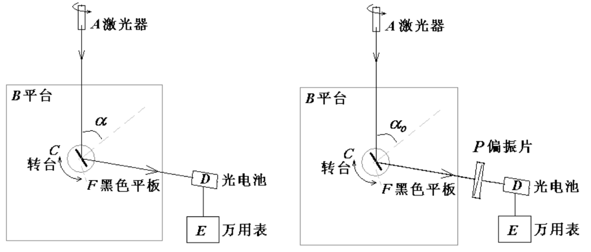
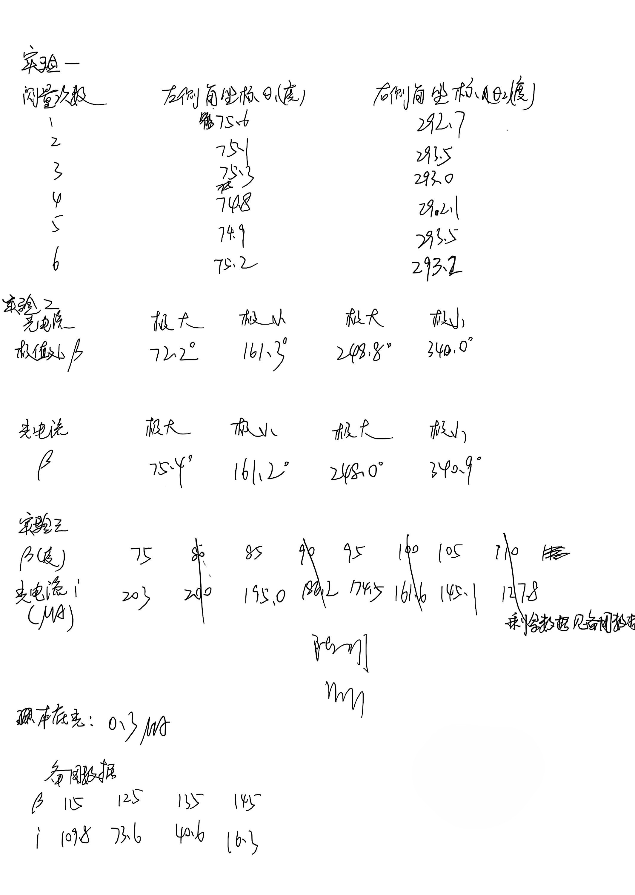
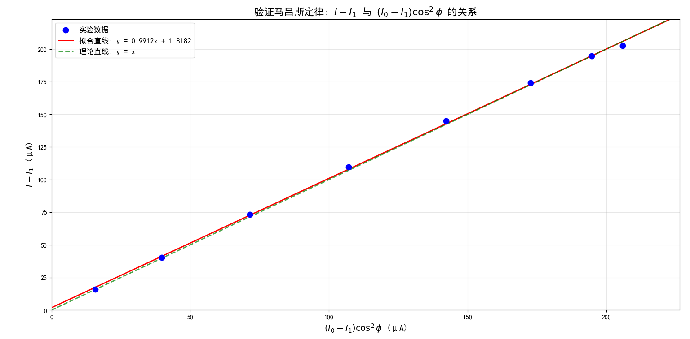

# 光的偏振应用研究

[← 大学物理实验 · 课程心得](../../index.md) · [全部实验报告](../index.md)

- [在线打开 PDF（1.9 MB）](%E5%85%89%E7%9A%84%E5%81%8F%E6%8C%AF%E5%BA%94%E7%94%A8%E7%A0%94%E7%A9%B6%E5%AE%9E%E9%AA%8C%E6%8A%A5%E5%91%8A.pdf)

展开 PDF 预览

- [下载markdown版可编辑源文件与配套图片、脚本](source.zip)

数据处理脚本

- [1.py](%E6%95%B0%E6%8D%AE%E5%88%86%E6%9E%90/1.py)

---

## 一、预习报告

### 1. 实验综述

#### 1)实验现象

在实验过程中，当转动偏振片或改变入射角时，可以观察到反射光强和透射光强发生明显变化，同时光电流读数也随之改变。特别地，当入射角达到布儒斯特角时，反射光强达到最小值，此时反射光为完全线偏振光，其光矢量振动方向垂直于入射面。

#### 2)实验原理

本实验基于光的偏振特性。当自然光以布儒斯特角入射到介质界面时，反射光变为线偏振光，其光矢量垂直于入射面；如果入射光本身就是平行于入射面的线偏振光，则在此角度下反射光强为零。通过测量布儒斯特角 *α₀*，可以计算出介质的折射率 *n = tanα₀*。同时，根据马吕斯定律 *I = I₀cos²ϕ*，线偏振光通过偏振片后的光强与偏振片透光轴和光矢量夹角有关，这为我们研究光强与光电流关系提供了理论基础。

<strong>实验原理及实验装置示意图</strong>

#### 3)实验方法

1. 测量黑色平板折射率：通过转动平台和光电池测量反射光最弱时的角位置，计算布儒斯特角，进而求得折射率。同时通过旋转偏振片并记录光电流极值对应的角坐标，确定偏振片偏振化方向与指针的夹角。
2. 实验研究光电池的光电流与入射光强之间的关系：利用偏振片旋转改变入射光强，记录光电流与*cos²ϕ* 的关系，验证马吕斯定律。
3. 线偏振光入射黑色平板时，测量其反射率：通过比较入射与反射光电流，绘制反射率随入射角变化曲线。

### 2. 实验重点

本实验的重点在于掌握布儒斯特角的精确测量方法，通过双侧测量取平均来减小系统误差，从而准确计算黑色平板的折射率。同时，需要深入理解马吕斯定律的物理意义，通过实验数据验证光电流与光强的线性关系，掌握偏振光学的基本测量技术。

### 3. 实验难点

实验的主要难点在于光路的精细调节和角度的准确读数。需要确保激光精确通过转台中心轴并垂直入射样品表面。此外，反射光强极值点的判断容易受到环境本底光和仪器灵敏度的影响，偏振片偏振化方向的标定也需要耐心进行多次测量以减少随机误差。

## 二、原始数据

## 三、结果与分析

### 1. 数据处理与结果

#### （1）测量黑色平板折射率

<strong>表 1 &emsp; 实验一数据记录</strong>

| 测量次数 | 左侧角坐标θ~1~（度） | 右侧角坐标θ~2~（度） | 布儒斯特角θ（度） |
| -------- | -------------------- | -------------------- | ----------------- |
| 1        | 75.6                 | 292.7                | 54.275            |
| 2        | 75.1                 | 293.5                | 54.6              |
| 3        | 75.3                 | 293.0                | 54.425            |
| 4        | 74.8                 | 292.1                | 54.325            |
| 5        | 74.9                 | 293.5                | 54.65             |
| 6        | 75.2                 | 293.2                | 54.5              |

根据布儒斯特角计算公式$θ= \frac{ \lvert θ_1 - θ_2\rvert} {4}$ 得到每一次测量的θ~i~（i=1，2，3，4，5，6）

则最终得到的布儒斯特角的值为

$$
\bar{θ} = \frac{\overset{6}{\underset{i=1}{\sum}} θ_i}{6} ≈ 54.46°
$$

黑色平板的折射率 $n=tan\bar{θ}≈1.40$ 

#### （2）测量偏振片的偏振化方向角度

<strong>表 2 &emsp; 实验二数据记录</strong>

| 光电流             | 极大值 | 极小值 | 极大值 | 极小值 | 极大值 | 极小值 | 极大值 | 极小值 |
| ------------------ | ------ | ------ | ------ | ------ | ------ | ------ | ------ | ------ |
| **极值处*β***      | 72.2°  | 161.3° | 248.8° | 340.0° | 75.4°  | 161.2° | 248.0° | 340.9° |
| **等效角坐标*Δβ*** | 72.2°  | 71.3°  | 68.8°  | 70.0°  | 75.4°  | 71.2°  | 68.0°  | 70.9°  |

$$
\bar{β} = \frac{\overset{8}{\underset{i=1}{\sum}} β_i}{8} ≈ 71.0°
$$

#### （3）光电流和光强的关系（验证马吕斯定律）

| 角坐标β            | 75°  | 85°   | 95°   | 105°  | 115°  | 125° | 135° | 145° |
| ------------------ | ---- | ----- | ----- | ----- | ----- | ---- | ---- | ---- |
| ***ϕ=β−Δβ***       | -4°  | -14°  | -24°  | -34°  | -44°  | -54° | -64° | -74° |
| **光电流 *I*(μA)** | 203  | 195.0 | 174.5 | 145.1 | 109.8 | 73.6 | 40.6 | 16.3 |

本底光电流 *I~1~* = 0.3μA
取 *ϕ* = 0°时的光电流值为 *I~0~*，作出 *I - I~1~* 与(*I~0~ - I~1~*)cos²*ϕ*关系的图像:

可见，*I - I~1~* 与 (*I~0~-I~1~*) cos²*ϕ* 在误差允许的范围内成线性关系。

结合马吕斯定律 $cos²ϕ ∝ \frac {1}{I_0} $，又因为 *I~0~* 是定值，我们得出结论：

光电流 *I - I~1~* 与入射光强*I~0~ - I~1~*成线性关系。

### 2. 误差分析

#### （一）实验一不确定度计算

$$
u_{θA} = \sqrt{\frac{\overset{6}{\underset{i=1}{\sum}} (θ_i - \bar{θ})^2}{6 \times 5}} ≈ 0.06°
$$

$$
u_{θB} = \frac{\Delta \text{仪}}{\sqrt{3}} = \frac{0.05}{\sqrt{3}} ≈ 0.029 °
$$

$$
u_θ = \sqrt{u_{θA}^2 + u_{θB}^2} ≈ 0.07 °
$$

$$
θ = (54.46 \pm 0.07)°
$$

#### （二）实验二不确定度计算

$$
u_{βA} = \sqrt{\frac{\overset{8}{\underset{i=1}{\sum}} (β_i - \bar{β})^2}{8 \times 7}} ≈ 0.8°
$$

$$
u_{βB} = \frac{\Delta \text{仪}}{\sqrt{3}} = \frac{0.05}{\sqrt{3}} ≈ 0.029 °
$$

$$
u_β = \sqrt{u_{βA}^2 + u_{βB}^2} ≈ 0.08°
$$

$$
β = (71.0 \pm 0.8)°
$$

#### （三）误差分析

1. 在测量布儒斯特角实验中，读取角度 θ₁ 和 θ₂ 是由旋臂一致的刀口读出，由于旋臂有宽度，因此刀口处该数与实际的角度 θ’₁、θ’₂ 相差一个固定的角度Δθ。
   即Δθ₁＝θ′₁－θ₁，Δθ₂=θ′₂－θ₂。
   而我们计算的$θ= \frac{ \lvert θ_1 - θ_2\rvert} {4}$，消除了Δθ产生的误差。
2. 由于环境光稳定性变化，因此角度和光电能的测量都可能存在偏差。
3. 在实验二中，有时我们将偏振片指针在一定范围（约3.0°）内转动时，光电流示数不变。这是因为精度不够（如万用表有效位数较小），可能会使得Δβ的测量存在误差。

### 3. 实验探讨

本次实验通过光的偏振特性，利用反射光强极值精确测定布儒斯特角，成功计算出黑色平板的折射率。同时验证了马吕斯定律，证实光电流与光强呈线性关系。实验加深了对偏振光学原理的理解，掌握了光电转换测量技术。

## 四、思考题

**1.请简述减小实验误差的方法。**

1. 增加测量次数取平均值，减小随机误差；
2. 在暗室环境中实验，消除环境杂散光干扰；
3. 精确调节光路，确保激光通过转台中心轴；
4. 采用双侧读数法，消除系统偏心差；
5. 使用更高精度的测量仪器。

**2.如何调节激光通过转台的中心转轴？**

首先调节激光器后的旋钮，使激光束大致对准转台中心。然后缓慢转动转台，观察激光光斑在黑色平板上的位置变化。如果光斑位置保持不变，说明激光已通过中心转轴；如果光斑移动，则微调激光器位置直至光斑固定。

**3.在探究光电流与光照强度关系时背景光照的影响是怎样的？**

背景光照会产生固定的本底光电流，但通过测量并扣除本底值 *I₁* 可消除其影响。实验中只要保证背景光稳定，且反射光能正常通过偏振片入射到光电池，就不会影响光电流与 *cos²ϕ* 的线性关系验证。
