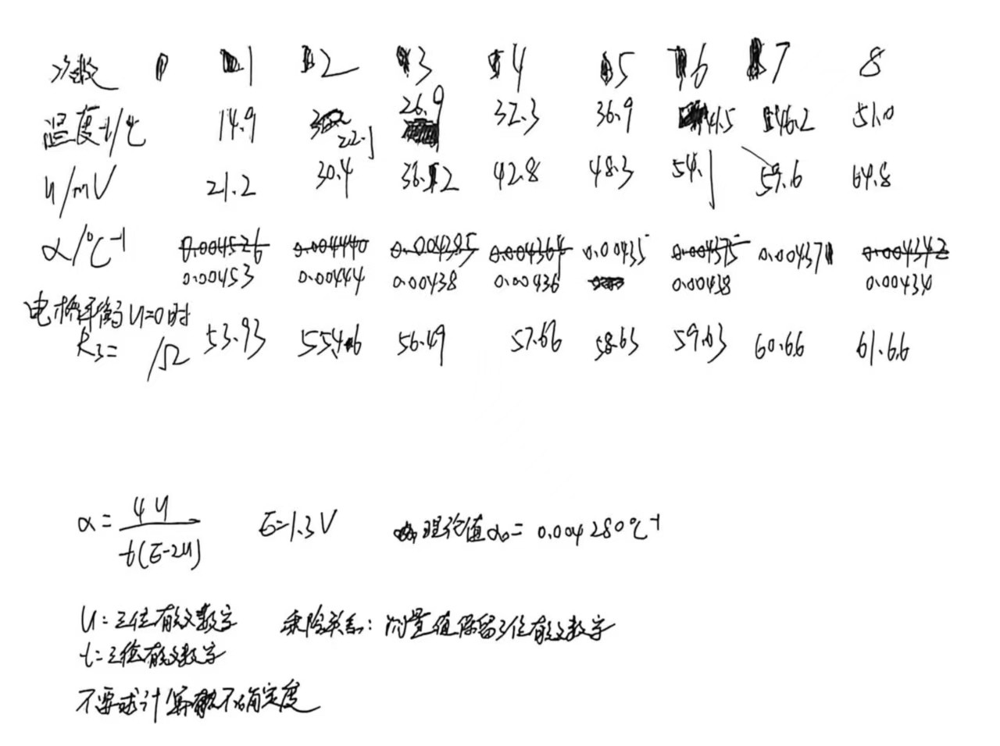
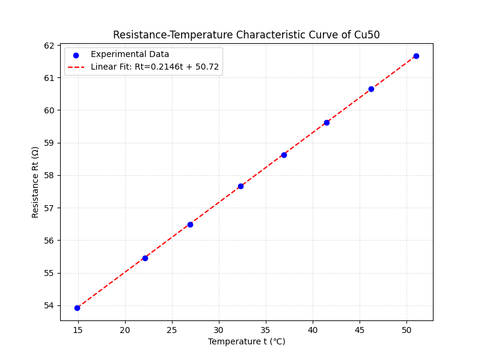

# 非平衡电桥

[← 大学物理实验 · 课程心得](../../index.md) · [全部实验报告](../index.md)

- [在线打开 PDF（1.5 MB）](%E9%9D%9E%E5%B9%B3%E8%A1%A1%E7%94%B5%E6%A1%A5%E5%AE%9E%E9%AA%8C%E6%8A%A5%E5%91%8A.pdf)

展开 PDF 预览

- [下载markdown版可编辑源文件与配套图片、脚本](source.zip)

数据处理脚本

- [1.py](%E6%95%B0%E6%8D%AE%E5%A4%84%E7%90%86/1.py)

---

## 一、预习报告

### 1. 实验综述

#### 1. 实验现象

惠斯登电桥在四个桥臂电阻满足特定比例关系时处于平衡状态，输出电压为零。当作为桥臂之一的金属热电阻（如铜电阻 Cu50）受到温度变化影响，其阻值发生改变，导致电桥失去平衡。此时，电桥输出端会产生一个微小的电压信号，该电压信号的大小与电阻的变化量（即温度的变化）存在对应关系。

#### 2. 实验原理

本实验基于惠斯登电桥电路。

**平衡条件**：当 $R_1 R_3 = R_2 R_x$ 时，电桥平衡，输出电压 $U = 0$。

**非平衡输出**：保持 $R_1, R_2, R_3$ 固定不变，当待测电阻 $R_x$ 随温度变化产生增量 $\Delta R_x$ 时，电桥输出电压 $U$ 为：$U = \frac{R_2(R_x + \Delta R_x) - R_1 R_3}{(R_1 + R_x + \Delta R_x)(R_2 + R_3)} E$

**温度系数测量**：已知铜电阻在室温范围内呈线性温阻特性 $R_t = R_0(1+\alpha t)$。若预设 $R_1=R_2=R_3=R_0$（等臂电桥），则可推导出电阻温度系数 $\alpha$ 的计算公式：$\alpha = \frac{4U}{t(E-2U)}$
其中 $E$ 为电桥工作电源电压（实验中 $E \approx 1.3V$），$t$ 为摄氏温度，$U$ 为非平衡电压。

<strong>图 1 &emsp; 实验电路图</strong>

#### 3. 实验方法

利用FQJ型非平衡直流电桥和温控加热装置进行实验：

1. **测温度系数**：将功能开关置于“非平衡电压”档，按原理图接线。设置 $R_1=R_2=R_3=50\Omega$（对应 Cu50 在 $0^\circ C$ 阻值），调零后加热铜电阻，每隔 $5^\circ C$ 记录非平衡电压 $U$ 和温度 $t$，利用公式计算 $\alpha$。
2. **描绘特性曲线**：将功能开关置于“平衡5V”档。加热过程中，每隔 $5^\circ C$ 调节比较臂电阻使电桥重新平衡，直接读取此时的电阻值 $R_t$，绘制 $R_t - t$ 特性曲线并与理论值对比。

### 2. 实验重点

1. 掌握非平衡直流电桥将电阻变化转化为电压输出的工作原理及测量方法；
2. 通过实验测量金属材料（铜电阻 Cu50）的温阻特性，利用非平衡电压数据准确计算电阻温度系数，并验证其线性关系。

### 3. 实验难点

1. **热平衡的控制**：加热过程中存在热惯性，需等待温度读数稳定且铜电阻与传感器达到热平衡后方可读数，否则会引入较大误差。
2. **数据处理与公式理解**：非平衡输出电压公式推导较为复杂，需准确理解公式中各参数（特别是电源电压 $E$ 和初始阻值 $R_0$）的物理意义及代入计算。

## 二、原始数据

## 三、结果与分析

### 1. 数据处理与结果

实验中的总电压 $E=1.3\text{V}$，温度系数的理论值 $\alpha_0=0.004280\text{℃}^{-1}$
实验一测得的温度 $t$，非平衡电压 $U$，由公式$\alpha = \frac{4U}{t(E-2U)}$ 得到的 $\alpha$，以及实验二测得的电桥平衡($U=0$)时的 $R_3$ 如下表所示：

| 次数                | 1     | 2     | 3     | 4     | 5     | 6     | 7     | 8     |
| ------------------- | ----- | ----- | ----- | ----- | ----- | ----- | ----- | ----- |
| **温度 *t*/℃**      | 14.9  | 22.1  | 26.9  | 32.3  | 36.9  | 41.5  | 46.2  | 51.0  |
| ***U*/mV**          | 21.2  | 30.4  | 36.2  | 42.8  | 48.3  | 54.1  | 59.6  | 64.8  |
| ***α*/10^-3^℃^-1^** | 4.53  | 4.44  | 4.38  | 4.36  | 4.35  | 4.38  | 4.37  | 4.34  |
| ***U*=0时*R*~3~/Ω** | 53.93 | 55.46 | 56.49 | 57.66 | 58.63 | 59.63 | 60.66 | 61.66 |

**实验一：用非平衡电桥测铜电阻（Cu50）温度系数**
平均值 $\bar{α} = \frac{\overset{8}{\underset{i=1}{\sum}} α_i}{8} = 4.39 \times 10^{-3} \text{℃}^{-1}$
相对误差 $E=\frac{\lvert {\bar{α}}-{α_0}\rvert}{{α_0}}×100\% = 2.57\%$

**实验二：用平衡电桥描绘铜电阻（Cu50）温度特性曲线**
利用 Python 生成 $R_3 - t$ 特性曲线如下：

拟合直线方程为 $R_t = 0.2146t + 50.72$ ，则斜率 $k=0.2146$，截距 $b=50.72$
由 $R_t = R_0(1 + \alpha t)$ 得 $α = \frac{k}{b} = 4.23 \times 10^{-3} \text{℃}^{-1}$
相对误差 $E=\frac{\lvert {α}-{α_0}\rvert}{{α_0}}×100\%= 1.16\%$

### 2. 误差分析

用非平衡电桥以逐差法计算得的结果的相对误差 $E_1=\frac{\lvert {\bar{α}}-{α_0}\rvert}{{α_0}}×100\%= 2.57\%$ ，用平衡电桥以作图法计算得的结果的相对误差 $E_2=\frac{\lvert {α}-{α_0}\rvert}{{α_0}}×100\%= 1.16\%$ ，由此可见平衡电桥法的准确性较高。

#### 误差原因分析：

1.  在加热过程中，温度计测量的往往是介质（如水或油）的温度，而铜棒内部温度的变化具有热惯性，导致记录的温度与导体实际温度存在偏差。此外，温控装置内若搅拌不充分，会存在温度梯度。
2.  非平衡电桥的输出电压 $U$ 直接依赖于电源电压 $E$。实验中假定 $E=1.3\text{V}$ 恒定，但实际电源可能有波动或内阻分压，导致非平衡法（实验一）误差较大。相比之下，平衡电桥法（实验二）是零示法，测量结果与电源电压波动无关。
3.  在极小电流下检流计指针可能不偏转，导致电桥平衡点的判断存在死区。此外，手动调节平衡时可能存在人为读数或调节误差。
4.  由于电路中存在不同金属的接线柱和接触点，且处于不同温度下，可能会产生微弱的温差电动势叠加在测量信号上。同时接线处的接触电阻虽然很小，但在高精度测量中仍可能引入误差。

### 3. 实验探讨

本次实验通过两种方法测量了Cu50的温度系数。非平衡电桥法能够将电阻变化实时转化为电压信号，适合动态测量，但受电源稳定性影响较大；平衡电桥法精度更高，结果更接近理论值，但操作繁琐，仅适用于静态测量。实验验证了铜电阻在常温区良好的线性温阻特性。

## 四、思考题

**1. 从结构或原理角度讲解一下非平衡电桥与平衡电桥的区别。**

**原理区别**：平衡电桥（如惠斯登电桥）通过调节桥臂电阻，使通过检流计的电流为零（$I_g=0$），此时电桥处于平衡状态，利用电阻比例关系计算待测电阻；非平衡电桥则保持桥臂电阻固定，当待测电阻变化时，电桥失去平衡，通过测量输出端的非平衡电压 $U$ 来反推电阻的变化量。

**结构区别**：平衡电桥通常包含一个可调电阻臂和一个检流计（或零位指示器）；非平衡电桥通常桥臂固定，输出端接高阻抗电压表或放大电路，不需要反复调节平衡。

**2. 非平衡电桥与平衡电桥，分别适用于哪些电学量的测量或仪器的应用。**

**平衡电桥**：适用于测量固定或变化极其缓慢的电阻，测量精度高，且测量结果与电源电压波动无关。常用于实验室精密电阻测量、标准电阻标定等场合。

**非平衡电桥**：适用于测量连续变化的物理量（如温度、压力、应变等），能够将非电量的变化（转化为电阻变化后）实时转换为电压信号输出，便于进行自动记录和控制。常用于工业自动化控制中的传感器电路（如热敏电阻测温、应变片测力）。
