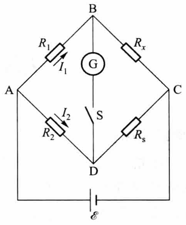
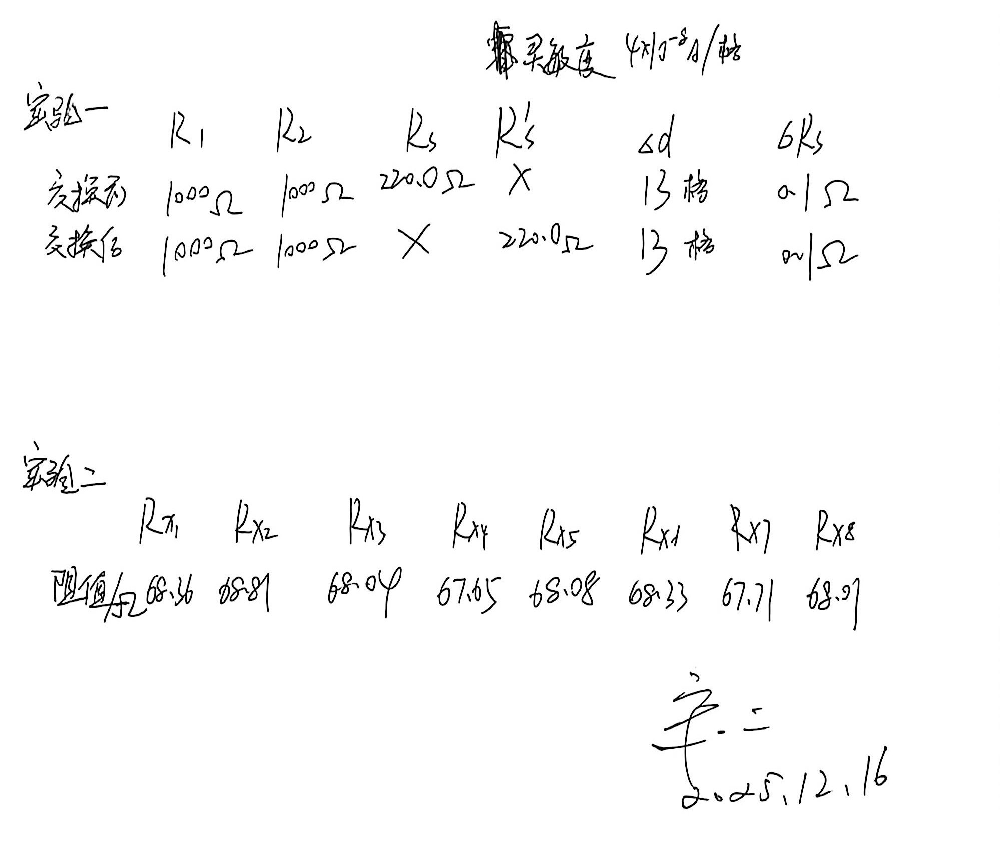

# 惠斯登电桥

[← 大学物理实验 · 课程心得](../../index.md) · [全部实验报告](../index.md)

- [在线打开 PDF（2.6 MB）](%E6%83%A0%E6%96%AF%E7%99%BB%E7%94%B5%E6%A1%A5%E5%AE%9E%E9%AA%8C%E6%8A%A5%E5%91%8A.pdf)

展开 PDF 预览

- [下载markdown版可编辑源文件与配套图片、脚本](source.zip)

---

## 一、预习报告

### 1. 实验综述

**1. 实验现象**
在搭建好的电桥电路中，接通电源后，检流计指针通常会发生偏转。通过调节比较臂电阻 $R_S$ 的阻值，观察检流计指针的偏转情况。当调节到某一特定阻值时，检流计指针指零（即流过检流计的电流 $I_g = 0$），此时电桥达到平衡状态。若改变电路中微小电阻量，指针会再次偏转，显示出电桥的灵敏特性。

**2. 实验原理**
惠斯登电桥是一种直流平衡单臂电桥，主要用于测量中等阻值（$10^1 \sim 10^6 \Omega$）的电阻。

*   **平衡条件**：电路如图所示，由四个电阻臂（待测电阻 $R_x$、比较臂 $R_S$、比率臂 $R_1, R_2$）组成。当 $I_g=0$ 时，B、D两点电位相同，满足方程：

    $$
    \frac{R_1}{R_2} = \frac{R_x}{R_s} \implies R_x = \frac{R_1}{R_2} \cdot R_S
    $$

*   **电桥灵敏度**：电桥平衡后，$R_S$ 的微小改变 $\Delta R_S$ 会引起检流计偏转 $\Delta d$。灵敏度定义为：

    $$
    S = \frac{\Delta d}{\Delta R_S / R_S}
    $$

    灵敏度越高，测量误差越小。

<strong>图 1 &emsp; 实验原理图</strong>

**3. 实验方法**

*   **自组电桥法**：根据原理图连接电路。为了消除比率臂 $R_1, R_2$ 不准确带来的系统误差，采用交换法测量：
    1.  调节 $R_S$ 使电桥平衡。
    2.  保持 $R_1, R_2$ 不变，交换 $R_x$ 与 $R_S$ 的位置，调节电阻箱至 $R_S'$ 再次平衡。
    3.  待测电阻值为：$R_x = \sqrt{R_S \cdot R_S'}$。
*   **盒式电桥法**：使用 QJ-23 型盒式电桥，通过“内接”或“外接”电源，调节旋钮使指针指零直接读数，用于测量电阻离散度。

### 2. 实验重点

1.  掌握惠斯登电桥测电阻的基本原理及平衡条件。
2.  重点掌握利用交换法消除电桥系统误差的原理与操作步骤。
3.  学会测定电桥的灵敏度 $S$，并结合仪器误差计算待测电阻的不确定度。

### 3. 实验难点

1.  **电路搭建与排查**：自组电桥时线路复杂，需避免虚接，确保所有节点连接稳固。
2.  **灵敏度测定**：在平衡点附近准确读取微小电阻变化 $\Delta R_S$ 对应的微小偏转 $\Delta d$，并正确估算人眼观察极限引起的误差。
3.  **操作规范**：测量时需遵循“先按电源钮(B)，再按检流计钮(G)”的顺序，防止感应电动势损坏检流计。

## 二、原始数据

## 三、结果与分析

### 1. 数据处理与结果

**实验一：自组电桥测未知电阻**
采用电桥灵敏度为 $4 \times 10^{-8} \text{A/格}$，进行实验，数据记录如下：

|            | *R~1~* | *R~2~* | *R~s~* | *R’~s~* | *Δd* | *ΔR~s~* |
| ---------- | ------ | ------ | ------ | ------- | ---- | ------- |
| **交换前** | 1000Ω  | 1000Ω  | 220.0Ω | ×       | 13格 | 0.1Ω    |
| **交换后** | 1000Ω  | 1000Ω  | ×      | 220.0Ω  | 13格 | 0.1Ω    |

待测电阻最佳期望值 $\bar{R_x}=\sqrt{R_s \cdot R_s'} = \sqrt{220.0 \times 220.0} = 220.0\,\Omega$

电阻箱内阻 $R_s$ 的绝对不确定度：

$$
u(R_s) = \pm(0.001R_s+0.002m) = \pm(0.001 \times 220.0 + 0.002 \times 6) = \pm 0.232\,\Omega
$$

*(注：此处 m=6)*

电桥灵敏度：

$$
S = \frac{\Delta d}{\Delta R_s / R_s} = \frac{13}{0.1 / 220.0} = 13 \times 2200 = 2.86 \times 10^4
$$

$R_x$ 的相对不确定度：

$$
E = \frac{\Delta R_x}{\bar{R_x}} = \sqrt{ \left( \frac{u(R_s)}{R_s} \right)^2 + \left( \frac{0.2}{S} \right)^2 } = \sqrt{ \left( \frac{0.232}{220.0} \right)^2 + \left( \frac{0.2}{28600} \right)^2 } \approx \sqrt{(1.05 \times 10^{-3})^2 + (7 \times 10^{-6})^2} \approx 1.05 \times 10^{-3}
$$

则 $u(R_x) = E \cdot \bar{R_x} = 1.05 \times 10^{-3} \times 220.0 \approx 0.23\,\Omega$
最终结果： $R_x = \bar{R_x} \pm u(R_x) = (220.0 \pm 0.2) \,\Omega$

**实验二：用QJ-23型盒式惠斯登电桥测电阻离散度**
下表为编号为1-8的电阻所测得的阻值：

|            | R~x1~ | R~x2~ | R~x3~ | R~x4~ | R~x5~ | R~x6~ | R~x7~ | R~x8~ |
| ---------- | ----- | ----- | ----- | ----- | ----- | ----- | ----- | ----- |
| **阻值/Ω** | 68.36 | 68.81 | 68.04 | 67.65 | 68.08 | 68.33 | 67.71 | 68.01 |

平均值：

$$
\bar{R_x} = \frac{\overset{8}{\underset{i=1}{\sum}} R_{x_i}}{8} = \frac{544.99}{8} \approx 68.12\,\Omega
$$

标准偏差（贝塞尔公式）：

$$
S=\sqrt{\frac{1}{n-1} \overset{n} {\underset{x=1}\sum}(R_{x_i}-\bar{R_x)}^2}= \sqrt{\frac{0.9869}{7}} \approx 0.38\,\Omega
$$

电阻离散度：

$$
\text{离散度} = \frac{S}{\bar{R_x}} \cdot 100\% = \frac{0.38}{68.12} \times 100\% \approx 0.56\%
$$

### 2. 误差分析

1.  **系统误差**：
    *   **仪器误差**：电阻箱本身的精度等级限制（如0.1级），以及检流计存在零点漂移。
    *   **接触电阻与导线电阻**：虽然采用了交换法可消除比率臂误差，但连接线路的接触电阻（尤其是自组电桥接线柱处）若不稳定，仍会引入误差。
    *   **电源电压**：实验过程中电池电压若有波动，会影响电桥的灵敏度，进而影响平衡点的判断。
2.  **随机误差**：
    *   **读数误差**：在判断检流计指针是否指零时，受人眼分辨率限制，存在估读误差（约0.1-0.2格）。
    *   **接触不稳定**：电阻箱旋钮或导线接头可能存在接触不良，导致阻值微小跳动。
    *   **环境因素**：温度变化可能导致电阻阻值发生微小改变，产生热电势干扰（虽然交换法和正确的操作顺序可减小其影响）。
3.  **实验二特有误差**：批量电阻本身的工艺离散性是造成实验二数据波动的主要原因，而非测量误差。

### 3. 实验探讨

本次实验通过自组电桥成功测量了未知电阻，利用交换法有效消除了桥臂电阻不对称带来的系统误差。计算得出的相对不确定度约为 $0.1\%$，说明惠斯登电桥法具有较高的测量精度。实验二通过测量一批电阻，观察到电阻阻值呈正态分布特征，离散度约为 $0.56\%$，验证了工业电阻存在的误差分布规律。实验中发现，提高电源电压或选择合适的比率臂可提高电桥灵敏度，有助于减小死区误差。

## 四、思考题

**1. 为什么用惠斯登电桥测电阻比伏安法测量的准确度高？用电桥法测电阻产生误差的主要因素是什么？**

**准确度高原因**：惠斯登电桥采用的是比较法测量，当电桥平衡时，流过检流计的电流为零，不从电路中分流，也无电压降，因此避免了伏安法中电流表内阻分压或电压表内阻分流带来的系统误差。其精度主要取决于电阻箱的精度和检流计的灵敏度。

**主要误差因素**：① 标准电阻 $R_s$ 及比率臂 $R_1, R_2$ 的准确度；② 检流计的灵敏度；③ 连接导线的接触电阻和热电势。

**2. 为了提高电桥测量灵敏度，应采取哪些措施？为什么？**

**措施**：① 适当提高电源电压 $E$；② 选用灵敏度更高的检流计；③ 选择合适的桥臂电阻，使四个桥臂的阻值尽可能接近，此时电桥灵敏度最高；④ 减小检流计支路和电源支路的内阻。

**原因**：灵敏度 $S \propto E$，且与桥臂电阻匹配情况有关。电压越高、阻值越匹配，单位电阻变化引起的电流偏转量越大，越容易分辨平衡点。

**3. 用电桥测电阻时，若线路接通后检流计指针总是在一个方向偏转或总不偏转，试分析是什么原因？**

**总向一个方向偏转**：说明电桥无法平衡。原因可能是：① 桥臂中有断路或接触不良；② 待测电阻 $R_x$ 估算错误，超出了电阻箱 $R_s$ 的调节范围；③ 比率臂 $R_1/R_2$ 选择不当；④ 连线错误。

**总不偏转**：说明回路中无电流或检流计失效。原因可能是：① 电源未接通或电池没电；② 检流计保护开关未打开或检流计线圈烧毁；③ 线路主干路断路。

**4. 惠斯登电桥比率选定的原则是什么？为什么要这样选取？**

**原则**：应选定比率 $K = R_1 / R_2$，使得比较臂电阻箱 $R_S$ 的所有读数盘都能被充分利用，通常使 $R_S$ 的示值尽可能接近待测电阻 $R_x$ 的真值，且与 $R_1, R_2$ 处于同一数量级。

**原因**：这样可以保证测量结果具有最多的有效数字位数，减小读数误差，同时当四个桥臂电阻大致相等时，电桥的灵敏度最高，测量结果最准确。

**5. 如何使用自组电桥测量电表内阻（注意电表所能允许通过的最大电流）？根据电桥平衡的特点，可否将桥路中的检流计去掉，换成待测电表判别电桥的平衡？**

**测量方法**：将待测电表接入电桥的 $R_x$ 臂。调节其他电阻使电桥平衡，通过平衡条件计算电表内阻。注意控制通过电表的电流不超过其最大允许值。

理论上可以换成待测电表判别平衡，但待测电表的灵敏度可能不足以检测微小的不平衡，影响测量精度。因此，通常使用高灵敏度检流计来确保平衡的准确性。
