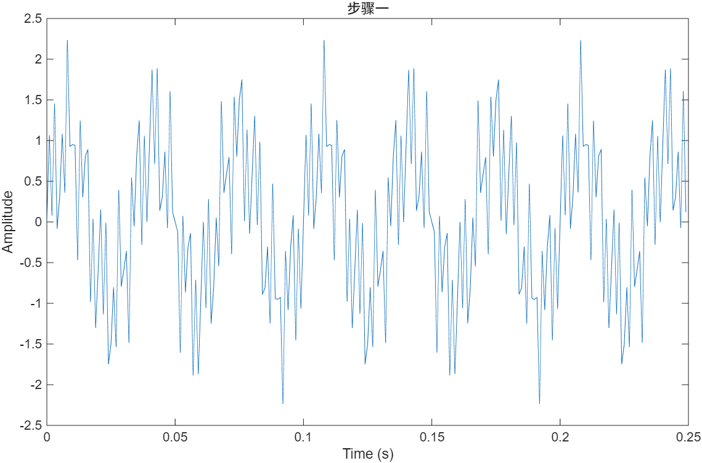
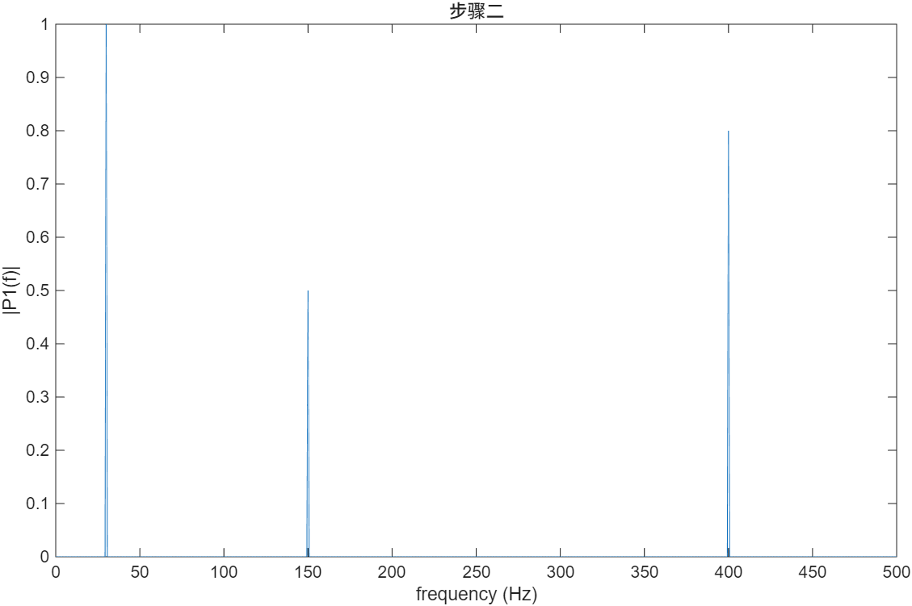
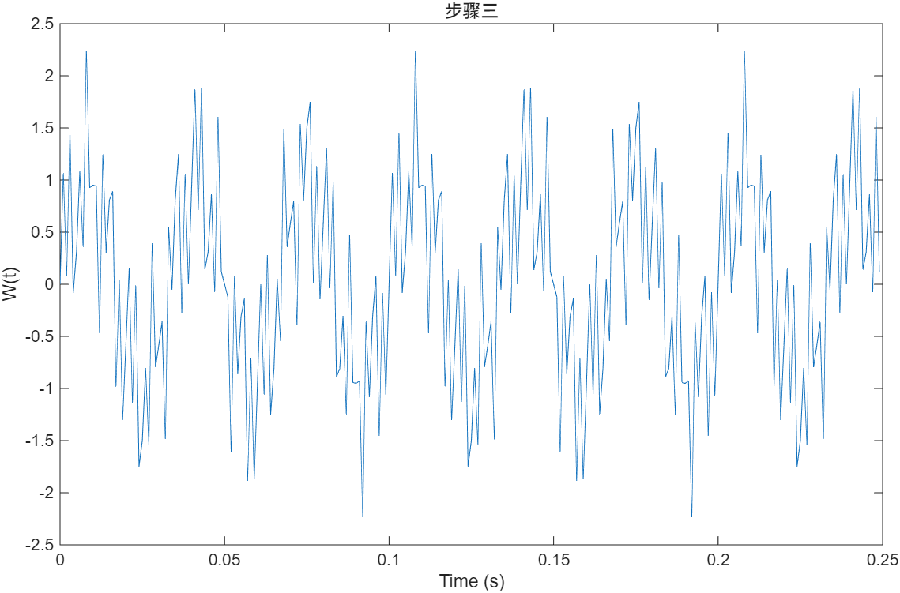
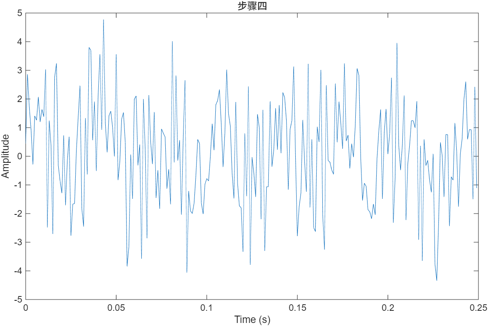
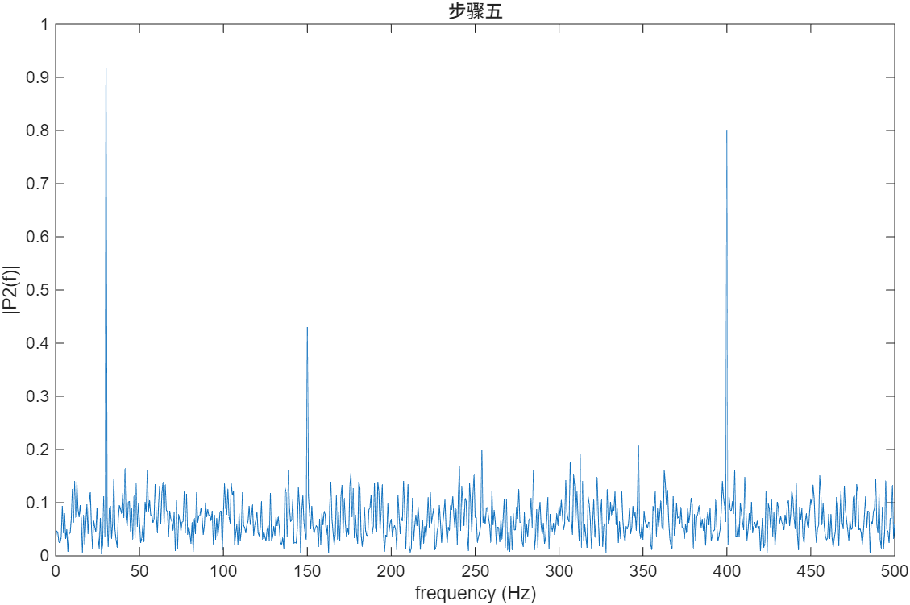
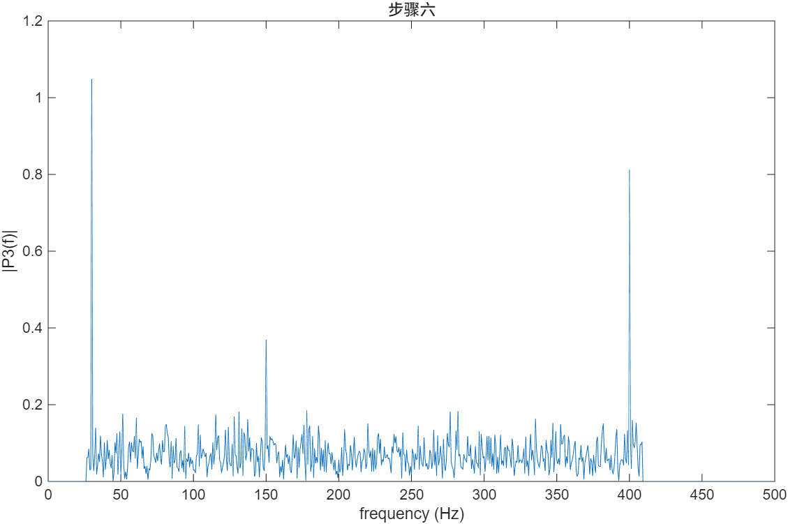
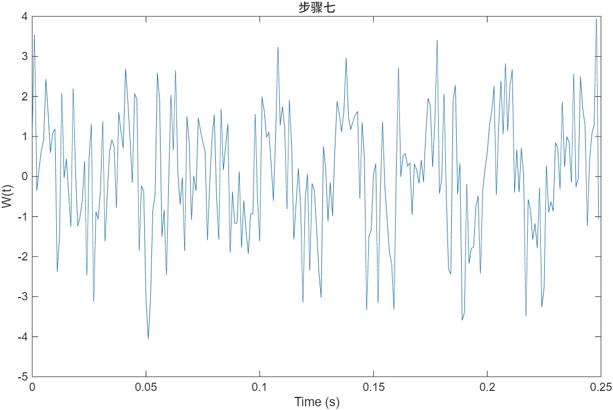

# 实验 1 · 基于 MATLAB 的信号频谱分析

[← 信息与电子工程导论 · 课程心得](../../index.md) · [全部实验报告](../index.md)

报告仅供参考，请独立完成课程作业。

## 报告与配套资料

- [在线打开 / 下载 PDF](实验1.pdf)
- [下载 Markdown 原稿与完整配图（ZIP）](source.zip)
- [作业题目](assignment.pdf) · [实验指导资料](reference.pdf)

<details class="report-pdf" data-pdf="实验1.pdf">
<summary>展开报告 PDF 预览</summary>
</details>

<details class="report-pdf" data-pdf="assignment.pdf">
<summary>展开作业题目 PDF 预览</summary>
</details>

<details class="report-pdf" data-pdf="reference.pdf">
<summary>展开实验指导 PDF 预览</summary>
</details>

## Markdown 报告正文

## 1 实验目的和要求

### 1.1 实验目的
1. 掌握利用 MATLAB 构建含多个频率分量的周期及非周期信号的方法。
2. 熟练使用 MATLAB 中的 fft 和 ifft 函数进行信号的频谱分析及波形还原。
3. 通过对频谱进行滤波处理（如去除特定频率成分或噪声），观察并理解时域与频域的对应关系。

### 1.2 实验要求
1. 构建一个至少含有 3 个不同频率分量的信号（包含纯净信号与加噪信号）。
2. 利用 MATLAB 计算并绘制信号的频谱图。
3. 对频谱进行适当处理（如滤波），并利用逆变换观察处理后的时域信号变化，撰写实验报告。

## 2 实验原理
计算机处理信号时，通常处理的是离散的、有限长度的数值信号。离散傅里叶变换（DFT）是实现时域到频域转换的核心数学工具，而快速傅里叶变换（FFT）是 DFT 的一种高效算法。

对于采样频率为 *F~s~* ，采样点数为 *N* 的信号，FFT 计算结果 *X(k)* 具有对称性。其实际频率分辨率为 *F~s~*/*N* 。在 MATLAB 中，fft 函数返回的双侧频谱中，前 *N*/2+1 个点代表了 0 到 *F~s~*/2（奈奎斯特频率）的有用信息。通过对频域数据 *Y* 进行操作（如将部分幅值置零）再使用 ifft（快速傅里叶逆变换），可以实现信号的滤波和重构。

## 3 实验内容
1. 设定采样率 *Fs* = 2000 Hz，采样点数 *N* = 2000。构建一个包含 30 Hz、150 Hz 和 400 Hz 三个正弦分量的合成信号 *S(t)*。
2. 用 MATLAB 对 *S(t)* 进行傅里叶变换得到其频谱。
3. 对上一步得到的频谱数据进行傅里叶逆变换得到其时域，并与初始时域进行比较。
4. 用均值为零、方差为2.25的白噪声扰乱该信号，生成非周期信号 *X(t)*。
5. 用 MATLAB 对 *X(t)* 进行傅里叶变换得到其频谱。
6. 对频谱进行滤波处理，将 25 Hz 以下的低频噪声与 410 Hz 以上的高频噪声滤除，得到去除噪声的信号的频谱，观察去除效果。
7. 对上一步得到的频谱进行傅里叶逆变换得到其时域，观察滤波后的时域波形变化。

## 4 实验结果和分析
图 1 至图 7 依次为以上第一步至第七步的输出结果。



<center><strong>图 1 </strong></center>



<center><strong>图 2 </strong></center>



<center><strong>图 3 </strong></center>



<center><strong>图 4 </strong></center>



<center><strong>图 5 </strong></center>



<center><strong>图 6 </strong></center>



<center><strong>图 7 </strong></center>

### 结果分析：

	将图 1与图 3进行对比，发现两张时域图的波形轨迹几乎完全一致，完全重合。这说明如果对较为简单的周期信号进行快速傅里叶变换和快速傅里叶逆变换，MATLAB 能够非常准确地实现时频域的转换并还原出原信号。

	观察图 4，在加入白噪声后，信号的时域波形出现了明显的毛刺和抖动。接着观察图 6，虽然我们对频谱进行了滤波处理（保留了 30Hz、150Hz 和 400Hz 的主要分量，去除了一定范围的背景噪声），但对比图 7 的还原波形与图 1 的原始波形，我们发现：由于干扰噪声是宽带随机信号，其能量分布在所有频率上，简单的频域截断或置零难以完全滤去叠加在信号频率附近的噪声。因此，进行初步过滤后的信号虽然比含噪信号平滑了一些，但仍保留了部分噪点，也就无法呈现出完全没有噪声干扰的原始周期信号的时域平滑感。

## 5 实验结论

通过步骤 1 至步骤 3 ，我们发现对于由多个正弦分量合成的周期信号，利用 MATLAB 进行快速傅里叶变换（FFT）和逆变换（iFFT）是非常有效的分析手段。这种方法不仅验证了时频域转换的可逆性和精确性，而且相比于直接使用离散傅里叶变换的数学定义进行运算，FFT 算法大幅度减少了乘法和加法的运算次数，从而降低了对计算硬件的性能要求，显著提高了数字信号处理的效率。

而通过步骤 4 至步骤 7 ，我们发现对于受到白噪声干扰的信号，虽然我们可以通过频域滤波去除极低频和极高频的干扰，但由于白噪声在频域上具有全频带分布的特性，我们无法简单地通过置零操作完全滤去叠加在有效信号频率附近的噪声。因此，在实际的信号传输工程中，我们必须认识到单纯依靠简单的频域滤波很难彻底消除随机干扰；在构建系统时，应当致力于提高信噪比（如增大信号幅度），或者采用抗干扰能力更强的编码方式，从而拉大有效信号与噪声基底的差距，尽可能减小随机噪声对信息传递准确性的影响。

在查找了相关资料之后，我了解了以下处理受到白噪声干扰的信号的思路：该思路不再局限于切除特定的频率范围，而是设定一个幅度阈值——将频谱中所有幅值低于该阈值的分量（视为背景噪声）统一置零，仅保留幅值高于阈值的尖峰（视为有效信号）。这种方法能够利用信噪比的差异，精准“剔除”夹杂在信号分量之间的宽带噪声，从而在逆变换后获得比带通滤波更加平滑、纯净的时域波形，为数字信号处理提供了更具实用价值的参考思路。

## 6 源代码与分析

### （1）构建一个含有 3 个频率分量的周期信号

```matlab
 Fs = 1000;
 T = 1/Fs;
 N = 1500;
 t = (0:N-1)*T;
 S = 1.0*sin(2*pi*30*t) +0.5*sin(2*pi*150*t) +0.8*sin(2*pi*400*t);
 plot(t(1:250),S(1:250))
 xlabel('Time (s)')
 ylabel('Amplitude')
 title('步骤一')
```

### （2）用 MATLAB 对 *S(t)* 进行傅里叶变换得到其频谱

```matlab
 Fs = 1000;
 T = 1/Fs;
 N = 1500;
 t = (0:N-1)*T;
 S = 1.0*sin(2*pi*30*t) +0.5*sin(2*pi*150*t) +0.8*sin(2*pi*400*t);
 Y = fft(S);
 P2 = abs(Y/N);
 P1 = P2(1:N/2+1);
 P1(2:end-1) = 2*P1(2:end-1);
 f = Fs*(0:(N/2))/N;
 plot(f,P1)
 xlabel('frequency (Hz)')
 ylabel('|P1(f)|')
 title('步骤二')
```

### （3）对上一步得到的频谱数据进行傅里叶逆变换得到其时域，并与初始时域进行比较

```matlab
 Fs = 1000;
 T = 1/Fs;
 N = 1500;
 t = (0:N-1)*T;
 S = 1.0*sin(2*pi*30*t) +0.5*sin(2*pi*150*t) +0.8*sin(2*pi*400*t);
 Y =fft(S);
 W =ifft(Y);
 plot(t(1:250),W(1:250))
 xlabel('Time (s)')
 ylabel('W(t)')
 title('步骤三')
```

### （4）用均值为零、方差为2.25的白噪声扰乱该信号，生成非周期信号 *X(t)*

```matlab
 Fs = 1000;
 T = 1/Fs;
 N = 1500;
 t = (0:N-1)*T;
 S = 1.0*sin(2*pi*30*t) +0.5*sin(2*pi*150*t) +0.8*sin(2*pi*400*t);
 X = S + 1.5*randn(size(t));
 plot(t(1:250),X(1:250))
 xlabel('Time (s)')
 ylabel('Amplitude')
 title('步骤四')
```

### （5）用 MATLAB 对 *X(t)* 进行傅里叶变换得到其频谱

```matlab
 Fs = 1000;
 T = 1/Fs;
 N = 1500;
 t = (0:N-1)*T;
 S = 1.0*sin(2*pi*30*t) +0.5*sin(2*pi*150*t) +0.8*sin(2*pi*400*t);
 X = S + 1.5*randn(size(t));
 Y = fft(X);
 P2 = abs(Y/N);
 P1 = P2(1:N/2+1);
 P1(2:end-1) = 2*P1(2:end-1);
 f = Fs*(0:(N/2))/N;
 plot(f,P1)
 xlabel('frequency (Hz)')
 ylabel('|P2(f)|')
 title('步骤五')
```

### （6）对频谱进行滤波处理，得到去除噪声的信号的频谱，观察去除效果。

```matlab
 Fs = 1000;
 T = 1/Fs;
 N = 1500;
 t = (0:N-1)*T;
 S = 1.0*sin(2*pi*30*t) +0.5*sin(2*pi*150*t) +0.8*sin(2*pi*400*t);
 X = S + 1.5*randn(size(t));
 Y = fft(X);
 Y(1:40) = 0;%切除极低频噪声 (< 25Hz)
 Y(615:900)=0;%切除极高频噪声 (> 410Hz)
 Y(1461:1500)=0;%切除尾部对称的极低频噪声
 P2 = abs(Y/N);
 P1 = P2(1:N/2+1);
 P1(2:end-1) = 2*P1(2:end-1);
 f = Fs*(0:(N/2))/N;
 plot(f,P1)
 xlabel('frequency (Hz)')
 ylabel('|P3(f)|')
 title('步骤六')
```

### （7）对上一步得到的频谱进行傅里叶逆变换得到其时域，观察滤波后的时域波形变化

```matlab
 Fs = 1000;
 T = 1/Fs;
 N = 1500;
 t = (0:N-1)*T;
 S = 1.0*sin(2*pi*30*t) +0.5*sin(2*pi*150*t) +0.8*sin(2*pi*400*t);
 X = S + 1.5*randn(size(t));
 Y = fft(X);
 Y(1:40) = 0;%切除极低频噪声 (< 25Hz)
 Y(615:900)=0;%切除极高频噪声 (> 410Hz)
 Y(1461:1500)=0;%切除尾部对称的极低频噪声
 W =ifft(Y);
 W =real(W);
 plot(t(1:250),W(1:250))
 xlabel('Time (s)')
 ylabel('W(t)')
 title('步骤七')
```
