# 实验 2 · 基于 Simulink 的信号调制仿真

[← 信息与电子工程导论 · 课程心得](../../index.md) · [全部实验报告](../index.md)

报告仅供参考，请独立完成课程作业。

## 报告与配套资料

- [在线打开 / 下载 PDF](实验2.pdf)
- [下载 Markdown 原稿与完整配图（ZIP）](source.zip)
- [作业题目](assignment.pdf) · [实验指导资料](reference.pdf)

展开报告 PDF 预览

展开作业题目 PDF 预览

展开实验指导 PDF 预览

## Markdown 报告正文

## 1 实验目的和要求

### 1.1 实验目的
掌握使用MATLAB/Simulink进行通信系统建模的方法，通过对不同调制方式的仿真，深入理解信号调制的基本原理，并对以下问题进行分析：

1. 信号频率、采样率对仿真结果的影响。
2. 比较基带调制和频带调制。
3. 比较数字调制和模拟调制。
4. 比较AM和FM的调制系数。

### 1.2 实验要求
1. 利用 Simulink 搭建仿真模型，完成对非归零码（NRZ）、数字调制（ASK, FSK, PSK）及模拟调制（AM, FM）的仿真。
2. 观察并记录示波器和频谱仪的输出结果。
3. 分析实验目的部分中的四个问题。

## 2 实验原理
Simulink 是 MATLAB 环境下用于动态系统建模、仿真和分析的图形化环境。在通信系统中，信号的传输通常需要经过调制，即将基带信号的频谱搬移到适合信道传输的高频段（载波频率）。

- **采样定理**：为了不失真地恢复模拟信号，采样频率 *f~s~*必须大于信号最高频率 *f~max~* 的两倍(*f~s~* >2*f~max~*)。
- **数字调制**：利用数字基带信号控制载波的幅度（ASK）、频率（FSK）或相位（PSK），使载波的对应参数随数字信号（0或1）变化。
- **模拟调制**：
  **AM（调幅）**：载波的幅度随基带模拟信号线性变化。
  **FM（调频）**：载波的瞬时频率随基带模拟信号线性变化。

## 3 实验内容
（1）建立一个仿真模型，产生一个非归零码，分别用示波器和频谱分析仪观察它的时域和频域。
（2）模拟ASK、FSK、PSK调制，观察数字调制的特点。
（3）模拟AM、FM调制，观察模拟调制的特点。
（4）比较数字调制和模拟调制。
（5）比较AM与FM的调制系数。
（6）比较基带调制和频带调制。

## 4 实验结果和分析
### 4.1 信号频率、采样率对仿真结果的影响

**实验操作**：

1. 首先建立一个仿真模型，产生一个非归零码。
2. 设置 Rate Transition 输出端口采样时间为 1/100。
3. 将采样时间缩短为 1/200（即采样率提高一倍）。

**结果展示**：

<table style="border: none; border-collapse: collapse; width: 100%;">
    <!-- 第一行：放置并排的两张图片 -->
    <tr>
        <td style="border: none; text-align: center; width: 50%;">
            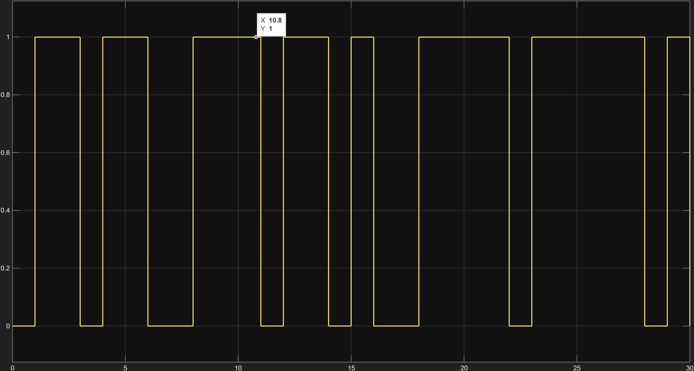
        </td>
        <td style="border: none; text-align: center; width: 50%;">
            
        </td>
    </tr>
    <!-- 第二行：放置对应的两个题注 -->
    <tr>
        <td style="border: none; text-align: center; padding-top: 8px; color: #666; font-size: 0.9em;">
            <strong>图一&nbsp;&nbsp;</strong> 采样时间 1/100 时的时域
        </td>
        <td style="border: none; text-align: center; padding-top: 8px; color: #666; font-size: 0.9em;">
            <strong>图二&nbsp;&nbsp;</strong> 采样时间 1/100 时的频谱
        </td>
    </tr>
</table>

<table style="border: none; border-collapse: collapse; width: 100%;">
    <!-- 第一行：放置并排的两张图片 -->
    <tr>
        <td style="border: none; text-align: center; width: 50%;">
            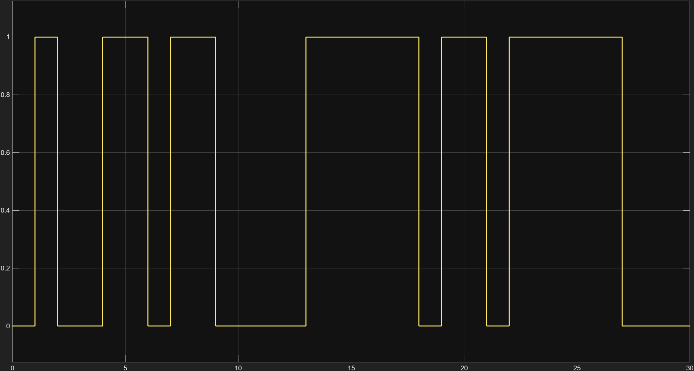
        </td>
        <td style="border: none; text-align: center; width: 50%;">
            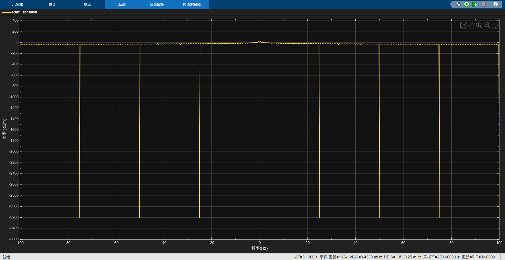
        </td>
    </tr>
    <!-- 第二行：放置对应的两个题注 -->
    <tr>
        <td style="border: none; text-align: center; padding-top: 8px; color: #666; font-size: 0.9em;">
            <strong>图三&nbsp;&nbsp;</strong> 采样时间 1/200 时的时域
        </td>
        <td style="border: none; text-align: center; padding-top: 8px; color: #666; font-size: 0.9em;">
            <strong>图四&nbsp;&nbsp;</strong> 采样时间 1/200 时的频谱
        </td>
    </tr>
</table>

**分析：**
经过对照后，我们发现，提高采样率后，信号频率范围变大了，即频带明显加宽了。

### 4.2 比较数字调制和模拟调制

#### 4.2.1 数字调制

**实验操作：**
构建三个新的仿真模型，依次模拟ASK、FSK、PSK调制。

**结果展示**：

<table style="border: none; border-collapse: collapse; width: 100%;">
    <!-- 第一行：放置并排的两张图片 -->
    <tr>
        <td style="border: none; text-align: center; width: 50%;">
            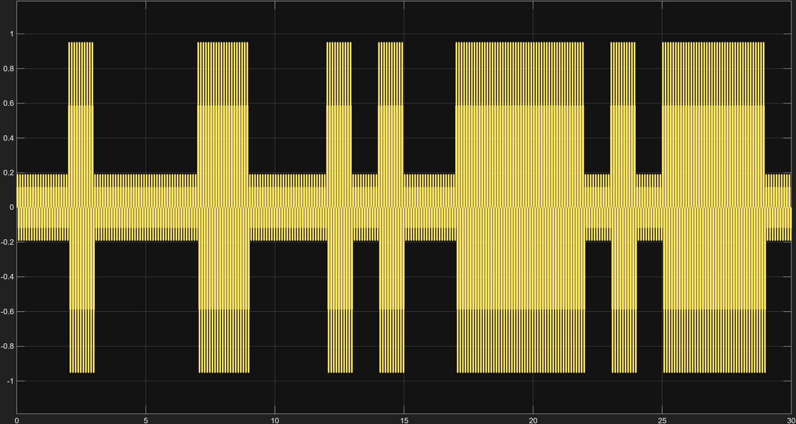
        </td>
        <td style="border: none; text-align: center; width: 50%;">
            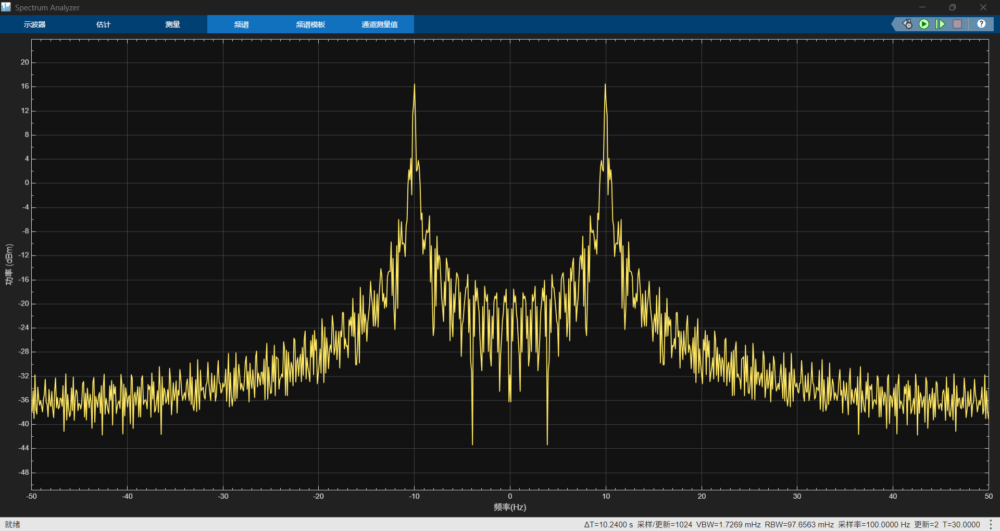
        </td>
    </tr>
    <!-- 第二行：放置对应的两个题注 -->
    <tr>
        <td style="border: none; text-align: center; padding-top: 8px; color: #666; font-size: 0.9em;">
            <strong>图五&nbsp;&nbsp;</strong> ASK调制时的时域
        </td>
        <td style="border: none; text-align: center; padding-top: 8px; color: #666; font-size: 0.9em;">
            <strong>图六&nbsp;&nbsp;</strong> ASK调制时的频谱
        </td>
    </tr>
</table>

<table style="border: none; border-collapse: collapse; width: 100%;">
    <!-- 第一行：放置并排的两张图片 -->
    <tr>
        <td style="border: none; text-align: center; width: 50%;">
            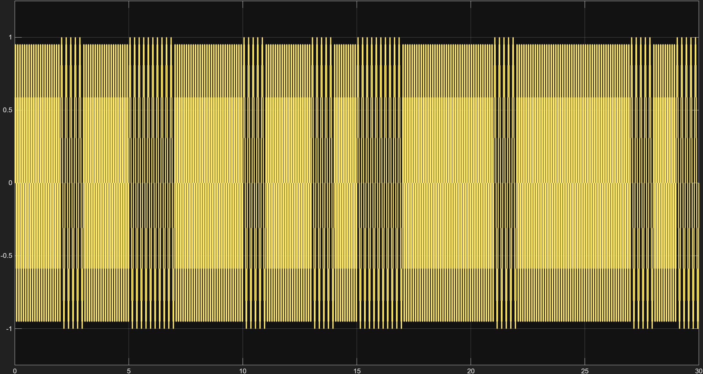
        </td>
        <td style="border: none; text-align: center; width: 50%;">
            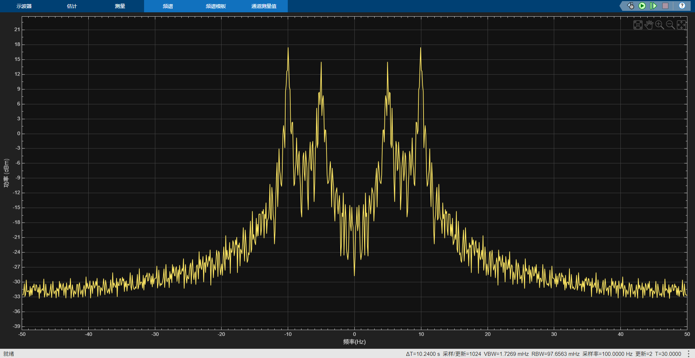
        </td>
    </tr>
    <!-- 第二行：放置对应的两个题注 -->
    <tr>
        <td style="border: none; text-align: center; padding-top: 8px; color: #666; font-size: 0.9em;">
            <strong>图七&nbsp;&nbsp;</strong> FSK调制时的时域
        </td>
        <td style="border: none; text-align: center; padding-top: 8px; color: #666; font-size: 0.9em;">
            <strong>图八&nbsp;&nbsp;</strong> FSK调制时的频谱
        </td>
    </tr>
</table>

<table style="border: none; border-collapse: collapse; width: 100%;">
    <!-- 第一行：放置并排的两张图片 -->
    <tr>
        <td style="border: none; text-align: center; width: 50%;">
           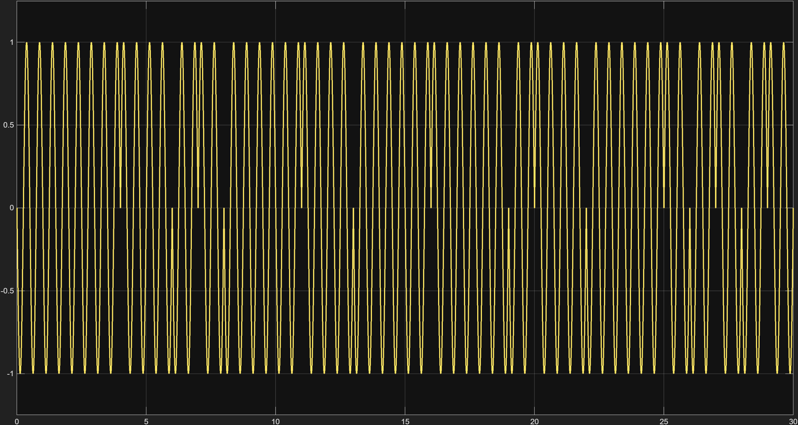
        </td>
        <td style="border: none; text-align: center; width: 50%;">
          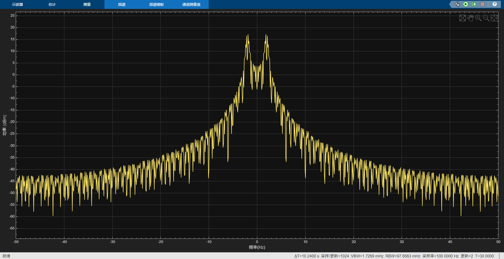
        </td>
    </tr>
    <!-- 第二行：放置对应的两个题注 -->
    <tr>
        <td style="border: none; text-align: center; padding-top: 8px; color: #666; font-size: 0.9em;">
            <strong>图九&nbsp;&nbsp;</strong> PSK调制时的时域
        </td>
        <td style="border: none; text-align: center; padding-top: 8px; color: #666; font-size: 0.9em;">
            <strong>图十&nbsp;&nbsp;</strong> PSK调制时的频谱
        </td>
    </tr>
</table>

#### 4.2.2 模拟调制

**实验操作：**
构建两个新的仿真模型，依次模拟AM、FM调制。

**结果展示**：

<table style="border: none; border-collapse: collapse; width: 100%;">
    <!-- 第一行：放置并排的两张图片 -->
    <tr>
        <td style="border: none; text-align: center; width: 50%;">
         
        </td>
        <td style="border: none; text-align: center; width: 50%;">
           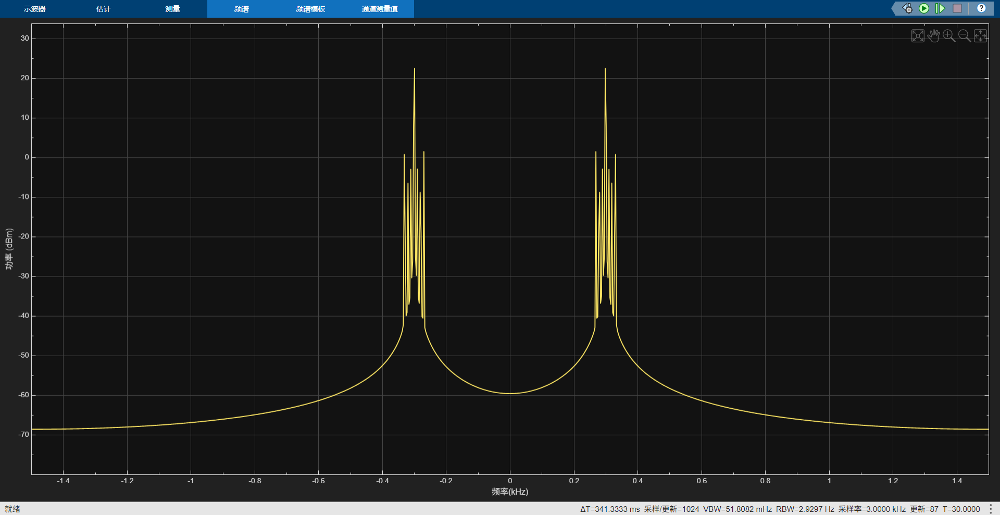
        </td>
    </tr>
    <!-- 第二行：放置对应的两个题注 -->
    <tr>
        <td style="border: none; text-align: center; padding-top: 8px; color: #666; font-size: 0.9em;">
            <strong>图十一&nbsp;&nbsp;</strong> AM调制时的时域
        </td>
        <td style="border: none; text-align: center; padding-top: 8px; color: #666; font-size: 0.9em;">
            <strong>图十二&nbsp;&nbsp;</strong> AM调制时的频谱
        </td>
    </tr>
</table>

<table style="border: none; border-collapse: collapse; width: 100%;">
    <!-- 第一行：放置并排的两张图片 -->
    <tr>
        <td style="border: none; text-align: center; width: 50%;">
         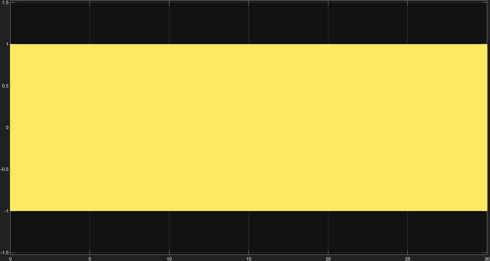
        </td>
        <td style="border: none; text-align: center; width: 50%;">
          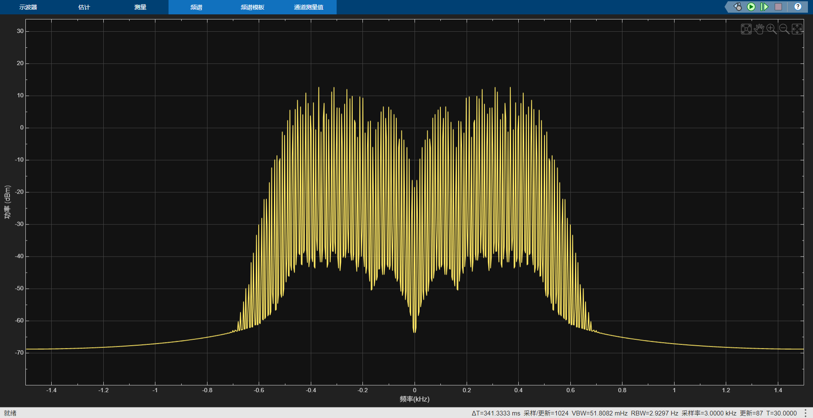
        </td>
    </tr>
    <!-- 第二行：放置对应的两个题注 -->
    <tr>
        <td style="border: none; text-align: center; padding-top: 8px; color: #666; font-size: 0.9em;">
            <strong>图十三&nbsp;&nbsp;</strong> FM调制时的时域
        </td>
        <td style="border: none; text-align: center; padding-top: 8px; color: #666; font-size: 0.9em;">
            <strong>图十四&nbsp;&nbsp;</strong> FM调制时的频谱
        </td>
    </tr>
</table>

#### 4.2.3 对比分析

将步骤数字调制和模拟调制的结果对比，我们发现，数字调制的时域波形差异明显，而频谱波动频繁，峰值不是十分集中；相比之下，模拟调制的时域波形差异不明显，而频谱波动较小，峰值明显，十分集中。

### 4.3 比较AM 和 FM 调制系数

**实验操作：**
在 AM 和 FM 仿真中，观察 Gain 模块的作用。

**分析：**
我们发现，AM和FM的调制系数中，FM的Gain模块的收益值高于 AM，即FM的输入乘以的常量值较大。这表明FM调制的信号解调过程中需要更大的放大程度，这也就意味着FM调制的信号内部的差异更不明显。

### 4.4 比较基带调制和频带调制

通过对比基带信号（步骤 (1) 中的非归零码）与频带调制信号（步骤 (2)、(3) 中的ASK/AM等）的仿真结果，可以得出：基带传输方式结构简单，但其信号频谱位于低频段，不仅抗干扰能力较弱，且由于无法进行有效的频谱搬移，难以实现无线远距离传输和多路信号的频分复用，信道利用率较低；而频带调制通过载波将信号频谱搬移至高频段，不仅解决了天线尺寸受限的问题，实现了无线传输，还极大地提高了信道的抗噪声性能和频谱利用率。因此，在长距离无线通信或需要高信道容量的场景下，频带调制是比基带调制更为优越的选择。

## 5 实验结论

本实验基于 Simulink 仿真平台，对多种信号调制方式进行了系统性的建模与分析。实验结果显示，采样频率的设定、调制模式的选择以及关键参数（如调制系数）的调整，均会在信号的时域波形细节和频域频谱分布上产生显著的差异。而这些时频特性的不同，直接决定了信号在信道传输中的抗干扰性能与带宽占用情况。因此，在实际的通信系统设计中，鉴于不同场景下对传输质量和资源开销的要求存在较大区别，我们需要依据具体的应用指标，综合权衡并选择最适配的信号体制与调制参数，从而确保系统的信息传输兼具高效性与可靠性。

## 6 源代码与分析
### 步骤（1）

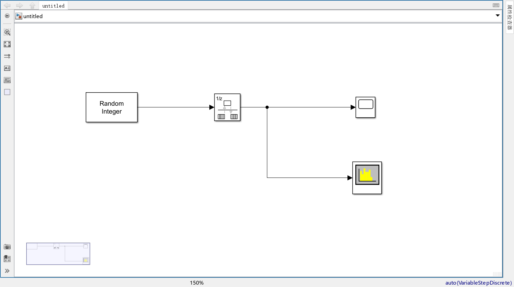

<strong>图十五&nbsp;&nbsp;</strong>非归零码的仿真分析

### 步骤（2）

<table style="border: none; border-collapse: collapse; width: 100%;">
    <!-- 第一行：放置并排的两张图片 -->
    <tr>
        <td style="border: none; text-align: center; width: 50%;">
        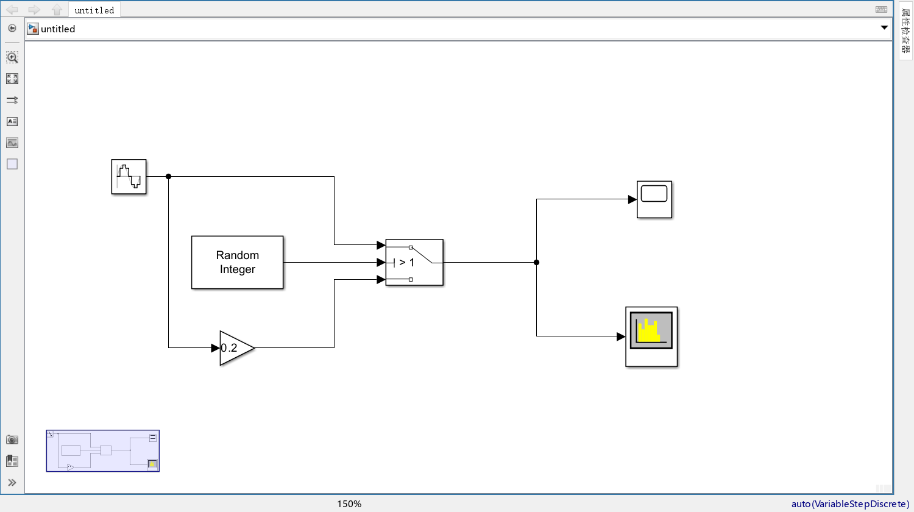
        </td>
        <td style="border: none; text-align: center; width: 50%;">
        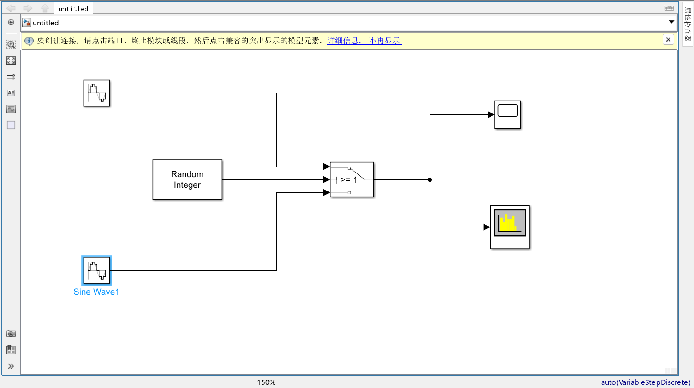
        </td>
    </tr>
    <!-- 第二行：放置对应的两个题注 -->
    <tr>
        <td style="border: none; text-align: center; padding-top: 8px; color: #666; font-size: 0.9em;">
            <strong>图十六&nbsp;&nbsp;</strong> ASK
        </td>
        <td style="border: none; text-align: center; padding-top: 8px; color: #666; font-size: 0.9em;">
            <strong>图十七&nbsp;&nbsp;</strong> FSK、PSK
        </td>
    </tr>
</table>

### 步骤（3）

<table style="border: none; border-collapse: collapse; width: 100%;">
    <!-- 第一行：放置并排的两张图片 -->
    <tr>
        <td style="border: none; text-align: center; width: 50%;">
       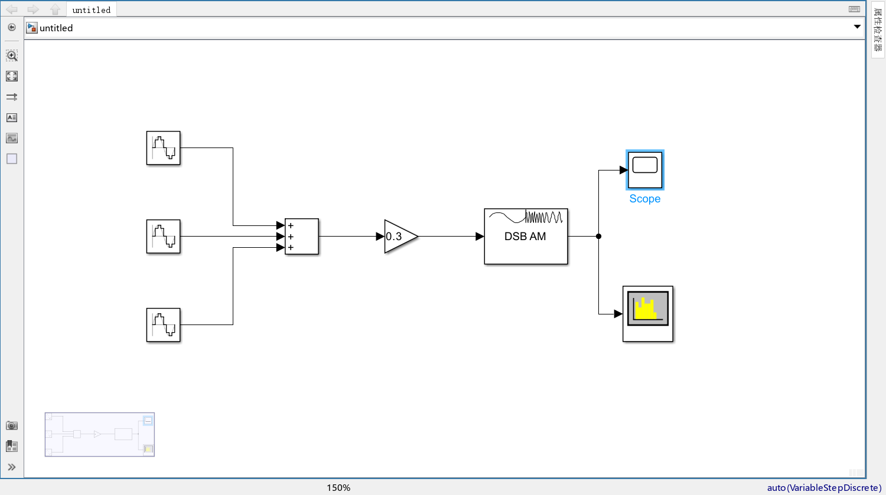
        </td>
        <td style="border: none; text-align: center; width: 50%;">
        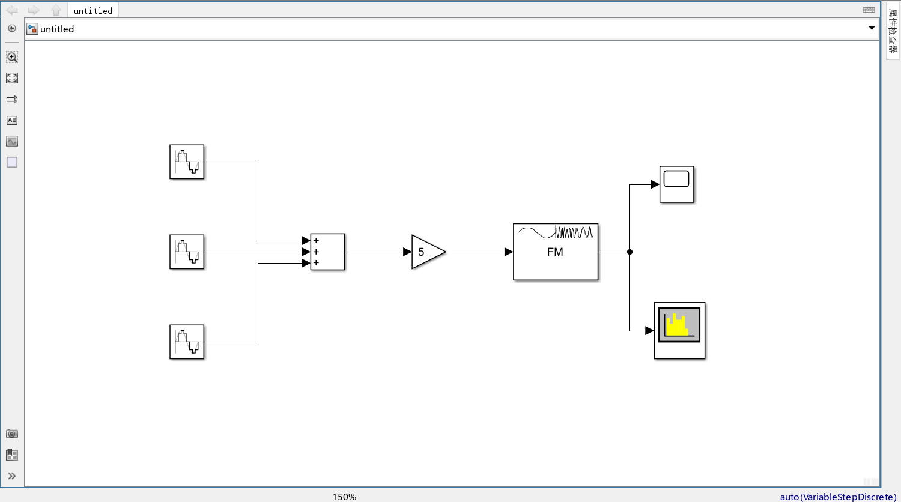
        </td>
    </tr>
    <!-- 第二行：放置对应的两个题注 -->
    <tr>
        <td style="border: none; text-align: center; padding-top: 8px; color: #666; font-size: 0.9em;">
            <strong>图十八&nbsp;&nbsp;</strong> AM
        </td>
        <td style="border: none; text-align: center; padding-top: 8px; color: #666; font-size: 0.9em;">
            <strong>图十九&nbsp;&nbsp;</strong> FM
        </td>
    </tr>
</table>
