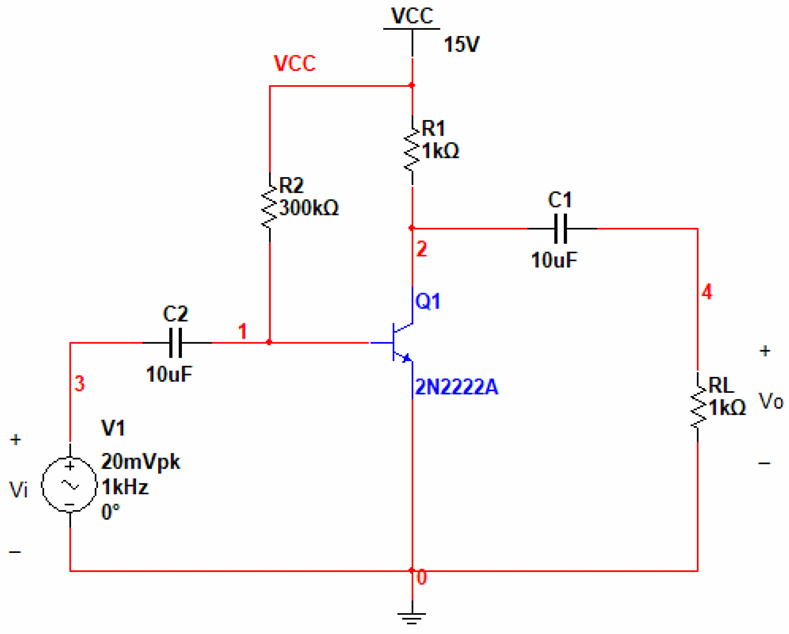
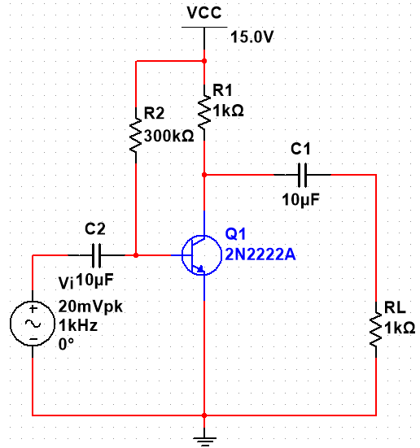
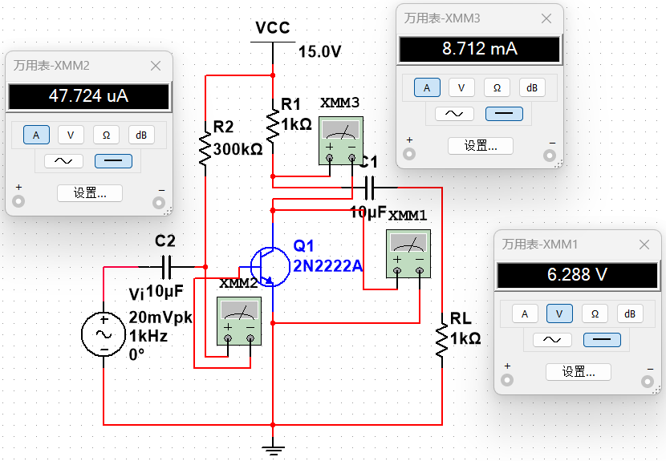
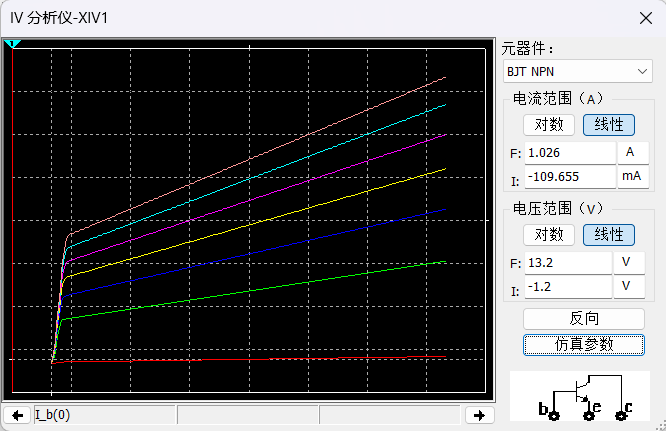
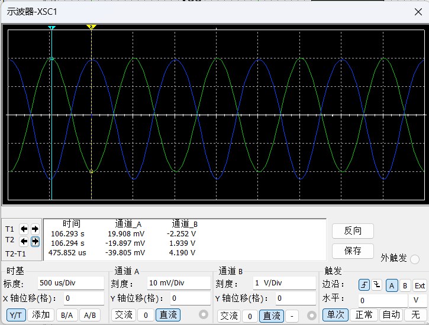
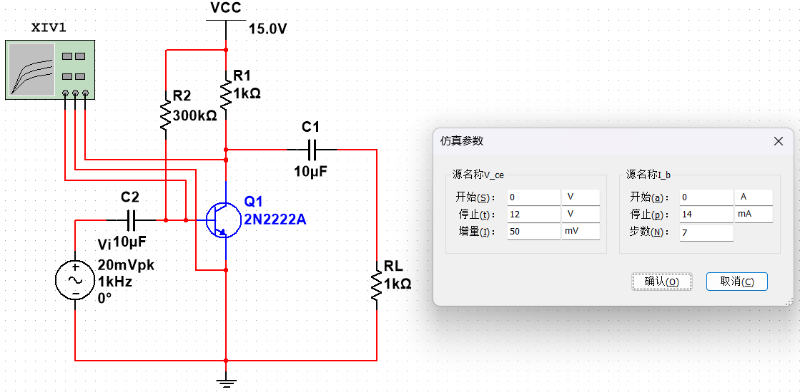
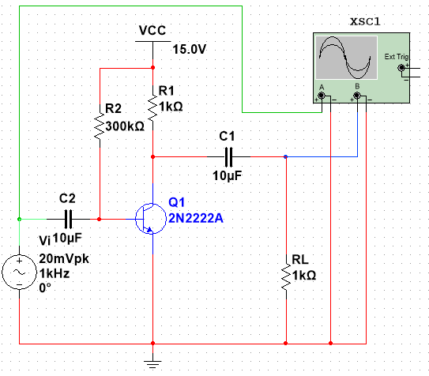

# 实验 3 · 基于 Multisim 的三极管放大电路仿真

[← 信息与电子工程导论 · 课程心得](../../index.md) · [全部实验报告](../index.md)

报告仅供参考，请独立完成课程作业。

## 报告与配套资料

- [在线打开 / 下载 PDF](实验3.pdf)
- [下载 Markdown 原稿与完整配图（ZIP）](source.zip)
- [作业题目](assignment.pdf) · [实验指导资料](reference.pdf)

展开报告 PDF 预览

展开作业题目 PDF 预览

展开实验指导 PDF 预览

## Markdown 报告正文

## 1 实验目的和要求

### 1.1 实验目的
对下图所示的放大电路进行仿真分析。

<strong>图1&nbsp;&nbsp;</strong>共射极放大电路

### 1.2 实验要求
（1）应用估算法计算三极管的静态工作点，在电路中接入万用表仿真测量静态工作点，并进行比较。
（2）用虚拟IV测试仪测试三极管输出特性曲线簇，并观察静态工作点的位置。
（3）用示波器观察输入、输出信号波形，并测量电压放大倍数。

## 2 实验原理

Multisim 是以 Windows 为基础的板级模拟/数字电路仿真工具。通过交互式搭建电路原理图，它可以模拟电路的实际运行情况。
**共射极放大电路原理**： 三极管（BJT）是核心放大元件。为了使三极管实现线性放大，必须设置合适的直流偏置，使其工作在放大区。
**输入回路**：基极电源 $V_{CC}$ 通过 $R_2$ 提供基极电流 $I_B$。
**输出回路**：集电极电源 $V_{CC}$ 通过 $R_1$ 提供集电极电流 $I_C$。
**信号传输**：交流信号 $V_1$ 经电容耦合输入，输出信号经电容耦合到负载。由于共射接法，输出电压与输入电压反相。

## 3 实验内容
（1）用Multisim 构建出如**图1**所示的仿真电路。
（2）应用估算法计算出三极管的静态工作点。
（3）在仿真电路中接入万用表来对静态工作点进行仿真测量，并与（2）中结果进行比较。
（4）用虚拟IV测试仪测试出三极管的输出特性曲线簇，并观察静态工作点的位置。
（5）用示波器观察输入、输出信号波形，并测量电压放大倍数。

## 4 实验结果和分析
（1）仿真电路图如下。

（2）**理论估算：** 假设 $V_{BE} = 0.7V$，且 $\beta \approx 100$。

$$
I_{BQ} = \frac{V_{CC} - V_{BE}}{R_2} = \frac{15V - 0.7V}{300k\Omega} \approx 47.67 \mu A
$$

$$
I_{CQ} = \beta I_{BQ} = 100 \times 47.67 \mu A \approx 4.77 mA
$$

$$
V_{CEQ} = V_{CC} - I_{CQ}R_1 = 15V - 4.77mA \times 1k\Omega \approx 10.23 V
$$

（3）**仿真测量：** 在电路中串联万用表测量 $I_B$ 和 $I_C$，并联万用表测量 $V_{CE}$，运行仿真。

运行结果如图所示，万用表测量得到的静态工作点为：
$V_{CEQ} \approx 6.288V$，$I_{CQ} \approx 8.712 mA$ (仿真值可能与估算值不同，取决于模型实际 $\beta$ 值) 

**与理论计算结果比较：**理论计算的 $V_{CEQ}$ (约10.23V) 与仿真结果 (约6.038V) 存在一定差异。这是因为理论计算时假设 $\beta=100$，而 Multisim 中 2N2222A 模型的实际 $\beta$ 值在工作点处可能接近 180-200。若反推 $\beta = I_C / I_B \approx 8.712mA / 47.713\mu A \approx 182$，则计算结果将与仿真高度吻合。这说明了参数选取对静态工作点的重要影响。

（4）通过虚拟 IV 测试仪得到的特性曲线如下图所示。

观察可知，设置的静态工作点位于特性曲线的平坦区域，即放大区（线性区）。在此区域内，集电极电流 $I_C$ 主要受 $I_B$ 控制，且不随 $V_{CE}$ 剧烈变化，适合进行信号放大。

（5）如下图所示，示波器通道 A（绿色）显示输入正弦波，通道 B（蓝色）显示输出正弦波。

**相位关系**：输出波形与输入波形相位相反（相位差 $180^\circ$），符合共射极放大电路的反相特性。
**放大倍数计算**：
输入信号峰值 $V_{in\_pk} = 20 mV$ 
输出信号峰值 $V_{out\_pk} \approx -1.939 V$ (根据仿真数据读取)
电压放大倍数 $A_v = \frac{V_{out}}{V_{in}} = \frac{-1.939V}{0.02V} = -96.95$
该放大倍数较高，实现了小信号的电压放大功能。

## 5 实验结论
1. 通过 Multisim 仿真，成功验证了共射极放大电路的放大功能。实验测得的静态工作点 $V_{CEQ}$ 使得晶体管工作在放大区，保证了输出信号不失真。 
2. 理论估算与仿真结果的对比表明，晶体管的电流放大系数 $\beta$ 是影响静态工作点的关键参数。在实际设计中，需要根据具体元件参数调整偏置电阻，以获得理想的 Q 点（通常设在 $1/2 V_{CC}$ 附近以获得最大动态范围）。
3. 电路实现了反相电压放大，放大倍数约为 -100 倍左右，与理论分析相符。Multisim 作为一种强大的 EDA 工具，能直观地展示电路特性，是电子线路设计与分析的有效辅助手段。

## 6 源代码与分析
（1）（2）（3）的电路图或计算过程均在第四部分实验结果和分析中展示过。
（4）用虚拟IV测试仪测试出三极管的输出特性曲线簇的电路图与仿真参数如下。

（5）用示波器观察输入、输出信号波形的电路图如下。

