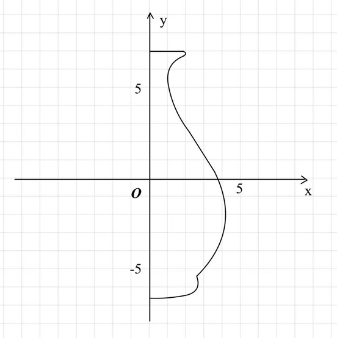
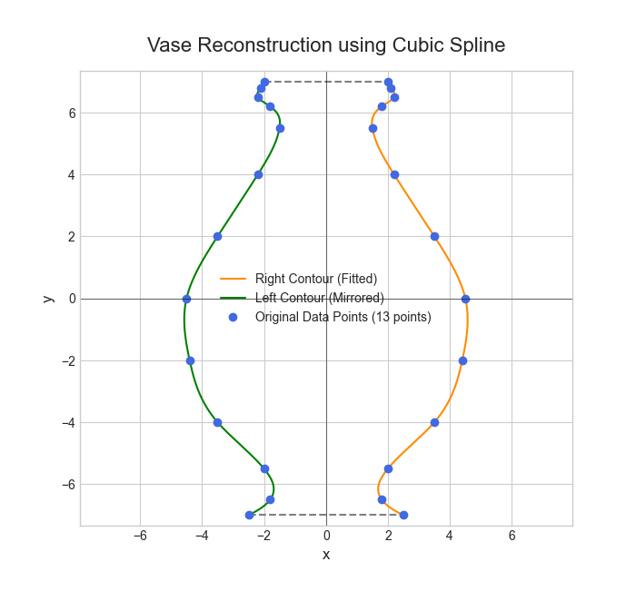
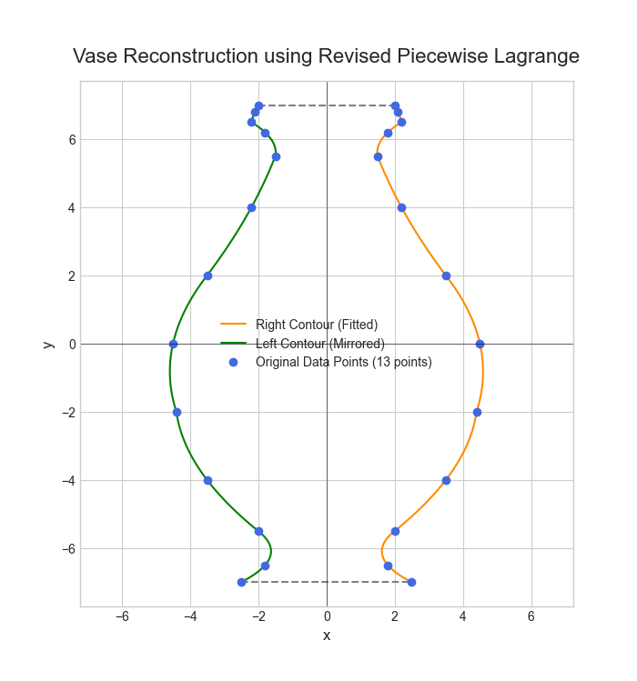

# 数值分析方法 · 花瓶轮廓插值与重构

[← 返回课程心得](../../index.md)

## 项目报告

[打开或下载 PDF](report.pdf)

<details class="report-pdf" data-pdf="report.pdf">
<summary>展开 PDF 预览</summary>
</details>

- [下载 Python 程序、报告和配图](project-source.zip)

---

# 数值分析方法大作业项目报告

## 一、任务内容

图1是一个对称花瓶的右半部分，尝试用合适的插值方法，拟合出花瓶的右半部分并重构整个花瓶。



**具体任务：**

1. 从图中提取花瓶轮廓的离散坐标点；
2. 对图中曲线进行分割，选择至少**两种**不同的数值方法进行曲线拟合；
3. 利用花瓶的对称性，将单侧轮廓镜像生成完整花瓶轮廓。

## 二、算法设计思路

### 1.数据点提取

为了提升拟合精度，我们从图像中提取了13个关键坐标点，特别是在曲率变化较大的瓶口、瓶颈和底座部分增加了采样密度。我们依然将y作为自变量，x作为因变量，寻找函数 x = f(y)。提取的数据点 (y, x) 如下表所示（从下至上）：

<center><strong>表 1 &emsp; 提取的数据点</strong></center>

| 序号 | y (自变量) | x (因变量) | 所在区域 |
| ---- | ---------- | ---------- | -------- |
| 1    | -7.0       | 2.5        | 底部     |
| 2    | -6.5       | 1.8        | 底部     |
| 3    | -5.5       | 2.0        | 底部     |
| 4    | -4.0       | 3.5        | 瓶身     |
| 5    | -2.0       | 4.4        | 瓶身     |
| 6    | 0.0        | 4.5        | 瓶身     |
| 7    | 2.0        | 3.5        | 瓶身     |
| 8    | 4.0        | 2.2        | 瓶颈     |
| 9    | 5.5        | 1.5        | 瓶颈     |
| 10   | 6.2        | 1.8        | 瓶口     |
| 11   | 6.5        | 2.2        | 瓶口     |
| 12   | 6.8        | 2.1        | 瓶口     |
| 13   | 7.0        | 2.0        | 瓶口     |

### 2.拟合方式选取

#### 1、三次样条插值

三次样条插值通过构建一系列分段三次多项式来拟合数据点，同时保证在连接点（节点）处函数值、一阶导数和二阶导数均连续（C²连续性）。这种内在的平滑特性使其非常适合生成美观、自然的曲线，能有效避免高阶多项式插值可能引发的龙格现象。我们将对全部13个数据点应用**自然三次样条插值**，生成一条贯穿始终的平滑曲线。

#### 2、拉格朗日多项式插值

为了更好地贴合花瓶不同部分的独特形状，我们将13个数据点分为三个分段，并对每个分段独立应用最合适的低阶拉格朗日多项式插值。

1. **底座部分:** 使用点1-3 (-7.0, 2.5), (-6.5, 1.8), (-5.5, 2.0)。这3个点足以定义底部的外扩再内收的形态，我们用一个**二次**拉格朗日多项式拟合。
2. **瓶身部分:** 使用点3-8 (-5.5, 2.0), (-4.0, 3.5), (-2.0, 4.4), (0.0, 4.5), (2.0, 3.5), (4.0, 2.2)。这是点数最多的部分，描述了花瓶从宽到窄的主体，我们用一个**五次**拉格朗日多项式拟合。
3. **瓶颈与瓶口部分:** 使用点8-13 (4.0, 2.2), (5.5, 1.5), (6.2, 1.8), (6.5, 2.2), (6.8, 2.1), (7.0, 2.0)。这部分描述了瓶颈的收窄和瓶口的再次外扩，我们同样用一个**五次**拉格朗日多项式拟合。

**备注：** 相邻分段之间共享一个连接点（如点3和点8），以确保整条曲线没有断点。

### 3.作图步骤：

1. 采用的拟合方法为三次样条插值和拉格朗日多项式插值，拟合出右半侧轮廓的曲线部分。
2. 在获得右半侧轮廓 x_right = f(y) 后，左半侧轮廓通过镜像 x_left = -f(y) 得到。
3. 最后，为了形成一个封闭的花瓶形状，我们在花瓶的顶部 (y_max) 和底部 (y_min) 分别绘制一条水平直线，连接左右两侧的轮廓。

## 三、理论依据

### 1、三次样条插值

#### 核心思想

三次样条插值是一种高级的分段插值方法，它通过一系列分段三次多项式来连接数据点，其首要目标是生成一条具有高度平滑性的曲线。

#### 构造原理

与简单的分段连接不同，三次样条不仅保证曲线在连接点（节点）处的位置连续（C⁰），还强制要求一阶导数（切线斜率）和二阶导数（曲率）也必须连续。这种 C² 连续性是其核心特征，它确保了曲线在视觉上没有任何“尖角”或“扭结”，过渡极其自然流畅。这是通过建立并求解一个包含所有插值与连续性条件的线性方程组来实现的。

#### 在本项目中的应用

我们将自然三次样条应用于全部13个数据点。这种方法非常适合建模像花瓶这样要求外观优雅、轮廓平滑的物体。通过保证全局的C²连续性，它能生成一条“一气呵成”的理想曲线，避免了分段方法可能带来的连接点不平滑问题。“自然”边界条件假设曲线在两端点自然平直延伸（二阶导数为零），这是一个对花瓶形态的合理简化。

### 2.拉格朗日多项式插值

#### **核心思想**

对于给定的 n+1 个数据点，拉格朗日插值旨在构造一个唯一的、阶数不超过 n 的多项式，使其精确地穿过所有这些点。

#### 构造原理

该方法通过一组巧妙构造的基多项式 Lᵢ(x) 实现。每个基多项式 Lᵢ(x) 的特性是：在其对应的节点 xᵢ 处值为 1，而在所有其他节点 xⱼ (j≠i) 处值为 0。最终的插值多项式 Pₙ(x) 是这些基多项式与对应数据点纵坐标 yᵢ 的加权和：
Pₙ(x) = y₀L₀(x) + y₁L₁(x) + ... + yₙLₙ(x)
这个构造确保了 Pₙ(xᵢ) = yᵢ 总是成立。

#### 在本项目中的应用

直接对所有13个点使用一个高阶（12次）的拉格朗日多项式会引发龙格现象，导致曲线在数据点之间产生剧烈振荡。为解决此问题，我们采用分段拉格朗日插值策略：将轮廓分割为多个小段，并对每段应用一个低阶（二次）的多项式。这种方法有效抑制了振荡，并提供了对曲线局部形状的精确控制，但其代价是牺牲了连接点处的平滑性（仅保证 C⁰ 连续）。

## 四、代码展示

```python
import numpy as np
import matplotlib.pyplot as plt
from scipy.interpolate import CubicSpline, lagrange

y_points = np.array([-7.0, -6.5, -5.5, -4.0, -2.0,  0.0,  2.0, 4.0, 5.5, 6.2, 6.5, 6.8, 7.0])
x_points = np.array([ 2.5,  1.8,  2.0,  3.5,  4.4,  4.5,  3.5, 2.2, 1.5, 1.8, 2.2, 2.1, 2.0])

# == 方法一：三次样条插值 ==
y_continuous_spline = np.linspace(y_points.min(), y_points.max(), 500)
cs = CubicSpline(y_points, x_points)
x_spline = cs(y_continuous_spline)


# == 方法二：精细化分段拉格朗日插值 ==
# 将轮廓分解为6个二次多项式分段
segments_y = []
segments_x = []

# 定义每个分段的起始点索引 (共13个点，索引为0-12)
# 分段为 [0,1,2], [2,3,4], [4,5,6], [6,7,8], [8,9,10], [10,11,12]
segment_indices = [0, 2, 4, 6, 8, 10]

for i in segment_indices:
    # 每个分段取3个点 (例如 i=0, 取 0,1,2)
    y_seg = y_points[i:i+3]
    x_seg = x_points[i:i+3]
    
    # 创建二次拉格朗日多项式
    poly_seg = lagrange(y_seg, x_seg)
    
    # 在该分段的y区间内生成绘图点
    y_plot_seg = np.linspace(y_seg[0], y_seg[2], 50)
    x_plot_seg = poly_seg(y_plot_seg)
    
    segments_y.append(y_plot_seg)
    segments_x.append(x_plot_seg)

# 合并所有分段的结果
y_piecewise_revised = np.concatenate(segments_y)
x_piecewise_revised = np.concatenate(segments_x)


# --- 3. 结果可视化 ---

def plot_vase(y_coords, x_coords, title, original_y, original_x):
    """
    绘制完整、封闭的花瓶轮廓
    """
    plt.style.use('seaborn-v0_8-whitegrid')
    fig, ax = plt.subplots(figsize=(7, 9))

    # 绘制右侧和左侧轮廓
    ax.plot(x_coords, y_coords, color='darkorange', label='Right Contour (Fitted)')
    ax.plot(-x_coords, y_coords, color='green', label='Left Contour (Mirrored)')

    # 绘制顶部和底部的封口线
    x_bottom = x_coords[0]
    x_top = x_coords[-1]
    ax.plot([-x_bottom, x_bottom], [y_coords.min(), y_coords.min()], color='gray', linestyle='--')
    ax.plot([-x_top, x_top], [y_coords.max(), y_coords.max()], color='gray', linestyle='--')

    # 绘制原始数据点
    ax.plot(original_x, original_y, 'o', color='royalblue', markersize=6, label=f'Original Data Points ({len(original_x)} points)')
    ax.plot(-original_x, original_y, 'o', color='royalblue', markersize=6)

    # 美化图表
    ax.set_title(title, fontsize=16, pad=15)
    ax.set_xlabel('x', fontsize=12)
    ax.set_ylabel('y', fontsize=12)
    ax.axhline(0, color='black', linewidth=0.75, alpha=0.5)
    ax.axvline(0, color='black', linewidth=0.75, alpha=0.5)
    ax.axis('equal')
    ax.legend()
    ax.grid(True)
    plt.show()

# 调用绘图函数
# 1. 显示三次样条的结果作为对照
plot_vase(y_continuous_spline, x_spline, 'Vase Reconstruction using Cubic Spline', y_points, x_points)

# 2. 显示修正后的分段拉格朗日结果
plot_vase(y_piecewise_revised, x_piecewise_revised, 'Vase Reconstruction using Revised Piecewise Lagrange', y_points, x_points)
```

## 五、重构的结果图

<center><strong>图 1 &emsp; 三次样条插值重构结果</strong></center>



<center><strong>图 2 &emsp; 分段拉格朗日插值重构结果</strong></center>



## 六、算法结果分析

### （1）优点分析

#### 1.**精度与细节表现：**

通过增加数据点的数量，两种方法都更准确地捕捉了原始图像的细节，特别是瓶底和瓶口的微妙曲线变化。最终的轮廓与原图的相似度显著提高。

#### 2.**平滑度对比：**

- **三次样条插值** 依然表现出色，生成了一条无可挑剔的平滑曲线。C²连续性确保了在任何尺度下观察，曲线都不会有尖锐的过渡。
- **分段拉格朗日插值** 的结果也得到了很大改善。因为每个分段内部是由一个更高阶（五次）的多项式平滑拟合的，所以整体看起来比之前更加流畅。然而，在分段连接点（y=-5.5 和 y=4.0）处，理论上仍然只保证C⁰连续。尽管在视觉上可能不明显，但在数学上，这些点的平滑度是不如样条插值的。

### （2）缺点分析

#### **1. 三次样条插值**

三次样条插值以其出色的全局平滑性（C²连续）著称，但其缺点也源于此：

- **缺乏局部控制性：** 样条插值是全局性的，修改任何一个数据点的位置都会对整条曲线产生影响（尽管影响会随距离衰减）。这使得对曲线进行精确的局部调整变得困难。
- **过度平滑问题：** 对于包含锐利折角或硬朗线条的设计，样条的C²连续性会强制将这些特征“磨圆”，从而可能丢失原始设计的关键细节。
- **边界条件的假设性：** 我们采用的“自然样条”假设曲线在两端点二阶导数为零。这是一种理想化的数学假设，它决定了端点处的曲线形态，但可能与花瓶真实的物理形态（如完全平坦的底部）不完全相符。

#### **2. 拉格朗日多项式插值**

此方法通过低阶多项式避免了振荡，并提供了优秀的局部保真度，但牺牲了高阶平滑性：

- **导数不连续：** 这是该方法最核心的缺陷。曲线在各分段的连接点仅保证位置连续（C⁰连续），但其一阶导数（即切线斜率）通常是不连续的。这导致在微观层面，连接点是理论上的“尖角”，破坏了曲线的完美平滑性。
- **依赖于分段策略：** 最终生成的曲线形状强依赖于我们如何选择分段的节点。不同的分段方式会产生不同的曲线，使得结果带有一顶的主观性，缺乏唯一的客观最优解。

<center><strong>表 2 &emsp; 两种拟合方法特点对比</strong></center>

| 特性         | 三次样条插值                 | 拉格朗日多项式插值                             |
| ------------ | ---------------------------- | ---------------------------------------------- |
| **核心优势** | 全局C²平滑，外观优雅         | 局部控制性强，稳定无振荡                       |
| **核心缺陷** | 缺乏局部控制，可能过度平滑   | 连接点仅C⁰连续，存在理论上的“尖角”             |
| **适用场景** | 追求美学和高度平滑的曲线设计 | 需要精确控制局部形状，且能容忍平滑度稍差的场景 |

## 七、结论

通过采用更密集的采样点和优化的分段策略，我们显著提升了花瓶轮廓的重构精度。根据第六部分中对两种拟合方法的对比，我们有以下结论：

- **三次样条插值** 再次证明了其在生成全局平滑曲线方面的优越性，是此类图形学和外形设计应用中的黄金标准。
- **分段拉格朗日插值** 同样可以产生非常好的结果，其灵活性允许对不同区域采用不同的拟合策略，是对复杂曲线进行拟合的有效备选方案。

两种方法揭示了数值插值中的一个核心权衡：三次样条插值牺牲了局部控制性以换取全局的完美平滑，而精细化的分段插值则牺牲了高阶的平滑性以换取对局部形状的忠实还原和稳定性。 此外，两种方法都属于插值，强制曲线通过所有采样点，这使其对数据点的噪声较为敏感，而近似拟合（如最小二乘法）在处理含噪声数据时则更为稳健。综合考量下来，对于追求平滑和还原性的场景，推荐使用三次样条插值。
